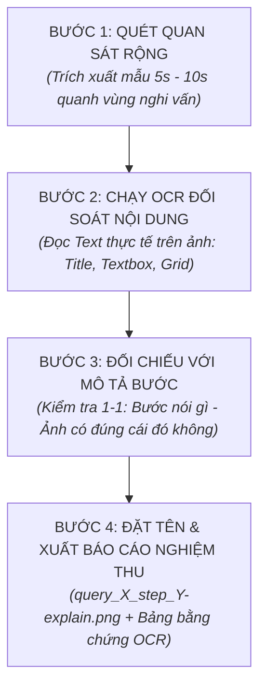

# QUY CHUẨN KIỂM ĐỊNH VÀ TRÍCH XUẤT HÌNH ẢNH (RULE-IMAGE.MD)
## (Strict Visual Audit & Screenshot Verification Protocol)

> **Mục tiêu:** Ngăn chặn triệt để tình trạng AI suy đoán timestamp, gán nhãn sai lệch giữa nội dung văn bản và hình ảnh thực tế, hoặc lấy nhầm ảnh của bước này cắm vào bước khác.  
> **Phạm vi áp dụng:** Toàn bộ quá trình trích xuất hình ảnh từ video (`MDX_Final.mp4`), tài liệu báo cáo và các giao diện hệ thống (Visual Studio SSDT, Microsoft Excel PivotTable, SSMS MDX).

---

## 1. NGUYÊN TẮC CỐT LÕI (CORE PRINCIPLES)

1. **Nguyên tắc "Không Nhìn Thấy Thì Không Khẳng Định" (Zero-Assumption Rule):**
   * Tuyệt đối không được tính toán timestamp trên lý thuyết rồi tự động gán tên file.
   * Mọi ảnh trích xuất BẮT BUỘC phải được kiểm tra nội dung thực tế (bằng OCR hoặc phân tích vùng điểm ảnh) để chứng minh trên màn hình đang hiển thị đúng cửa sổ, đúng tab và đúng thao tác của bước đó.

2. **Nguyên tắc Khớp Nghĩa 1-1 Tuyệt Đối (1:1 Semantic Matching):**
   * **Tên file - Nội dung bước - Hình ảnh** phải đồng nhất hoàn toàn:
     * Nếu bước mô tả: *"Khởi tạo thước đo Pct Of England Goals trong tab Calculations"* $\rightarrow$ Ảnh BẮT BUỘC phải chụp rõ tab **Calculations**, khung **Name**, khung **Expression** có chứa công thức đó.
     * Nếu bước mô tả: *"Kéo thả các trường vào Data Grid"* $\rightarrow$ Ảnh BẮT BUỘC phải chụp rõ giao diện **Cube Browser** với các trường nằm trong Data Grid, tuyệt đối không được là ảnh tab Calculations hay ảnh Build/Deploy.
     * Nếu bước mô tả: *"Bảng kết quả sau khi ấn Execute"* $\rightarrow$ Ảnh BẮT BUỘC phải có lưới dữ liệu đã được lấp đầy số liệu sau khi chạy, không phải lưới rỗng.

3. **Nguyên tắc "Soát Biên Timestamp" (Boundary Verification):**
   * Thao tác của người dùng trong video thường diễn ra trong một khoảng thời gian (khoảng vài chục giây).
   * Điểm lấy ảnh chuẩn phải là thời điểm **thao tác đã hoàn tất trọn vẹn** (đã gõ xong công thức, đã chọn xong checkbox, đã xuất hiện bảng kết quả) và cửa sổ giao diện ổn định, rõ nét nhất, không bị mờ nhòe do hiệu ứng chuyển cảnh hoặc menu xổ xuống che khuất.

---

## 2. QUY TRÌNH 4 BƯỚC BẮT BUỘC KHI TRÍCH XUẤT ẢNH (4-STEP EXTRACTION PROTOCOL)

### Bước 1: Quét biên độ (Bracket Scanning)
* Khi xác định một bước (ví dụ: tạo Measure trong Calculations), trích xuất một chuỗi các khung hình liên tiếp cách nhau 5 giây xung quanh mốc thời gian đó (ví dụ từ giây $t - 20s$ đến $t + 20s$).

### Bước 2: Kiểm định bằng chứng hình ảnh (OCR Audit)
* Chạy công cụ nhận dạng chữ (OCR) trên từng khung hình đã trích xuất:
  * Xác định tiêu đề cửa sổ / Tab đang mở (`Calculations`, `Browser`, `PivotTable`, `SSMS`).
  * Xác định các từ khóa trọng tâm (ví dụ: tên Measure `Pct_Of_England_Goals`, giá trị lọc `England`, hàm `TOPPERCENT`...).

### Bước 3: Đánh giá độ khớp ngữ nghĩa (Semantic Check)
* Chỉ chọn khung hình khi và chỉ khi:
  1. Tab / Cửa sổ hiển thị khớp 100% với bước trong văn bản.
  2. Dữ liệu hoặc biểu thức đã được nhập đầy đủ, không còn trong trạng thái dở dang.
  3. Không bị nhầm lẫn giữa trước khi ấn nút và sau khi ấn nút.

### Bước 4: Đặt tên chuẩn và lưu vết
* Đặt tên file theo đúng cú pháp: `query_X_step_Y-explain.png`.
* Lập bảng giải trình đối chiếu:
  * Tên file
  * Timestamp chính xác ($mm:ss$)
  * Bằng chứng Text/OCR đọc được trên ảnh chứng minh tính đúng đắn.

---

## 3. CHECKLIST KIỂM ĐỊNH TỪNG GIAO DIỆN (UI CHECKLIST)

### A. Giao diện Visual Studio - Tab Calculations:
- [ ] Tab trên cùng phải đang sáng ở chữ **Calculations** (không phải Browser, không phải Cube Structure).
- [ ] Cột bên trái hiển thị đúng mục được chọn trong **Script Organizer**.
- [ ] Ô **Name** hiển thị đúng tên Measure / Named Set.
- [ ] Ô **Expression** hiển thị đúng công thức MDX được hướng dẫn.
- [ ] Ô **Format String** hiển thị đúng chuỗi định dạng (ví dụ `0.00%`, `#,##0`).

### B. Giao diện Visual Studio - Tab Browser:
- [ ] Tab trên cùng phải đang sáng ở chữ **Browser**.
- [ ] Biểu tượng **Design Mode** (thước kẻ + lưới) đã được kích hoạt.
- [ ] **Filter Pane:** Dòng Dimension, Hierarchy, Operator (`Equal`, `Custom`...), Filter Expression phải hiển thị đúng giá trị đã chọn.
- [ ] **Expression Builder (nếu có):** Cửa sổ popup mở rộng phải chụp rõ khung soạn thảo chứa đầy đủ biểu thức MDX.
- [ ] **Data Grid:** Phải thấy rõ các trường kéo vào Rows/Columns/Values.
- [ ] **Ảnh kết quả Browser:** Bắt buộc phải là bảng sau khi đã nhấn nút Execute (dữ liệu đã hiển thị đầy đủ các dòng, không còn chữ *"Click to execute the query"*).

### C. Giao diện Microsoft Excel PivotTable:
- [ ] **Khung trường PivotTable Fields:** Hiển thị rõ danh sách các trường đã được tick/kéo vào 4 ô `Filters`, `Rows`, `Columns`, `Values`.
- [ ] **Hộp thoại thiết lập (Top 10 / Create Set):** Chụp rõ các thông số đã cấu hình trước khi bấm OK.
- [ ] **Bảng kết quả Excel:** Hiển thị rõ bảng tính với tiêu đề cột, các hàng dữ liệu và định dạng số liệu chuẩn.

### D. Giao diện SQL Server Management Studio (SSMS):
- [ ] Khung soạn thảo phía trên hiển thị trọn vẹn truy vấn MDX sạch đẹp.
- [ ] Khung phía dưới hiển thị tab **Results** với bảng lưới số liệu thực thi thực tế từ Cube.

---

## 4. CHẾ TÀI KỶ LUẬT NGHIÊM NGẶT (STRICT DISCIPLINARY RULE)

1. Mọi hành vi:
   * Chụp tab Calculations nhưng lại đặt tên là Browser kéo thả Data Grid.
   * Lấy ảnh màn hình đang deploy dở dang hoặc màn hình trống gán cho bước tạo thước đo.
   * Bịa đặt timestamp mà không qua bước quét OCR kiểm chứng.
   $\rightarrow$ **MẶC ĐỊNH BỊ COI LÀ VI PHẠM KỶ LUẬT NGHIÊM TRỌNG, BÁO CÁO BỊ HỦY BỎ VÀ BẮT BUỘC PHẢI THỰC HIỆN LẠI TỪ ĐẦU.**
2. Bản quy chuẩn này có hiệu lực tức thì và bắt buộc phải tuân thủ cho toàn bộ các lần nghiệm thu hình ảnh trong dự án.
