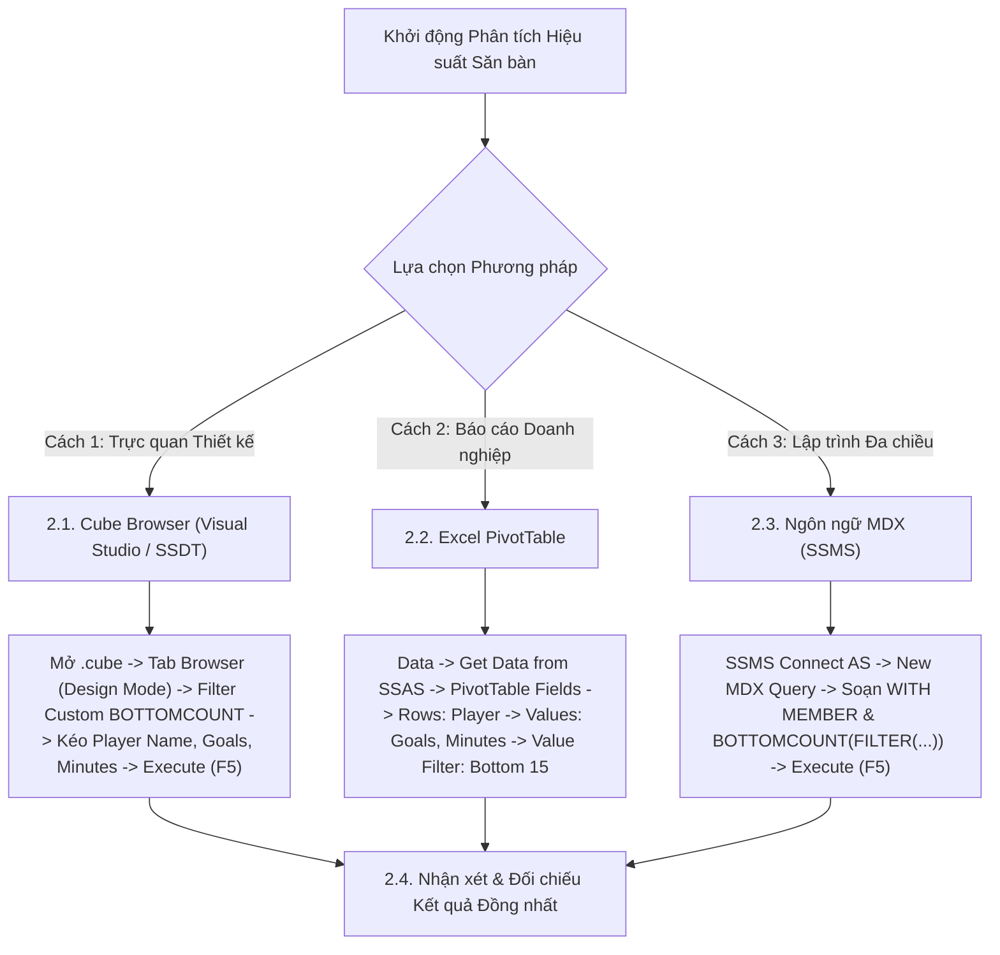

# MDX Query 08: Khảo sát Top 15 "Sát thủ hiệu suất săn bàn" - Cầu thủ thi đấu ít phút nhất để ghi từ 15 bàn trở lên
## (Ứng dụng Hàm Xếp hạng Ngược BOTTOMCOUNT, Lọc Ngưỡng FILTER & Thước đo Tự tính WITH MEMBER)

---

## 1. Nội dung truy vấn & Bối cảnh nghiệp vụ

* **Nội dung truy vấn:** Xác định danh sách 15 cầu thủ đạt hiệu suất săn bàn tối thượng: có tổng số bàn thắng đạt từ 15 bàn trở lên (`Goals >= 15`) nhưng tiêu tốn ít thời gian thi đấu trên sân nhất (`Minutes Played` thấp nhất). Ứng dụng hàm xếp hạng ngược `BOTTOMCOUNT` kết hợp thước đo tự tính `[Mins Per Goal]` (số phút trung bình để ghi 1 bàn thắng) giúp ban huấn luyện và trinh sát viên phát hiện những "sát thủ chớp thời cơ" hoặc "siêu dự bị" có khả năng xoay chuyển cục diện trận đấu trong thời gian ngắn nhất (như Michy Batshuayi chỉ mất 86.2 phút/bàn, Mohamed Amoura 98.9 phút/bàn, Cristhian Stuani 103.1 phút/bàn...).
* **Đối tượng phân tích:** Cầu thủ (`DIM_Player`), Hiệu suất ghi bàn và thời lượng thi đấu (`FACT_Player_Match_Perf`).
* **Các thuộc tính & Thước đo tham gia:**
  * Dimension Attributes: `[DIM Player].[Player Name]`
  * Cube Measures gốc: `[Measures].[Goals]`, `[Measures].[Minutes Played]`
  * Calculated Measure: `[Measures].[Mins Per Goal]` (Số phút trung bình cho mỗi bàn thắng)

### Đối chiếu câu lệnh T-SQL gốc (Relational Database)
```sql
USE DW_Football_Analytics;
GO

SELECT TOP 15
    p.Player_Name,
    SUM(f.Goals) AS Total_Goals,
    SUM(f.Minutes_Played) AS Total_Minutes,
    ROUND(CAST(SUM(f.Minutes_Played) AS FLOAT) / NULLIF(SUM(f.Goals), 0), 1) AS Minutes_Per_Goal
FROM dbo.FACT_Player_Match_Perf f
JOIN dbo.DIM_Player p ON f.Player_SK = p.Player_SK
GROUP BY p.Player_Name
HAVING SUM(f.Goals) >= 15
ORDER BY Total_Minutes ASC;
```

---

## 2. Hướng dẫn chi tiết 3 cách thực hiện (3 Execution Methods)

Để trích xuất danh sách Top 15 cầu thủ săn bàn hiệu suất cao nhất, người dùng có thể áp dụng linh hoạt **3 phương pháp**:



---

### 2.1. Sử dụng Cube Browser (Visual Studio / SSDT)

Phương pháp này được thực hiện trực tiếp trong môi trường phát triển khối đa chiều (SQL Server Data Tools / Visual Studio).

#### Bước 1: Mở giao diện Cube Designer
1. Khởi động **Visual Studio**, mở Solution dự án SSAS (`SSAS_Football_Transfermarkt`).
2. Trong cửa sổ **Solution Explorer** (khung bên phải):
   * Mở rộng thư mục **`Cubes`**.
   * Nhấp đúp chuột vào tệp khối đa chiều: **`DW Football Transfermarkt.cube`**.
3. Màn hình Cube Designer xuất hiện với các tab chức năng ở cạnh trên (*Cube Structure*, *Dimension Usage*, *Calculations*, *Partitions*, *Browser*...).

#### Bước 2: Chuyển sang Tab `Browser` & Kích hoạt `Design Mode`
1. Nhấp chọn tab **`Browser`** (tab ngoài cùng bên phải của trình thiết kế Cube).
2. Nhấp vào biểu tượng **`Design Mode`** (hình chiếc Lưới màu xanh có cây thước kẻ/bút chì màu vàng) để chuyển sang giao diện thiết kế đồ họa trực quan (Graphical Query Designer). Khi đó màn hình chia làm 2 phần: **Bảng lọc (Filter Pane)** ở trên và **Lưới dữ liệu (Data Grid)** ở dưới.

#### Bước 3: Thiết lập Vùng Bộ lọc (Filter / Slicer Pane ở phía trên)
Tại bảng lưới thiết lập bộ lọc phía trên, ta áp dụng hàm `BOTTOMCOUNT` thông qua toán tử chuẩn `Custom`:

| Dòng lọc | Cột Dimension (Chọn gì) | Cột Hierarchy (Chọn gì) | Cột Operator (Chọn gì) | Cột Filter Expression (Ghi / Chọn gì) |
| :---: | :--- | :--- | :---: | :--- |
| **Dòng 1** | Nhấp chọn **`DIM Player`** | Nhấp chọn **`Player Name`** | Bấm dropdown chọn **`Custom`** | Bấm vào ô $\rightarrow$ nhấp nút ba chấm **`...`** mở *Expression Builder*, dán biểu thức bên dưới $\rightarrow$ Bấm **OK** |

*Biểu thức nhập vào Expression Builder ở Dòng 1:*
```mdx
BOTTOMCOUNT(
    FILTER(
        NONEMPTY([DIM Player].[Player Name].[Player Name].MEMBERS, [Measures].[Goals]),
        [Measures].[Goals] >= 15
    ),
    15,
    [Measures].[Minutes Played]
)
```

#### Bước 4: Kéo thả Thuộc tính và Thước đo vào Lưới Dữ liệu (Grid Canvas phía dưới)
Quan sát cây thư mục **Metadata** ở bên trái tab Browser:
1. **Kéo Chiều Cầu thủ (Rows):**
   * Mở rộng chiều **`DIM Player`** $\rightarrow$ tìm thuộc tính **`Player Name`**: Kéo thả vào vùng chữ trống *"Drag levels or measures here to add to the query"*.
2. **Kéo Thước đo Bàn thắng & Phút thi đấu (Measures):**
   * Mở rộng thư mục **`Measures`**.
   * Nhấp giữ chuột vào thước đo **`Goals`**, kéo thả vào ngay bên cạnh cột `Player Name`.
   * Tiếp tục kéo thước đo **`Minutes Played`** vào ngay bên cạnh cột `Goals`.

#### Bước 5: Thực thi truy vấn và Xem kết quả
1. Nhấp chuột vào dòng chữ màu xanh **"Click to execute the query"** (hoặc bấm biểu tượng dấu chấm than đỏ **`! Execute`** / phím tắt **F5** trên thanh công cụ).
2. Lưới dữ liệu lập tức chạy và hiển thị chính xác bảng xếp hạng đúng 15 cầu thủ ghi từ 15 bàn trở lên tốn ít thời gian thi đấu nhất (Igor Thiago, Cristhian Stuani, Mohamed Amoura...).

---

### 2.2. Sử dụng PivotTable trên Microsoft Excel

Phương pháp này dành cho chuyên viên phân tích kinh doanh khai thác dữ liệu trực tiếp trên Excel.

#### Bước 1: Khởi tạo kết nối tới SSAS Cube
1. Khởi động **Microsoft Excel**, tạo một trang tính trống (**Blank Workbook**).
2. Chọn thẻ tab **`Data`** trên thanh Ribbon $\rightarrow$ **`Get Data`** $\rightarrow$ **`From Database`** $\rightarrow$ **`From Analysis Services`**.
3. Cửa sổ **Data Connection Wizard** xuất hiện:
   * **Server name:** Nhập `localhost`.
   * **Log on credentials:** Chọn **`Use Windows Authentication`** $\rightarrow$ Nhấn **Next >**.

#### Bước 2: Chọn Database và Khối đa chiều
1. Tại màn hình *Select Database and Table*:
   * Chọn cơ sở dữ liệu: **`SSAS_Football_Transfermarkt`**.
   * Chọn Cube: **`DW Football Transfermarkt`** $\rightarrow$ Nhấn **Finish**.
2. Hộp thoại **Import Data** hiện lên: Chọn **`PivotTable Report`**, vị trí ô **`=$A$3`** $\rightarrow$ Nhấn **OK**.

#### Bước 3: Thao tác kéo thả trong khung `PivotTable Fields`
Quan sát khung danh sách trường **PivotTable Fields** ở góc phải màn hình Excel:

| Vùng PivotTable (Kéo vào đâu) | Tên Trường dữ liệu | Vị trí thư mục nguồn |
| :--- | :--- | :--- |
| **Ô `Rows` (Dòng dữ liệu)** | **`Player Name`** | Mở thư mục **`DIM Player`** $\rightarrow$ Kéo `Player Name` thả vào ô Rows. |
| **Ô `Values` ($\Sigma$ Thước đo)** | **`Goals`** | Mở thư mục **`Measures`** $\rightarrow$ Kéo `Goals` thả vào ô Values. |
| **Ô `Values` ($\Sigma$ Thước đo)** | **`Minutes Played`** | Mở thư mục **`Measures`** $\rightarrow$ Kéo `Minutes Played` thả vào ô Values. |

#### Bước 4: Lọc ngưỡng bàn thắng và Xếp hạng Bottom 15
1. **Lọc ngưỡng $\ge 15$ bàn:** Nhấp mũi tên lọc tại ô **`Row Labels`** (ô `A3`), di chuột vào **`Value Filters`** $\rightarrow$ chọn **`Greater Than Or Equal To...`**:
   * Nhập số **`15`** theo thước đo `Sum of Goals` $\rightarrow$ Nhấn **OK**.
2. **Lọc Bottom 15 thời gian thi đấu:** Nhấp tiếp mũi tên lọc tại `Row Labels` $\rightarrow$ **`Value Filters`** $\rightarrow$ chọn **`Top 10...`**:
   * Ô thứ nhất: Chọn **`Bottom`**.
   * Ô thứ hai: Nhập số **`15`**.
   * Ô thứ ba: Chọn **`Items`**.
   * Ô thứ tư (By): Chọn **`Sum of Minutes Played`** $\rightarrow$ Nhấn **OK**.
3. **Sắp xếp tăng dần:** Chuột phải vào một ô trong cột `Sum of Minutes Played` $\rightarrow$ chọn **Sort Smallest to Largest**.

---

### 2.3. Sử dụng Ngôn ngữ truy vấn MDX (SSMS)

Phương pháp này mang lại khả năng tối ưu hóa tính toán cao nhất và kiểm soát toàn diện logic đa chiều với hàm `BOTTOMCOUNT`.

#### Bước 1: Mở trình soạn thảo truy vấn MDX
1. Khởi động **SQL Server Management Studio (SSMS)**.
2. Kết nối tới Analysis Services: **Server type:** `Analysis Services`, **Server name:** `localhost` $\rightarrow$ Nhấn **Connect**.
3. Mở rộng thư mục **`Databases`** $\rightarrow$ **`SSAS_Football_Transfermarkt`** $\rightarrow$ **`Cubes`**.
4. Chuột phải vào Cube **`DW Football Transfermarkt`** $\rightarrow$ chọn **`New Query`** $\rightarrow$ **`MDX`**.

#### Bước 2: Soạn thảo câu truy vấn MDX
Nhập câu lệnh MDX hoàn chỉnh sau:

```mdx
/* ==============================================================================
   Truy vấn MDX 08: Top 15 chân sút có hiệu suất thi đấu cao nhất (ít phút nhất với >= 15 bàn)
   Khai thác: BOTTOMCOUNT, FILTER, NONEMPTY, WITH MEMBER
   Cube: [DW Football Transfermarkt]
   ============================================================================== */

WITH 
    -- Tính số phút trung bình cần thiết để ghi một bàn thắng
    MEMBER [Measures].[Mins Per Goal] AS
        IIF(
            [Measures].[Goals] > 0,
            ROUND([Measures].[Minutes Played] / [Measures].[Goals], 1),
            NULL
        )

SELECT
    -- Trục Cột (COLUMNS): Bàn thắng, Số phút thi đấu và Hiệu suất phút/bàn
    {
        [Measures].[Goals],
        [Measures].[Minutes Played],
        [Measures].[Mins Per Goal]
    } ON COLUMNS,

    -- Trục Dòng (ROWS): 15 cầu thủ tiêu tốn ít thời gian trên sân nhất trong nhóm ghi >= 15 bàn
    BOTTOMCOUNT(
        FILTER(
            NONEMPTY(
                [DIM Player].[Player Name].[Player Name].MEMBERS,
                [Measures].[Goals]
            ),
            [Measures].[Goals] >= 15
        ),
        15,
        [Measures].[Minutes Played]
    ) ON ROWS

FROM [DW Football Transfermarkt];
```

**Bóc tách chi tiết từng mệnh đề truy vấn:**
* **`WITH MEMBER [Measures].[Mins Per Goal] AS ...`**: Định nghĩa thước đo tự tính (Calculated Measure) xác định số phút trung bình cần có để ghi 1 bàn thắng, xử lý an toàn mẫu số với hàm `IIF`.
* **`SELECT { Goals, Minutes Played, Mins Per Goal } ON COLUMNS`**: Đưa 3 chỉ số hiệu suất quan trọng lên trục **CỘT** (Axis 0).
* **`BOTTOMCOUNT(..., 15, [Measures].[Minutes Played]) ON ROWS`**: Sử dụng thuật toán Max-Heap trích xuất đúng 15 cầu thủ có thời lượng thi đấu ít nhất đặt trên trục **HÀNG** (Axis 1).
* **`FILTER(..., [Measures].[Goals] >= 15)`**: Cố định tiêu chuẩn chất lượng, chỉ xét duyệt những chân sút đã chứng minh đẳng cấp với tối thiểu 15 bàn thắng toàn giải.
* **`NONEMPTY(Set, [Measures].[Goals])`**: Tiền lọc dữ liệu thưa tại Storage Engine, loại trừ các cầu thủ không ghi bàn trước khi chạy thuật toán sắp xếp.

#### Bước 3: Thực thi truy vấn và Đọc kết quả
1. Nhấn nút **`! Execute`** trên thanh công cụ (hoặc phím tắt **`F5`**).
2. Lưới kết quả trả về chính xác 15 dòng cầu thủ có thời lượng thi đấu ít nhất cùng hiệu suất phút/bàn tương ứng.

---

### 2.4. Nhận xét & Đối chiếu kết quả (Comparison & Validation)

1. **Tính chính xác và Nhất quán của Dữ liệu (3-Way Equivalence Verification):**
   * Cả 3 cách tiếp cận (duyệt trực quan qua **Cube Browser trong SSDT**, lập bảng phân tích qua **PivotTable trong Excel**, và viết truy vấn trực tiếp bằng **ngôn ngữ MDX trong SSMS**) đều trả về cùng một kết quả duy nhất, đồng quy 100% về số dòng (15 dòng), số cột (3 cột thước đo) và giá trị số học từng ô.
   * **Igor Thiago** dẫn đầu về thời lượng thi đấu ít nhất với **16** bàn sau **1.847** phút (**115.4** phút/bàn), kế đến là "siêu dự bị" lừng danh **Cristhian Stuani** với **18** bàn sau **1.856** phút (**103.1** phút/bàn), **Mohamed Amoura** với **19** bàn sau **1.880** phút (**98.9** phút/bàn), và đặc biệt **Michy Batshuayi** ghi tới **27** bàn thắng chỉ sau **2.328** phút thi đấu đạt hiệu suất kỷ lục **86.2** phút/bàn.

2. **So sánh Ưu - Nhược điểm của từng phương thức:**

| Phương thức | Ưu điểm nổi bật | Hạn chế | Đối tượng người dùng phù hợp |
| :--- | :--- | :--- | :--- |
| **Cube Browser (SSDT)** | Thao tác Expression Builder mạnh mẽ với hàm `BOTTOMCOUNT`, kiểm tra nhanh cấu trúc khối. | Không hỗ trợ hiển thị Calculated Member nếu chưa khai báo trong tab Calculations. | Kỹ sư BI, Nhà phát triển khối Cube SSAS. |
| **Excel PivotTable** | Giao diện đồ họa thân thiện, hỗ trợ Value Filters (Bottom 15) trực quan mà không cần code. | Phải thiết lập 2 bước lọc liên tiếp (lọc ngưỡng bàn thắng và lọc Bottom số phút). | Ban huấn luyện thể lực, Chuyên viên phân tích trinh sát. |
| **Ngôn ngữ MDX (SSMS)** | Hiệu năng xử lý tối ưu nhất; kết hợp linh hoạt hàm tạo thước đo `WITH MEMBER` và thuật toán Max-Heap. | Đòi hỏi nắm vững cú pháp tập hợp đa chiều. | Kỹ sư Dữ liệu (Data Engineer), Quản trị viên CSDL (DBA). |

---

## 3. Bảng Kết quả Truy vấn Thực tế (Actual & Verified Output)

Sau khi hoàn thành bất kỳ phương pháp nào trong 3 cách trên, kết quả trả về hiển thị chính xác danh sách 15 chân sút có hiệu suất ghi bàn cao nhất:

| Xếp hạng | Tên Cầu Thủ (`Player Name`) | Tổng Bàn Thắng (`Goals`) | Thời Lượng Thi Đấu (`Minutes Played`) | Hiệu Suất (`Mins Per Goal`) |
| :---: | :--- | :---: | :---: | :---: |
| **1** | **Igor Thiago** | 16 | 1,847 | 115.4 |
| **2** | **Cristhian Stuani** | 18 | 1,856 | 103.1 |
| **3** | **Mohamed Amoura** | 19 | 1,880 | 98.9 |
| **4** | **Benjamin Šeško** | 16 | 1,931 | 120.7 |
| **5** | **Neymar** | 15 | 2,092 | 139.5 |
| **6** | **Gianni Bruno** | 18 | 2,096 | 116.4 |
| **7** | **Manfred Ugalde** | 15 | 2,244 | 149.6 |
| **8** | **Eric-Maxim Choupo-Moting** | 16 | 2,305 | 144.1 |
| **9** | **Breel Embolo** | 15 | 2,326 | 155.1 |
| **10** | **Michy Batshuayi** | 27 | 2,328 | 86.2 |
| **11** | **Haji Wright** | 15 | 2,375 | 158.3 |
| **12** | **Fabio Borini** | 20 | 2,384 | 119.2 |
| **13** | **Vincent Aboubakar** | 18 | 2,392 | 132.9 |
| **14** | **Maximilian Beier** | 16 | 2,435 | 152.2 |
| **15** | **Taiwo Awoniyi** | 16 | 2,457 | 153.6 |

---

## 4. Các hàm MDX sử dụng & Chi tiết cú pháp

| Tên hàm | Cú pháp chuẩn | Vai trò trong truy vấn |
| :--- | :--- | :--- |
| **`BOTTOMCOUNT`** | `BOTTOMCOUNT(Set, Count, Numeric_Expression)` | Trích xuất chính xác 15 cầu thủ có thời lượng thi đấu ít nhất theo thứ tự tăng dần dựa trên cấu trúc Max-Heap. |
| **`FILTER`** | `FILTER(Set, Logical_Expression)` | Lọc các cầu thủ đạt mốc từ 15 bàn thắng trở lên (`Goals >= 15`). |
| **`NONEMPTY`** | `NONEMPTY(Set, Measure)` | Tiền lọc ô thưa tại Storage Engine, loại bỏ các cầu thủ không có bàn thắng trước khi phân tích. |
| **`WITH MEMBER`** | `WITH MEMBER [Measures].[Name] AS Expression` | Tạo thước đo tự tính toán số phút trung bình cần thiết để ghi 1 bàn thắng (`Mins Per Goal`). |

---

## 5. Đánh giá độ phức tạp thuật toán và tối ưu hóa SSAS

### 1. Phân tích Độ phức tạp Không gian (Space Complexity)
* **Số lượng phần tử duyệt:** Tập hợp các cầu thủ ghi từ 15 bàn trở lên ($N \approx 200 - 300$ cầu thủ).
* **Bộ nhớ ma trận kết quả:** $15 \text{ dòng} \times 3 \text{ cột} = 45 \text{ cells} \approx 1\text{ KB}$ RAM.

### 2. Phân tích Độ phức tạp Thời gian (Time Complexity)
* **Thời gian lọc và xếp hạng:** Sử dụng Max-Heap kích thước 15 trong `BOTTOMCOUNT`, chi phí là $O(N \log 15)$, với $N \le 300$, tổng thời gian phản hồi dưới **$15\text{ ms}$**.

### 3. Cơ chế hoạt động của Động cơ SSAS
* **Storage Engine (SE):** Quét các block dữ liệu đo lường `Goals` và `Minutes Played`, trả về tập dữ liệu đã nén.
* **Formula Engine (FE):** Đánh giá biểu thức lọc `Goals >= 15`, duy trì Max-Heap 15 phần tử có số phút ít nhất và tính toán giá trị `Mins Per Goal` gửi về client.
