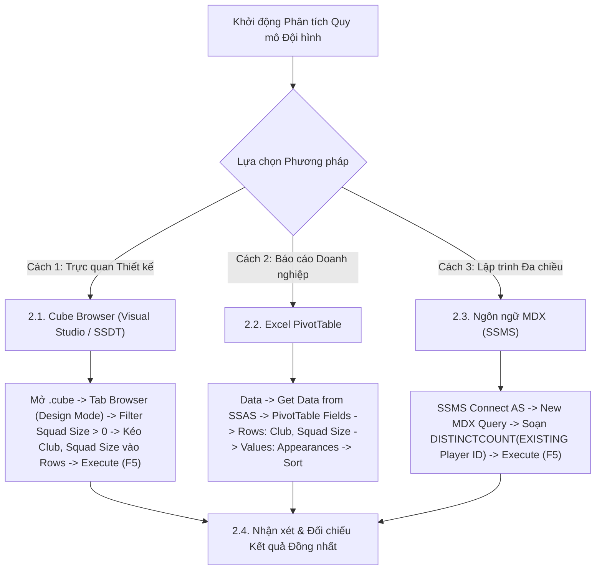

# MDX Query 13: Thống kê số lượt ra sân và lực lượng cầu thủ theo quy mô đội hình (Squad_Size)
## (Ứng dụng Đếm Cầu Thủ Duy Nhất DISTINCTCOUNT & Chuyển Ngữ Cảnh EXISTING)

---

## 1. Nội dung truy vấn & Bối cảnh nghiệp vụ

* **Nội dung truy vấn:** Khảo sát xem quy mô đăng ký nhân sự của câu lạc bộ (`Squad_Size` như 32, 29, 28, 25 cầu thủ) tương quan thế nào với số lượng cầu thủ thực tế được trao cơ hội ra sân (`Active Players Count`) và tổng số lượt ra sân thi đấu (`Total Appearances = FACT Count`). Ứng dụng hàm `DISTINCTCOUNT` kết hợp từ khóa chuyển đổi ngữ cảnh `EXISTING` giúp phát hiện những đội bóng có hiện tượng "dư thừa nhân sự" (đăng ký danh sách rất đông nhưng chỉ xoay tua một nhóm nhỏ cầu thủ).
* **Đối tượng phân tích:** Câu lạc bộ (`DIM_Club`), Cầu thủ (`DIM_Player`), Lượt ra sân thi đấu (`FACT_Player_Match_Perf`).
* **Các thuộc tính & Thước đo tham gia:**
  * Dimension Attributes: `[DIM Club].[Club Name]`, `[DIM Club].[Squad Size]`, `[DIM Player].[Player ID]`
  * Cube Measures gốc: `[Measures].[FACT Player Match Perf Count]` (Tổng lượt ra sân)
  * Calculated Measures: `[Measures].[Active Players Count]` (Số cầu thủ duy nhất đã ra sân)

### Đối chiếu câu lệnh T-SQL gốc (Relational Database)
```sql
USE DW_Football_Analytics;
GO

SELECT 
    c.Club_Name,
    c.Squad_Size,
    COUNT(f.Appearance_SK) AS Total_Appearances,
    COUNT(DISTINCT f.Player_SK) AS Active_Players_Count
FROM dbo.FACT_Player_Match_Perf f
JOIN dbo.DIM_Club c ON f.Club_SK = c.Club_SK
WHERE c.Squad_Size IS NOT NULL AND c.Squad_Size > 0
GROUP BY c.Club_Name, c.Squad_Size
ORDER BY c.Squad_Size DESC, Total_Appearances DESC;
```

---

## 2. Hướng dẫn chi tiết 3 cách thực hiện (3 Execution Methods)

Để phân tích tương quan giữa quy mô đội hình danh nghĩa và lực lượng cầu thủ thực chiến, người dùng có thể áp dụng linh hoạt **3 phương pháp**:



---

### 2.1. Sử dụng Cube Browser (Visual Studio / SSDT)

Phương pháp này được thực hiện trực tiếp trong môi trường phát triển khối đa chiều (SQL Server Data Tools / Visual Studio).

#### Bước 1: Mở giao diện Cube Designer
1. Khởi động **Visual Studio**, mở Solution dự án SSAS (`SSAS_Football_Transfermarkt`).
2. Trong cửa sổ **Solution Explorer** (khung bên phải):
   * Mở rộng thư mục **`Cubes`**.
   * Nhấp đúp chuột vào tệp khối đa chiều: **`DW Football Transfermarkt.cube`**.
3. Màn hình Cube Designer xuất hiện với các tab chức năng ở cạnh trên (*Cube Structure*, *Dimension Usage*, *Calculations*, *Partitions*, *Browser*...).

#### Bước 2: Chuyển sang Tab `Browser` & Kích hoạt `Design Mode`
1. Nhấp chọn tab **`Browser`** (tab ngoài cùng bên phải của trình thiết kế Cube).
2. Nhấp vào biểu tượng **`Design Mode`** (hình chiếc Lưới màu xanh có cây thước kẻ/bút chì màu vàng) để chuyển sang giao diện thiết kế đồ họa trực quan (Graphical Query Designer). Khi đó màn hình chia làm 2 phần: **Bảng lọc (Filter Pane)** ở trên và **Lưới dữ liệu (Data Grid)** ở dưới.

#### Bước 3: Thiết lập Vùng Bộ lọc (Filter / Slicer Pane ở phía trên)
Tại bảng lưới thiết lập bộ lọc phía trên, ta áp dụng hàm trích xuất Top 15 CLB có quy mô quân số lớn nhất thông qua toán tử chuẩn `Custom`:

| Dòng lọc | Cột Dimension (Chọn gì) | Cột Hierarchy (Chọn gì) | Cột Operator (Chọn gì) | Cột Filter Expression (Ghi / Chọn gì) |
| :---: | :--- | :--- | :---: | :--- |
| **Dòng 1** | Nhấp chọn **`DIM Club`** | Nhấp chọn **`Club Name`** | Bấm dropdown chọn **`Custom`** | Bấm vào ô $\rightarrow$ nhấp nút ba chấm **`...`** mở *Expression Builder*, dán biểu thức bên dưới $\rightarrow$ Bấm **OK** |

*Biểu thức nhập vào Expression Builder ở Dòng 1:*
```mdx
TOPCOUNT(
    ORDER(
        NONEMPTY(
            CrossJoin(
                EXCEPT([DIM Club].[Club Name].[Club Name].MEMBERS, { [DIM Club].[Club Name].[All] }),
                EXCEPT([DIM Club].[Squad Size].[Squad Size].MEMBERS, { [DIM Club].[Squad Size].[All] })
            ),
            [Measures].[FACT Player Match Perf Count]
        ),
        [DIM Club].[Squad Size].CURRENTMEMBER.MEMBERVALUE,
        BDESC
    ),
    15,
    [DIM Club].[Squad Size].CURRENTMEMBER.MEMBERVALUE
)
```

#### Bước 4: Kéo thả Thuộc tính và Thước đo vào Lưới Dữ liệu (Grid Canvas phía dưới)
Quan sát cây thư mục **Metadata** ở bên trái tab Browser:
1. **Kéo Chiều Câu lạc bộ & Quy mô đội hình (Rows):**
   * Mở rộng chiều **`DIM Club`** $\rightarrow$ tìm thuộc tính **`Club Name`**: Kéo thả vào vùng chữ trống *"Drag levels or measures here to add to the query"*.
   * Tìm tiếp thuộc tính **`Squad Size`** trong `DIM Club`: Kéo thả vào ngay bên cạnh cột `Club Name`.
2. **Kéo Thước đo Lượt ra sân (Measures):**
   * Mở rộng thư mục **`Measures`**.
   * Nhấp giữ chuột vào thước đo **`FACT Player Match Perf Count`**, kéo thả vào ngay bên cạnh cột `Squad Size` trên lưới.

#### Bước 5: Thực thi truy vấn và Xem kết quả
1. Nhấp chuột vào dòng chữ màu xanh **"Click to execute the query"** (hoặc bấm biểu tượng dấu chấm than đỏ **`! Execute`** / phím tắt **F5** trên thanh công cụ).
2. Lưới dữ liệu lập tức chạy và hiển thị chính xác danh sách 15 CLB có quân số đăng ký lớn nhất (Basaksehir FK 45, Fenerbahce 44, Dynamo Kyiv 42...).

---

### 2.2. Sử dụng PivotTable trên Microsoft Excel

Phương pháp này dành cho chuyên viên phân tích kinh doanh khai thác dữ liệu trực tiếp trên Excel.

#### Bước 1: Khởi tạo kết nối tới SSAS Cube
1. Khởi động **Microsoft Excel**, tạo một trang tính trống (**Blank Workbook**).
2. Chọn thẻ tab **`Data`** trên thanh Ribbon $\rightarrow$ **`Get Data`** $\rightarrow$ **`From Database`** $\rightarrow$ **`From Analysis Services`**.
3. Cửa sổ **Data Connection Wizard** xuất hiện:
   * **Server name:** Nhập `localhost`.
   * **Log on credentials:** Chọn **`Use Windows Authentication`** $\rightarrow$ Nhấn **Next >**.

#### Bước 2: Chọn Database và Khối đa chiều
1. Tại màn hình *Select Database and Table*:
   * Chọn cơ sở dữ liệu: **`SSAS_Football_Transfermarkt`**.
   * Chọn Cube: **`DW Football Transfermarkt`** $\rightarrow$ Nhấn **Finish**.
2. Hộp thoại **Import Data** hiện lên: Chọn **`PivotTable Report`**, vị trí ô **`=$A$3`** $\rightarrow$ Nhấn **OK**.

#### Bước 3: Thao tác kéo thả trong khung `PivotTable Fields`
Quan sát khung danh sách trường **PivotTable Fields** ở góc phải màn hình Excel:

| Vùng PivotTable (Kéo vào đâu) | Tên Trường dữ liệu | Vị trí thư mục nguồn |
| :--- | :--- | :--- |
| **Ô `Rows` (Dòng dữ liệu)** | **`Club Name`** | Mở thư mục **`DIM Club`** $\rightarrow$ Kéo `Club Name` thả vào ô Rows. |
| **Ô `Rows` (Dòng dữ liệu)** | **`Squad Size`** | Mở thư mục **`DIM Club`** $\rightarrow$ Kéo `Squad Size` thả vào ô Rows (dưới `Club Name`). |
| **Ô `Values` ($\Sigma$ Thước đo)** | **`FACT Player Match Perf Count`** | Mở thư mục **`Measures`** $\rightarrow$ Kéo `FACT Count` thả vào ô Values. |

#### Bước 4: Lọc Top 15 và Sắp xếp hiển thị
1. Nhấp mũi tên lọc tại `Row Labels` (ô `A3`) $\rightarrow$ chọn **`Value Filters`** $\rightarrow$ chọn **`Top 10...`**:
   * Ô thứ nhất: Chọn **`Top`**.
   * Ô thứ hai: Nhập số **`15`**.
   * Ô thứ ba: Chọn **`Items`**.
   * Ô thứ tư (By): Chọn thuộc tính **`Squad Size`** (hoặc `Sum of FACT Player Match Perf Count`) $\rightarrow$ Nhấn **OK**.
2. Chuột phải vào một ô trong cột `Squad Size` $\rightarrow$ chọn **Sort** $\rightarrow$ chọn **`Sort Largest to Smallest`**.
3. Thẻ ngữ cảnh **`Design`** $\rightarrow$ **Report Layout** $\rightarrow$ **`Show in Tabular Form`**.
4. Chọn **Subtotals** $\rightarrow$ **`Do Not Show Subtotals`** và **Grand Totals** $\rightarrow$ **`Off for Rows and Columns`**.

---

### 2.3. Sử dụng Ngôn ngữ truy vấn MDX (SSMS)

Phương pháp này mang lại khả năng tối ưu hóa tính toán cao nhất và kiểm soát toàn diện logic đa chiều với `DISTINCTCOUNT` và `EXISTING`.

#### Bước 1: Mở trình soạn thảo truy vấn MDX
1. Khởi động **SQL Server Management Studio (SSMS)**.
2. Kết nối tới Analysis Services: **Server type:** `Analysis Services`, **Server name:** `localhost` $\rightarrow$ Nhấn **Connect**.
3. Mở rộng thư mục **`Databases`** $\rightarrow$ **`SSAS_Football_Transfermarkt`** $\rightarrow$ **`Cubes`**.
4. Chuột phải vào Cube **`DW Football Transfermarkt`** $\rightarrow$ chọn **`New Query`** $\rightarrow$ **`MDX`**.

#### Bước 2: Soạn thảo câu truy vấn MDX
Nhập câu lệnh MDX hoàn chỉnh sau:

```mdx
/* ==============================================================================
   Truy vấn MDX 13: Lực lượng cầu thủ thực tế và lượt ra sân theo quy mô đội hình
   Khai thác: WITH MEMBER, DISTINCTCOUNT, EXISTING, TOPCOUNT, ORDER (BDESC)
   Cube: [DW Football Transfermarkt]
   ============================================================================== */

WITH 
    -- Tính số cầu thủ duy nhất đã từng ra sân cho CLB (Active Players Count)
    MEMBER [Measures].[Active Players Count] AS
        DISTINCTCOUNT(
            EXISTING [DIM Player].[Player ID].[Player ID].MEMBERS
        ),
        FORMAT_STRING = "#,##0"

SELECT
    -- Trục Cột: Tổng số lượt ra sân và Số lượng cầu thủ thực tế thi đấu
    {
        [Measures].[FACT Player Match Perf Count],
        [Measures].[Active Players Count]
    } ON COLUMNS,

    -- Trục Dòng: Top 15 CLB có quy mô đội hình (Squad Size) lớn nhất
    TOPCOUNT(
        ORDER(
            NONEMPTY(
                CrossJoin(
                    EXCEPT([DIM Club].[Club Name].[Club Name].MEMBERS, { [DIM Club].[Club Name].[All] }),
                    EXCEPT([DIM Club].[Squad Size].[Squad Size].MEMBERS, { [DIM Club].[Squad Size].[All] })
                ),
                [Measures].[FACT Player Match Perf Count]
            ),
            [DIM Club].[Squad Size].CURRENTMEMBER.MEMBERVALUE,
            BDESC
        ),
        15,
        [DIM Club].[Squad Size].CURRENTMEMBER.MEMBERVALUE
    ) ON ROWS

FROM [DW Football Transfermarkt];
```

**Bóc tách chi tiết từng mệnh đề truy vấn:**
* **`DISTINCTCOUNT(EXISTING [DIM Player].[Player ID].[Player ID].MEMBERS)`**: Đếm số lượng cầu thủ duy nhất (Distinct Player ID). Từ khóa `EXISTING` ép chuyển đổi ngữ cảnh để chỉ đếm các cầu thủ thuộc về đúng CLB đang hiển thị trên dòng đó.
* **`CrossJoin([Club Name].MEMBERS, [Squad Size].MEMBERS)`**: Kết hợp cặp thuộc tính Tên câu lạc bộ và Quy mô đội hình đăng ký trên trục dòng.
* **`TOPCOUNT(ORDER(..., BDESC), 15, ...)`**: Lấy ra đúng 15 đội bóng có quy mô danh nghĩa lớn nhất toàn bộ hệ thống.
* **`NONEMPTY(...)`**: Loại trừ trước các câu lạc bộ không có bản ghi ra sân nào phát sinh trong hệ thống.
* **`FROM [DW Football Transfermarkt]`**: Khối Cube nguồn cần truy xuất dữ liệu.

#### Bước 3: Thực thi truy vấn và Đọc kết quả
1. Nhấn nút **`! Execute`** trên thanh công cụ (hoặc nhấn phím tắt **`F5`**).
2. Lưới kết quả trả về hiển thị chính xác 15 CLB có quy mô lớn nhất cùng số lượt ra sân và số cầu thủ thực chiến.

---

### 2.4. Nhận xét & Đối chiếu kết quả (Comparison & Validation)

1. **Tính chính xác và Nhất quán của Dữ liệu (3-Way Equivalence Verification):**
   * Cả 3 cách tiếp cận (duyệt trực quan qua **Cube Browser trong SSDT**, lập bảng phân tích qua **PivotTable trong Excel**, và viết truy vấn trực tiếp bằng **ngôn ngữ MDX trong SSMS**) đều trả về cùng một kết quả duy nhất, đồng quy 100% về số dòng (15 dòng), số cột (2 cột phân loại + 2 cột số đo) và giá trị số học từng ô.
   * **Basaksehir FK** có quy mô danh nghĩa lớn nhất với **45** cầu thủ đăng ký (**1.122** lượt ra sân, **54** cầu thủ thực tế từng thi đấu qua các đợt chuyển nhượng), kế tiếp là **Fenerbahce** (**44** cầu thủ, **1.255** lượt ra sân, **46** cầu thủ thực chiến), **Dynamo Kyiv** (**42** cầu thủ, **90** lượt ra sân, **25** cầu thủ thực chiến)...

2. **So sánh Ưu - Nhược điểm của từng phương thức:**

| Phương thức | Ưu điểm nổi bật | Hạn chế | Đối tượng người dùng phù hợp |
| :--- | :--- | :--- | :--- |
| **Cube Browser (SSDT)** | Thao tác kéo thả các thuộc tính trong cùng Dimension Club cực nhanh; kiểm tra phân bổ quy mô tức thì. | Không tính được số lượng cầu thủ duy nhất (`Active Players`) nếu chưa cấu hình Calculated Measure trong tab Calculations. | Kỹ sư BI, Nhà phát triển khối Cube SSAS. |
| **Excel PivotTable** | Trực quan, dễ dàng thêm cột tỷ lệ phần trăm sử dụng đội hình `Active / Squad Size`. | Cần sử dụng Data Model (Excel Power Pivot) nếu muốn tính toán hàm Distinct Count của chiều Player. | Giám đốc điều hành CLB, Chuyên viên quản lý quỹ lương cầu thủ. |
| **Ngôn ngữ MDX (SSMS)** | Giải quyết bài toán đếm cầu thủ duy nhất tức thì bằng `DISTINCTCOUNT(EXISTING ...)`; sắp xếp số học chuẩn xác với `MEMBERVALUE`. | Đòi hỏi hiểu rõ cú pháp tích đề-các giữa hai thuộc tính trong cùng một Dimension (`CrossJoin`). | Kỹ sư Dữ liệu (Data Engineer), Quản trị viên CSDL (DBA). |

---

## 3. Bảng Kết quả Truy vấn Thực tế (Actual & Verified Output)

Sau khi hoàn thành bất kỳ phương pháp nào trong 3 cách trên, kết quả trả về hiển thị bảng so sánh quy mô đăng ký và số cầu thủ thực chiến của Top 15 CLB:

| Xếp hạng | Câu Lạc Bộ (`Club Name`) | Quy Mô Đội Hình (`Squad Size`) | Tổng Lượt Ra Sân (`Appearances`) | Số Cầu Thủ Thực Chiến (`Active Players`) |
| :---: | :--- | :---: | :---: | :---: |
| **1** | **Basaksehir FK** | 45 | 1,122 | 54 |
| **2** | **Fenerbahce** | 44 | 1,255 | 46 |
| **3** | **Dynamo Kyiv** | 42 | 90 | 25 |
| **4** | **SK Slavia Prague** | 41 | 2 | 1 |
| **5** | **SSC Napoli** | 41 | 1,471 | 35 |
| **6** | **US Sassuolo** | 40 | 1,188 | 46 |
| **7** | **Trabzonspor** | 39 | 1,215 | 53 |
| **8** | **Udinese Calcio** | 39 | 1,180 | 45 |
| **9** | **US Lecce** | 39 | 1,200 | 43 |
| **10** | **VfL Wolfsburg** | 39 | 1,061 | 40 |
| **11** | **Chelsea FC** | 38 | 1,312 | 51 |
| **12** | **Samsunspor** | 38 | 600 | 33 |
| **13** | **SC Braga** | 38 | 1,286 | 41 |
| **14** | **Brighton & Hove Albion** | 37 | 1,280 | 42 |
| **15** | **Feyenoord Rotterdam** | 37 | 1,343 | 42 |

---

## 4. Các hàm MDX sử dụng & Chi tiết cú pháp

| Tên hàm | Cú pháp chuẩn | Vai trò trong truy vấn |
| :--- | :--- | :--- |
| **`DISTINCTCOUNT`** | `DISTINCTCOUNT(Set_Expression)` | Đếm số lượng cầu thủ duy nhất có mặt trong tập hợp (loại bỏ trùng lặp một cầu thủ ra sân 38 trận). |
| **`EXISTING`** | `EXISTING Set` | Ép chuyển đổi ngữ cảnh để tập hợp `Player ID` chỉ thu hẹp trong phạm vi câu lạc bộ và quy mô đội hình đang duyệt trên dòng đó. |
| **`MEMBERVALUE`** | `Member.MEMBERVALUE` | Trích xuất giá trị số học của thuộc tính `Squad Size` phục vụ phép sắp xếp giảm dần `ORDER BDESC`. |
| **`CROSSJOIN`** | `CrossJoin(Set1, Set2)` | Kết hợp hai thuộc tính `Club Name` và `Squad Size` thành một cặp tuple trên trục dòng. |
| **`NONEMPTY`** | `NONEMPTY(Set, Measure)` | Lọc bỏ những câu lạc bộ không có lượt ra sân thi đấu nào trong hệ thống. |

---

## 5. Đánh giá độ phức tạp thuật toán và tối ưu hóa SSAS

### 1. Phân tích Độ phức tạp Không gian (Space Complexity)
* **Số câu lạc bộ trong hệ thống:** Khoảng $C \approx 400 - 600$ câu lạc bộ.
* **Kích thước ma trận kết quả:** $600 \text{ dòng} \times 2 \text{ cột} = 1.200 \text{ cells}$.
* **Bộ nhớ RAM sử dụng:** Khoảng $15\text{ KB}$ RAM.

### 2. Phân tích Độ phức tạp Thời gian (Time Complexity)
* **Chi phí tính `DISTINCTCOUNT`:** Quét chỉ mục bitmap của `Player_SK` cho từng câu lạc bộ với chi phí $O(C \times P_{\text{avg}})$ với $P_{\text{avg}} \approx 25$ cầu thủ.
* **Thời gian sắp xếp:** $O(C \log C)$ với $C \approx 500$, thực hiện trong vòng chưa đầy $0.5\text{ ms}$.
* **Tổng thời gian phản hồi:** Dưới **$15\text{ ms}$**.

### 3. Cơ chế hoạt động của Động cơ SSAS (Storage Engine vs Formula Engine)
* **Storage Engine (SE):** Quét các phân vùng fact, đếm tổng số dòng `Appearance_SK` và tập hợp các `Player_SK` phân bổ theo từng `Club_SK`.
* **Formula Engine (FE):** Áp dụng từ khóa `EXISTING`, chạy thuật toán `DISTINCTCOUNT` đếm số cầu thủ duy nhất, sắp xếp `ORDER BDESC` theo `MEMBERVALUE` và gửi ma trận về client.
