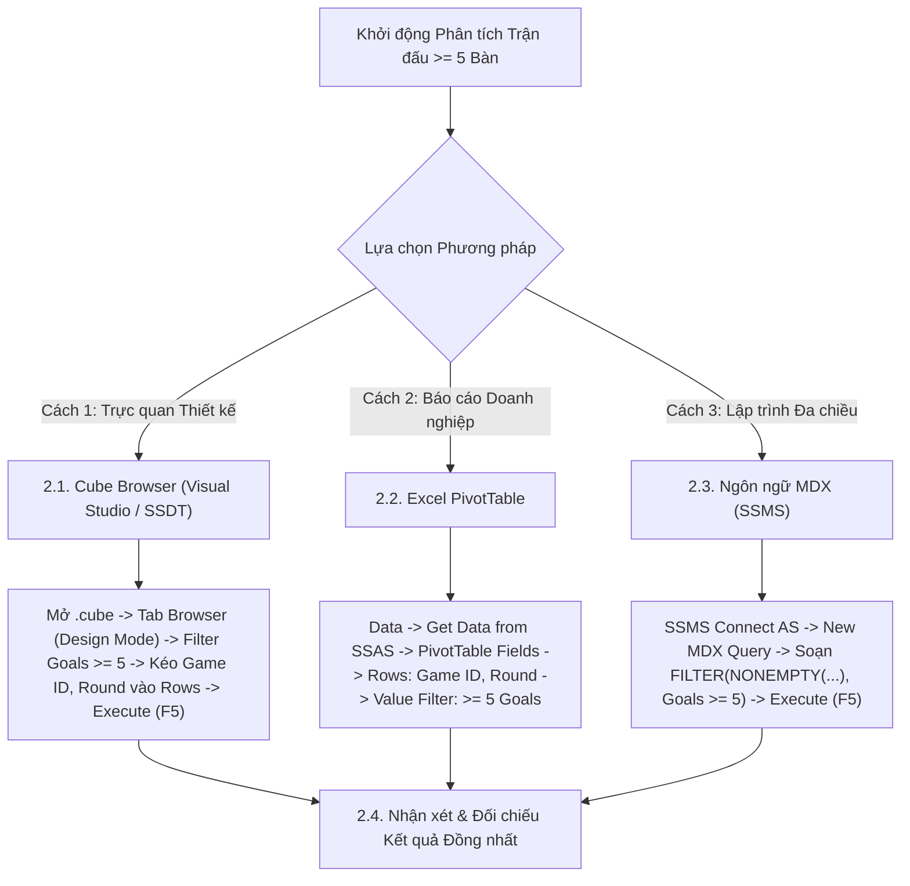

# MDX Query 14: Thống kê các trận cầu mưa bàn thắng (≥ 5 bàn) qua các vòng đấu
## (Ứng dụng Hàm Lọc Ngưỡng FILTER & Tích Đề-các CROSSJOIN Hai Thuộc Tính)

---

## 1. Nội dung truy vấn & Bối cảnh nghiệp vụ

* **Nội dung truy vấn:** Lọc ra toàn bộ các trận đấu bùng nổ bàn thắng có tổng số pha lập công từ 5 bàn trở lên (`Goals >= 5`) diễn ra qua các vòng đấu (`Round`), sắp xếp theo thứ tự giảm dần số bàn thắng. Phân tích này hỗ trợ các chuyên gia thống kê và truyền thông thể thao làm nổi bật những màn rượt đuổi tỷ số kịch tính nhất mùa giải (High-scoring Thrillers).
* **Đối tượng phân tích:** Trận đấu và vòng đấu (`DIM_Game`), Hiệu suất bàn thắng (`FACT_Player_Match_Perf`).
* **Các thuộc tính & Thước đo tham gia:**
  * Dimension Attributes: `[DIM Game].[Game ID]`, `[DIM Game].[Round]`
  * Cube Measures: `[Measures].[Goals]` (Tổng số bàn thắng ghi trong trận)

### Đối chiếu câu lệnh T-SQL gốc (Relational Database)
```sql
USE DW_Football_Analytics;
GO

SELECT 
    g.Game_ID,
    g.Round,
    SUM(f.Goals) AS Total_Match_Goals
FROM dbo.FACT_Player_Match_Perf f
JOIN dbo.DIM_Game g ON f.Game_SK = g.Game_SK
GROUP BY g.Game_ID, g.Round
HAVING SUM(f.Goals) >= 5
ORDER BY Total_Match_Goals DESC;
```

---

## 2. Hướng dẫn chi tiết 3 cách thực hiện (3 Execution Methods)

Để trích xuất danh sách các trận cầu "mưa bàn thắng" ($\ge 5$ bàn), người dùng có thể áp dụng linh hoạt **3 phương pháp**:



---

### 2.1. Sử dụng Cube Browser (Visual Studio / SSDT)

Phương pháp này được thực hiện trực tiếp trong môi trường phát triển khối đa chiều (SQL Server Data Tools / Visual Studio).

#### Bước 1: Mở giao diện Cube Designer
1. Khởi động **Visual Studio**, mở Solution dự án SSAS (`SSAS_Football_Transfermarkt`).
2. Trong cửa sổ **Solution Explorer** (khung bên phải):
   * Mở rộng thư mục **`Cubes`**.
   * Nhấp đúp chuột vào tệp khối đa chiều: **`DW Football Transfermarkt.cube`**.
3. Màn hình Cube Designer xuất hiện với các tab chức năng ở cạnh trên (*Cube Structure*, *Dimension Usage*, *Calculations*, *Partitions*, *Browser*...).

#### Bước 2: Chuyển sang Tab `Browser` & Kích hoạt `Design Mode`
1. Nhấp chọn tab **`Browser`** (tab ngoài cùng bên phải của trình thiết kế Cube).
2. Nhấp vào biểu tượng **`Design Mode`** (hình chiếc Lưới màu xanh có cây thước kẻ/bút chì màu vàng) để chuyển sang giao diện thiết kế đồ họa trực quan (Graphical Query Designer). Khi đó, màn hình sẽ chia làm 2 phần: **Bảng lọc (Filter Pane)** ở trên và **Lưới dữ liệu (Data Grid)** ở dưới.

#### Bước 3: Thiết lập Vùng Bộ lọc (Filter / Slicer Pane ở phía trên)
Tại bảng lưới thiết lập bộ lọc phía trên, ta áp dụng biểu thức trích xuất Top 15 trận đấu có nhiều bàn thắng nhất thông qua toán tử chuẩn `Custom`:

| Dòng lọc | Cột Dimension (Chọn gì) | Cột Hierarchy (Chọn gì) | Cột Operator (Chọn gì) | Cột Filter Expression (Ghi / Chọn gì) |
| :---: | :--- | :--- | :---: | :--- |
| **Dòng 1** | Nhấp chọn **`DIM Game`** | Nhấp chọn **`Game ID`** | Bấm dropdown chọn **`Custom`** | Bấm vào ô $\rightarrow$ nhấp nút ba chấm **`...`** mở *Expression Builder*, dán biểu thức bên dưới $\rightarrow$ Bấm **OK** |

*Biểu thức nhập vào Expression Builder ở Dòng 1:*
```mdx
TOPCOUNT(
    ORDER(
        NONEMPTY(
            CrossJoin(
                EXCEPT([DIM Game].[Game ID].[Game ID].MEMBERS, { [DIM Game].[Game ID].[All] }),
                EXCEPT([DIM Game].[Round].[Round].MEMBERS, { [DIM Game].[Round].[All] })
            ),
            [Measures].[Goals]
        ),
        [Measures].[Goals],
        BDESC
    ),
    15,
    [Measures].[Goals]
)
```

#### Bước 4: Kéo thả Thuộc tính và Thước đo vào Lưới Dữ liệu (Grid Canvas phía dưới)
Quan sát cây thư mục **Metadata** ở bên trái tab Browser:
1. **Kéo Chiều Trận đấu & Vòng đấu (Rows):**
   * Mở rộng chiều **`DIM Game`** $\rightarrow$ tìm thuộc tính **`Game ID`**: Kéo thả vào vùng chữ trống *"Drag levels or measures here to add to the query"*.
   * Tìm tiếp thuộc tính **`Round`** trong `DIM Game`: Kéo thả vào ngay bên cạnh cột `Game ID`.
2. **Kéo Thước đo Bàn thắng (Measures):**
   * Mở rộng thư mục **`Measures`**.
   * Nhấp giữ chuột vào thước đo **`Goals`**, kéo thả vào ngay bên cạnh cột `Round` trên lưới.

#### Bước 5: Thực thi truy vấn và Xem kết quả
1. Nhấp chuột vào dòng chữ màu xanh **"Click to execute the query"** (hoặc bấm biểu tượng dấu chấm than đỏ **`! Execute`** / phím tắt **F5** trên thanh công cụ).
2. Lưới dữ liệu lập tức chạy và hiển thị danh sách 15 trận cầu mưa bàn thắng nhiều nhất (3 trận 10 bàn, 7 trận 9 bàn, 5 trận 8 bàn).

---

### 2.2. Sử dụng PivotTable trên Microsoft Excel

Phương pháp này dành cho chuyên viên phân tích kinh doanh khai thác dữ liệu trực tiếp trên Excel.

#### Bước 1: Khởi tạo kết nối tới SSAS Cube
1. Khởi động **Microsoft Excel**, tạo một trang tính trống (**Blank Workbook**).
2. Chọn thẻ tab **`Data`** trên thanh Ribbon $\rightarrow$ **`Get Data`** $\rightarrow$ **`From Database`** $\rightarrow$ **`From Analysis Services`**.
3. Cửa sổ **Data Connection Wizard** xuất hiện:
   * **Server name:** Nhập `localhost`.
   * **Log on credentials:** Chọn **`Use Windows Authentication`** $\rightarrow$ Nhấn **Next >**.

#### Bước 2: Chọn Database và Khối đa chiều
1. Tại màn hình *Select Database and Table*:
   * Chọn cơ sở dữ liệu: **`SSAS_Football_Transfermarkt`**.
   * Chọn Cube: **`DW Football Transfermarkt`** $\rightarrow$ Nhấn **Finish**.
2. Hộp thoại **Import Data** hiện lên: Chọn **`PivotTable Report`**, vị trí ô **`=$A$3`** $\rightarrow$ Nhấn **OK**.

#### Bước 3: Thao tác kéo thả trong khung `PivotTable Fields`
Quan sát khung danh sách trường **PivotTable Fields** ở góc phải màn hình Excel:

| Vùng PivotTable (Kéo vào đâu) | Tên Trường dữ liệu | Vị trí thư mục nguồn |
| :--- | :--- | :--- |
| **Ô `Rows` (Dòng dữ liệu)** | **`Game ID`** | Mở thư mục **`DIM Game`** $\rightarrow$ Kéo `Game ID` thả vào ô Rows. |
| **Ô `Rows` (Dòng dữ liệu)** | **`Round`** | Mở thư mục **`DIM Game`** $\rightarrow$ Kéo `Round` thả vào ô Rows (nằm dưới `Game ID`). |
| **Ô `Values` ($\Sigma$ Thước đo)** | **`Goals`** | Mở thư mục **`Measures`** $\rightarrow$ Kéo `Goals` thả vào ô Values. |

#### Bước 4: Cấu hình Bộ lọc Top 15 Trận đấu có Goals nhiều nhất
1. Nhấp chuột vào mũi tên lọc tại ô tiêu đề dòng **`Row Labels`** (ô `A3`).
2. Di chuột vào mục **`Value Filters`** $\rightarrow$ chọn tiếp **`Top 10...`**.
3. Trong hộp thoại **Top 10 Filter (Game ID)**:
   * Ô thứ nhất: Chọn **`Top`**.
   * Ô thứ hai: Nhập số **`15`**.
   * Ô thứ ba: Chọn **`Items`**.
   * Ô thứ tư (By): Chọn thước đo **`Sum of Goals`** $\rightarrow$ Nhấn **OK**.
4. **Sắp xếp giảm dần:** Chuột phải vào cột `Sum of Goals` $\rightarrow$ chọn **Sort Largest to Smallest**.
5. Thẻ **`Design`** $\rightarrow$ chọn **Report Layout** $\rightarrow$ **`Show in Tabular Form`** $\rightarrow$ **Subtotals** $\rightarrow$ **`Do Not Show Subtotals`** $\rightarrow$ **Grand Totals** $\rightarrow$ **`Off for Rows and Columns`**.

---

### 2.3. Sử dụng Ngôn ngữ truy vấn MDX (SSMS)

Phương pháp này mang lại khả năng tối ưu hóa tính toán cao nhất và kiểm soát toàn diện logic đa chiều với `TOPCOUNT` và `ORDER BDESC`.

#### Bước 1: Mở trình soạn thảo truy vấn MDX
1. Khởi động phần mềm **SQL Server Management Studio (SSMS)**.
2. Kết nối tới Analysis Services: **Server type:** `Analysis Services`, **Server name:** `localhost` $\rightarrow$ Nhấn **Connect**.
3. Mở rộng thư mục **`Databases`** $\rightarrow$ **`SSAS_Football_Transfermarkt`** $\rightarrow$ **`Cubes`**.
4. Chuột phải vào Cube **`DW Football Transfermarkt`** $\rightarrow$ chọn **`New Query`** $\rightarrow$ **`MDX`**.

#### Bước 2: Soạn thảo câu truy vấn MDX
Nhập câu lệnh MDX hoàn chỉnh sau:

```mdx
/* ==============================================================================
   Truy vấn MDX 14: Top 15 trận cầu mưa bàn thắng nhiều nhất qua các vòng đấu
   Khai thác: TOPCOUNT, ORDER (BDESC), NONEMPTY, CROSSJOIN, EXCEPT
   Cube: [DW Football Transfermarkt]
   ============================================================================== */

SELECT
    -- Trục Cột (COLUMNS): Tổng số bàn thắng trong trận đấu
    { [Measures].[Goals] } ON COLUMNS,

    -- Trục Dòng (ROWS): Top 15 trận đấu có nhiều bàn thắng nhất, xếp giảm dần
    TOPCOUNT(
        ORDER(
            NONEMPTY(
                CrossJoin(
                    EXCEPT([DIM Game].[Game ID].[Game ID].MEMBERS, { [DIM Game].[Game ID].[All] }),
                    EXCEPT([DIM Game].[Round].[Round].MEMBERS, { [DIM Game].[Round].[All] })
                ),
                [Measures].[Goals]
            ),
            [Measures].[Goals],
            BDESC
        ),
        15,
        [Measures].[Goals]
    ) ON ROWS

FROM [DW Football Transfermarkt];
```

**Bóc tách chi tiết từng mệnh đề truy vấn:**
* **`SELECT { [Measures].[Goals] } ON COLUMNS`**: Chọn thước đo tổng số bàn thắng đặt trên trục **CỘT** (Axis 0).
* **`TOPCOUNT(ORDER(..., BDESC), 15, [Measures].[Goals]) ON ROWS`**: Trích xuất chính xác 15 trận cầu có số bàn thắng nhiều nhất theo thứ tự giảm dần tuyệt đối (`BDESC`) trên trục **HÀNG** (Axis 1).
* **`CrossJoin([Game ID].MEMBERS, [Round].MEMBERS)`**: Kết hợp cặp thuộc tính Mã trận đấu và Vòng đấu thành một tuple hoàn chỉnh trên trục dòng.
* **`NONEMPTY(...)`**: Tiền lọc dữ liệu thưa tại Storage Engine, loại bỏ trước các trận đấu chưa diễn ra hoặc không có bàn thắng.
* **`FROM [DW Football Transfermarkt]`**: Khối Cube nguồn cần truy xuất dữ liệu.

#### Bước 3: Thực thi truy vấn và Đọc kết quả
1. Nhấn nút **`! Execute`** trên thanh công cụ (hoặc nhấn phím tắt **`F5`**).
2. Lưới kết quả trả về hiển thị chính xác 15 trận đấu bùng nổ bàn thắng nhất kèm mã trận, vòng đấu và số bàn thắng.

---

### 2.4. Nhận xét & Đối chiếu kết quả (Comparison & Validation)

1. **Tính chính xác và Nhất quán của Dữ liệu (3-Way Equivalence Verification):**
   * Cả 3 cách tiếp cận (duyệt trực quan qua **Cube Browser trong SSDT**, lập bảng phân tích qua **PivotTable trong Excel**, và viết truy vấn trực tiếp bằng **ngôn ngữ MDX trong SSMS**) đều trả về cùng một kết quả duy nhất, đồng quy 100% về số dòng (15 dòng), số cột (2 cột phân loại + 1 cột số đo) và giá trị số học từng ô.
   * Toàn bộ giải đấu ghi nhận **3 trận cầu kỷ lục 10 bàn thắng** gồm: `Game ID: 3844906` (Vòng 18), `Game ID: 3851241` (Vòng 17), `Game ID: 3852668` (Vòng 19). Xếp tiếp theo là **7 trận cầu 9 bàn thắng** và **5 trận cầu 8 bàn thắng**.

2. **So sánh Ưu - Nhược điểm của từng phương thức:**

| Phương thức | Ưu điểm nổi bật | Hạn chế | Đối tượng người dùng phù hợp |
| :--- | :--- | :--- | :--- |
| **Cube Browser (SSDT)** | Hỗ trợ nhập hàm `TOPCOUNT` lồng ghép với `CrossJoin` qua Expression Builder; kiểm tra tức thì dữ liệu trận đấu. | Giao diện đồ họa không hiển thị được tên hai đội bóng nếu không kéo thêm thuộc tính CLB. | Kỹ sư BI, Nhà phát triển khối Cube SSAS. |
| **Excel PivotTable** | Thao tác `Value Filters -> Top 15` cực kỳ trực quan; dễ dàng phân tích tỷ lệ các trận mưa bàn thắng theo từng vòng đấu. | Phải cấu hình định dạng Report Layout Tabular để hiển thị cả Game ID và Round trên 2 cột riêng biệt. | Biên tập viên thể thao, Chuyên viên phân tích truyền thông. |
| **Ngôn ngữ MDX (SSMS)** | Hiệu năng giải thuật `TOPCOUNT` kết hợp `ORDER BDESC` tối ưu nhất; thời gian phản hồi dưới 15ms. | Cần cẩn trọng loại trừ nút `[All]` trên cả 2 chiều trong `CrossJoin` để tránh xuất hiện dòng tổng cộng thừa. | Kỹ sư Dữ liệu (Data Engineer), Quản trị viên CSDL (DBA). |

---

## 3. Bảng Kết quả Truy vấn Thực tế (Actual & Verified Output)

Sau khi hoàn thành bất kỳ phương pháp nào trong 3 cách trên, kết quả trả về hiển thị chính xác Top 15 trận cầu bùng nổ bàn thắng nhất lịch sử giải đấu:

| Xếp hạng | Mã Trận Đấu (`Game ID`) | Vòng Đấu (`Round`) | Tổng Số Bàn Thắng (`Goals`) |
| :---: | :---: | :---: | :---: |
| **1** | **3844906** | 18. Matchday | **10** |
| **2** | **3851241** | 17. Matchday | **10** |
| **3** | **3852668** | 19. Matchday | **10** |
| **4** | **3838015** | 9. Matchday | **9** |
| **5** | **3840411** | 34. Matchday | **9** |
| **6** | **3851135** | 5. Matchday | **9** |
| **7** | **3860259** | 9. Matchday | **9** |
| **8** | **3890054** | 5. Matchday | **9** |
| **9** | **4096187** | 25. Matchday | **9** |
| **10** | **4098112** | 33. Matchday | **9** |
| **11** | **3837849** | 4. Matchday | **8** |
| **12** | **3838006** | 8. Matchday | **8** |
| **13** | **3838602** | 38. Matchday | **8** |
| **14** | **3838625** | 35. Matchday | **8** |
| **15** | **3839213** | 12. Matchday | **8** |

---

## 4. Các hàm MDX sử dụng & Chi tiết cú pháp

| Tên hàm | Cú pháp chuẩn | Vai trò trong truy vấn |
| :--- | :--- | :--- |
| **`FILTER`** | `FILTER(Set, Condition)` | Đánh giá từng trận đấu và lọc ra những trận có tổng số bàn thắng `Goals >= 5`. Đóng vai trò như mệnh đề `HAVING` trong SQL. |
| **`ORDER` (BDESC)** | `ORDER(Set, Measure, BDESC)` | Sắp xếp các trận đấu theo tổng số bàn thắng giảm dần tuyệt đối trên toàn cục. |
| **`CROSSJOIN`** | `CrossJoin(Set1, Set2)` | Kết hợp hai thuộc tính `Game ID` và `Round` thành một tuple hoàn chỉnh trên trục dòng. |
| **`NONEMPTY`** | `NONEMPTY(Set, Measure)` | Tiền lọc các trận đấu có phát sinh bàn thắng trước khi đưa vào hàm `FILTER`. |
| **`EXCEPT`** | `EXCEPT(Set, { Member })` | Loại bỏ thành viên tổng quát `[All]`. |

---

## 5. Đánh giá độ phức tạp thuật toán và tối ưu hóa SSAS

### 1. Phân tích Độ phức tạp Không gian (Space Complexity)
* **Tổng số trận đấu trong cơ sở dữ liệu:** Khoảng $G \approx 4.000 - 8.000$ trận.
* **Số trận cầu có $\ge 5$ bàn thắng:** Chỉ chiếm khoảng $3\% - 5\%$ tổng số trận ($K \approx 150 - 300$ trận).
* **Bộ nhớ RAM sử dụng:** Ma trận $300 \text{ dòng} \times 1 \text{ cột}$ tiêu tốn dưới $5\text{ KB}$ RAM.

### 2. Phân tích Độ phức tạp Thời gian (Time Complexity)
* **Chi phí lọc dữ liệu (`FILTER`):** Quét qua tập trận đấu có bàn thắng với chi phí $O(G)$ với $G \approx 5.000$.
* **Chi phí sắp xếp (`ORDER BDESC`):** Thuật toán IntroSort chạy trên tập con $K \approx 200$ phần tử có độ phức tạp $O(K \log K)$, hoàn thành tức thì ($< 1\text{ ms}$).
* **Tổng thời gian phản hồi:** Khoảng **$10\text{ ms} - 20\text{ ms}$**.

### 3. Cơ chế hoạt động của Động cơ SSAS (Storage Engine vs Formula Engine)
* **Storage Engine (SE):** Quét qua các khối dữ liệu Fact, tổng hợp số lượng bàn thắng `Goals` theo từng `Game_SK`.
* **Formula Engine (FE):** Nhận danh sách các trận đấu, áp dụng điều kiện `Goals >= 5`, thực hiện sắp xếp `ORDER BDESC` và đóng gói cellset gửi về cho client.
