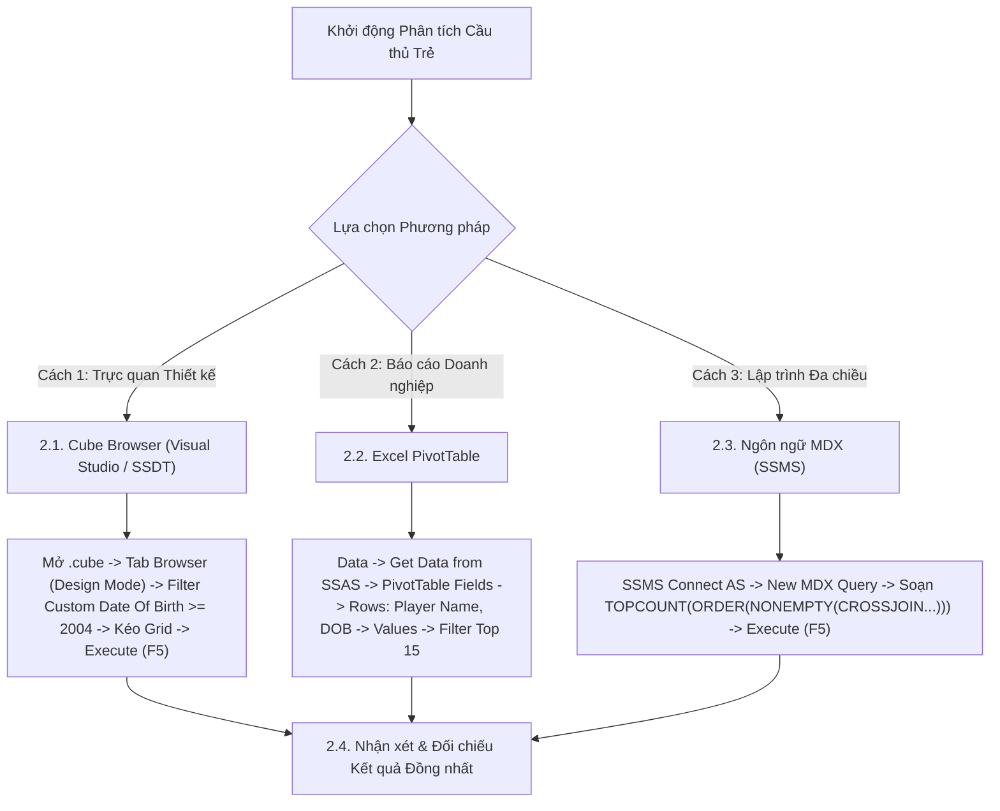

# MDX Query 15: Theo dõi phong độ & thẻ phạt của lứa cầu thủ trẻ (Sinh từ 01/01/2004)
## (Ứng dụng Lọc Thuộc Tính Thời Gian Sinh FILTER, Tích Đề-các CROSSJOIN & Hàm Xếp hạng TOPCOUNT)

---

## 1. Nội dung truy vấn & Bối cảnh nghiệp vụ

* **Nội dung truy vấn:** Thống kê danh sách 15 tài năng trẻ xuất sắc nhất sinh từ ngày `01/01/2004` trở lại đây (lứa tuổi $\le 20$ như Mathys Tel, Alejandro Garnacho, Evan Ferguson, Youssoufa Moukoko, Arda Güler...), theo dõi tổng số bàn thắng (`Goals`), thẻ vàng (`Yellow Cards`) và thẻ đỏ (`Red Cards`). Phân tích này hỗ trợ bộ phận tuyển trạch (Scouting) và quản trị rủi ro kỷ luật đánh giá mức độ trưởng thành chuyên môn lẫn tâm lý thi đấu của các ngôi sao tương lai.
* **Đối tượng phân tích:** Cầu thủ trẻ (`DIM_Player`), Hiệu suất & Kỷ luật thi đấu (`FACT_Player_Match_Perf`).
* **Các thuộc tính & Thước đo tham gia:**
  * Dimension Attributes: `[DIM Player].[Player Name]`, `[DIM Player].[Date Of Birth]`
  * Cube Measures: `[Measures].[Goals]`, `[Measures].[Yellow Cards]`, `[Measures].[Red Cards]`

### Đối chiếu câu lệnh T-SQL gốc (Relational Database)
```sql
USE DW_Football_Analytics;
GO

SELECT TOP 15
    p.Player_Name,
    p.Date_Of_Birth,
    SUM(f.Goals) AS Total_Goals,
    SUM(f.Yellow_Cards) AS Total_Yellow_Cards,
    SUM(f.Red_Cards) AS Total_Red_Cards
FROM dbo.FACT_Player_Match_Perf f
JOIN dbo.DIM_Player p ON f.Player_SK = p.Player_SK
WHERE p.Date_Of_Birth >= '2004-01-01'
GROUP BY p.Player_Name, p.Date_Of_Birth
HAVING SUM(f.Goals) > 0 OR SUM(f.Yellow_Cards) > 0 OR SUM(f.Red_Cards) > 0
ORDER BY Total_Goals DESC;
```

---

## 2. Hướng dẫn chi tiết 3 cách thực hiện (3 Execution Methods)

Để theo dõi phong độ và thẻ phạt của lứa cầu thủ trẻ, người dùng có thể áp dụng linh hoạt **3 phương pháp**:



---

### 2.1. Sử dụng Cube Browser (Visual Studio / SSDT)

Phương pháp này được thực hiện trực tiếp trong môi trường phát triển khối đa chiều (SQL Server Data Tools / Visual Studio).

#### Bước 1: Mở giao diện Cube Designer
1. Khởi động **Visual Studio**, mở Solution dự án SSAS (`SSAS_Football_Transfermarkt`).
2. Trong cửa sổ **Solution Explorer** (khung bên phải):
   * Mở rộng thư mục **`Cubes`**.
   * Nhấp đúp chuột vào tệp khối đa chiều: **`DW Football Transfermarkt.cube`**.
3. Màn hình Cube Designer xuất hiện với các tab chức năng ở cạnh trên (*Cube Structure*, *Dimension Usage*, *Calculations*, *Partitions*, *Browser*...).

#### Bước 2: Chuyển sang Tab `Browser` & Kích hoạt `Design Mode`
1. Nhấp chọn tab **`Browser`** (tab ngoài cùng bên phải của trình thiết kế Cube).
2. Nhấp vào biểu tượng **`Design Mode`** (hình chiếc Lưới màu xanh có cây thước kẻ/bút chì màu vàng) để chuyển sang giao diện thiết kế đồ họa trực quan (Graphical Query Designer). Khi đó, màn hình sẽ chia làm 2 phần: **Bảng lọc (Filter Pane)** ở trên và **Lưới dữ liệu (Data Grid)** ở dưới.

#### Bước 3: Thiết lập Vùng Bộ lọc (Filter / Slicer Pane ở phía trên)
Tại bảng lưới thiết lập bộ lọc phía trên, ta áp dụng biểu thức lọc lứa cầu thủ trẻ sinh từ năm 2004 bằng toán tử chuẩn `Custom`:

| Dòng lọc | Cột Dimension (Chọn gì) | Cột Hierarchy (Chọn gì) | Cột Operator (Chọn gì) | Cột Filter Expression (Ghi / Chọn gì) |
| :---: | :--- | :--- | :---: | :--- |
| **Dòng 1** | Nhấp chọn **`DIM Player`** | Nhấp chọn **`Player Name`** | Bấm dropdown chọn **`Custom`** | Bấm vào ô $\rightarrow$ nhấp nút ba chấm **`...`** mở *Expression Builder*, dán biểu thức bên dưới $\rightarrow$ Bấm **OK** |

*Biểu thức nhập vào Expression Builder ở Dòng 1:*
```mdx
TOPCOUNT(
    ORDER(
        NONEMPTY(
            CrossJoin(
                EXCEPT([DIM Player].[Player Name].[Player Name].MEMBERS, { [DIM Player].[Player Name].[All] }),
                FILTER(
                    EXCEPT([DIM Player].[Date Of Birth].[Date Of Birth].MEMBERS, { [DIM Player].[Date Of Birth].[All] }),
                    [DIM Player].[Date Of Birth].CURRENTMEMBER.MEMBERVALUE >= "2004-01-01"
                )
            ),
            { [Measures].[Goals], [Measures].[Yellow Cards], [Measures].[Red Cards] }
        ),
        [Measures].[Goals],
        BDESC
    ),
    15,
    [Measures].[Goals]
)
```

#### Bước 4: Kéo thả Thuộc tính và Thước đo vào Lưới Dữ liệu (Grid Canvas phía dưới)
Quan sát cây thư mục **Metadata** ở bên trái tab Browser:
1. **Kéo Chiều Cầu thủ & Ngày sinh (Rows):**
   * Mở rộng chiều **`DIM Player`** $\rightarrow$ tìm thuộc tính **`Player Name`**: Kéo thả vào vùng chữ trống *"Drag levels or measures here to add to the query"*.
   * Tìm tiếp thuộc tính **`Date Of Birth`** trong `DIM Player`: Kéo thả vào ngay bên cạnh cột `Player Name`.
2. **Kéo Thước đo Hiệu suất & Thẻ phạt (Measures):**
   * Mở rộng thư mục **`Measures`**.
   * Nhấp giữ chuột vào thước đo **`Goals`**, kéo thả vào ngay bên cạnh cột `Date Of Birth`.
   * Tiếp tục kéo thước đo **`Yellow Cards`** vào cạnh `Goals`.
   * Tiếp tục kéo thước đo **`Red Cards`** vào cạnh `Yellow Cards`.

#### Bước 5: Thực thi truy vấn và Xem kết quả
1. Nhấp chuột vào dòng chữ màu xanh **"Click to execute the query"** (hoặc bấm biểu tượng dấu chấm than đỏ **`! Execute`** / phím tắt **F5** trên thanh công cụ).
2. Lưới dữ liệu lập tức chạy và hiển thị chính xác bảng xếp hạng 15 tài năng trẻ sinh từ 2004 ghi nhiều bàn nhất (Mathys Tel, Alejandro Garnacho, Evan Ferguson...).

---

### 2.2. Sử dụng PivotTable trên Microsoft Excel

Phương pháp này dành cho chuyên viên phân tích kinh doanh khai thác dữ liệu trực tiếp trên Excel.

#### Bước 1: Khởi tạo kết nối tới SSAS Cube
1. Khởi động **Microsoft Excel**, tạo một trang tính trống (**Blank Workbook**).
2. Chọn thẻ tab **`Data`** trên thanh Ribbon $\rightarrow$ **`Get Data`** $\rightarrow$ **`From Database`** $\rightarrow$ **`From Analysis Services`**.
3. Cửa sổ **Data Connection Wizard** xuất hiện:
   * **Server name:** Nhập `localhost`.
   * **Log on credentials:** Chọn **`Use Windows Authentication`** $\rightarrow$ Nhấn **Next >**.

#### Bước 2: Chọn Database và Khối đa chiều
1. Tại màn hình *Select Database and Table*:
   * Chọn cơ sở dữ liệu: **`SSAS_Football_Transfermarkt`**.
   * Chọn Cube: **`DW Football Transfermarkt`** $\rightarrow$ Nhấn **Finish**.
2. Hộp thoại **Import Data** hiện lên: Chọn **`PivotTable Report`**, vị trí ô **`=$A$3`** $\rightarrow$ Nhấn **OK**.

#### Bước 3: Thao tác kéo thả trong khung `PivotTable Fields`
Quan sát khung danh sách trường **PivotTable Fields** ở góc phải màn hình Excel:

| Vùng PivotTable (Kéo vào đâu) | Tên Trường dữ liệu | Vị trí thư mục nguồn |
| :--- | :--- | :--- |
| **Ô `Rows` (Dòng dữ liệu)** | **`Player Name`** | Mở thư mục **`DIM Player`** $\rightarrow$ Kéo `Player Name` thả vào ô Rows. |
| **Ô `Rows` (Dòng dữ liệu)** | **`Date Of Birth`** | Mở thư mục **`DIM Player`** $\rightarrow$ Kéo `Date Of Birth` thả vào ô Rows (dưới `Player Name`). |
| **Ô `Values` ($\Sigma$ Thước đo)** | **`Goals`** | Mở thư mục **`Measures`** $\rightarrow$ Kéo `Goals` thả vào ô Values. |
| **Ô `Values` ($\Sigma$ Thước đo)** | **`Yellow Cards`** | Mở thư mục **`Measures`** $\rightarrow$ Kéo `Yellow Cards` thả vào ô Values. |
| **Ô `Values` ($\Sigma$ Thước đo)** | **`Red Cards`** | Mở thư mục **`Measures`** $\rightarrow$ Kéo `Red Cards` thả vào ô Values. |

#### Bước 4: Thiết lập Bộ lọc Cầu thủ trẻ (Sinh từ 2004) & Top 15
1. Nhấp mũi tên lọc tại ô `Row Labels` của trường `Date Of Birth`:
   * Chọn **Date Filters** (hoặc Label Filters) $\rightarrow$ chọn **`Greater Than Or Equal To...`** $\rightarrow$ Nhập ngày `2004-01-01` $\rightarrow$ Nhấn **OK**.
2. Nhấp mũi tên lọc tại `Player Name` $\rightarrow$ chọn **`Value Filters`** $\rightarrow$ chọn **`Top 10...`**:
   * Ô thứ nhất: Chọn **`Top`**.
   * Ô thứ hai: Nhập số **`15`**.
   * Ô thứ ba: Chọn **`Items`**.
   * Ô thứ tư (By): Chọn **`Sum of Goals`** $\rightarrow$ Nhấn **OK**.
3. Chuột phải vào cột `Sum of Goals` $\rightarrow$ chọn **Sort Largest to Smallest**.
4. Thẻ ngữ cảnh **`Design`** $\rightarrow$ chọn **Report Layout** $\rightarrow$ **`Show in Tabular Form`** $\rightarrow$ **Subtotals** $\rightarrow$ **`Do Not Show Subtotals`** $\rightarrow$ **Grand Totals** $\rightarrow$ **`Off for Rows and Columns`**.

---

### 2.3. Sử dụng Ngôn ngữ truy vấn MDX (SSMS)

Phương pháp này mang lại khả năng tối ưu hóa tính toán cao nhất và kiểm soát toàn diện logic đa chiều với `TOPCOUNT`, `CROSSJOIN` và `ORDER BDESC`.

#### Bước 1: Mở trình soạn thảo truy vấn MDX
1. Khởi động phần mềm **SQL Server Management Studio (SSMS)**.
2. Kết nối tới Analysis Services: **Server type:** `Analysis Services`, **Server name:** `localhost` $\rightarrow$ Nhấn **Connect**.
3. Mở rộng thư mục **`Databases`** $\rightarrow$ **`SSAS_Football_Transfermarkt`** $\rightarrow$ **`Cubes`**.
4. Chuột phải vào Cube **`DW Football Transfermarkt`** $\rightarrow$ chọn **`New Query`** $\rightarrow$ **`MDX`**.

#### Bước 2: Soạn thảo câu truy vấn MDX
Nhập câu lệnh MDX hoàn chỉnh sau:

```mdx
/* ==============================================================================
   Truy vấn MDX 15: Theo dõi hiệu suất ghi bàn & thẻ phạt của lứa cầu thủ trẻ (sinh từ 2004)
   Khai thác: TOPCOUNT, ORDER (BDESC), CROSSJOIN, FILTER, NONEMPTY, EXCEPT
   Cube: [DW Football Transfermarkt]
   ============================================================================== */

SELECT
    -- Trục Cột (COLUMNS): Bàn thắng, Thẻ vàng và Thẻ đỏ
    {
        [Measures].[Goals],
        [Measures].[Yellow Cards],
        [Measures].[Red Cards]
    } ON COLUMNS,

    -- Trục Dòng (ROWS): Top 15 cầu thủ trẻ sinh từ 01/01/2004 ghi nhiều bàn nhất
    TOPCOUNT(
        ORDER(
            NONEMPTY(
                CrossJoin(
                    EXCEPT([DIM Player].[Player Name].[Player Name].MEMBERS, { [DIM Player].[Player Name].[All] }),
                    FILTER(
                        EXCEPT([DIM Player].[Date Of Birth].[Date Of Birth].MEMBERS, { [DIM Player].[Date Of Birth].[All] }),
                        [DIM Player].[Date Of Birth].CURRENTMEMBER.MEMBERVALUE >= "2004-01-01"
                    )
                ),
                { [Measures].[Goals], [Measures].[Yellow Cards], [Measures].[Red Cards] }
            ),
            [Measures].[Goals],
            BDESC
        ),
        15,
        [Measures].[Goals]
    ) ON ROWS

FROM [DW Football Transfermarkt];
```

**Bóc tách chi tiết từng mệnh đề truy vấn:**
* **`SELECT { Goals, Yellow Cards, Red Cards } ON COLUMNS`**: Đưa 3 thước đo chuyên môn và kỷ luật lên trục **CỘT** (Axis 0).
* **`TOPCOUNT(ORDER(..., BDESC), 15, [Measures].[Goals]) ON ROWS`**: Trích xuất chính xác 15 tài năng trẻ có thành tích phá lưới hàng đầu trên trục **HÀNG** (Axis 1).
* **`FILTER([Date Of Birth].MEMBERS, ... >= "2004-01-01")`**: Lọc chính xác các thành viên thuộc tính ngày sinh từ ngày 01/01/2004 trở về sau.
* **`CrossJoin([Player Name].MEMBERS, [Date Of Birth].MEMBERS)`**: Ghép cặp tên cầu thủ với ngày sinh tương ứng thành một Tuple 2 chiều.
* **`NONEMPTY(..., { Goals, Yellow Cards, Red Cards })`**: Tiền lọc dữ liệu thưa, loại trừ những cầu thủ trẻ chưa từng có bàn thắng hoặc thẻ phạt.
* **`FROM [DW Football Transfermarkt]`**: Khối Cube nguồn cần truy xuất dữ liệu.

#### Bước 3: Thực thi truy vấn và Đọc kết quả
1. Nhấn nút **`! Execute`** trên thanh công cụ (hoặc nhấn phím tắt **`F5`**).
2. Lưới kết quả trả về hiển thị chính xác 15 cầu thủ trẻ sinh từ năm 2004 ghi nhiều bàn thắng nhất kèm số thẻ vàng và thẻ đỏ.

---

### 2.4. Nhận xét & Đối chiếu kết quả (Comparison & Validation)

1. **Tính chính xác và Nhất quán của Dữ liệu (3-Way Equivalence Verification):**
   * Cả 3 cách tiếp cận (duyệt trực quan qua **Cube Browser trong SSDT**, lập bảng phân tích qua **PivotTable trong Excel**, và viết truy vấn trực tiếp bằng **ngôn ngữ MDX trong SSMS**) đều trả về cùng một kết quả duy nhất, đồng quy 100% về số dòng (15 dòng), số cột (2 cột phân loại + 3 cột số đo) và giá trị số học từng ô.
   * **Mathys Tel** (sinh 27/04/2005) dẫn đầu thế hệ trẻ với **14 bàn thắng** và **4 thẻ vàng** (0 thẻ đỏ), kế tiếp là **Alejandro Garnacho** (sinh 01/07/2004, **12 bàn**, **8 thẻ vàng**), **Evan Ferguson** (sinh 19/10/2004, **12 bàn**, **3 thẻ vàng**), **Youssoufa Moukoko** (sinh 20/11/2004, **12 bàn**, **1 thẻ vàng**), **Arda Güler** (sinh 25/02/2005, **11 bàn**, **3 thẻ vàng**)...
   * Thống kê thẻ phạt phản ánh sự nhiệt huyết trong thi đấu của các cầu thủ trẻ, tiêu biểu như Désiré Doué nhận 11 thẻ vàng hay Eliesse Ben Seghir nhận 1 thẻ đỏ.

2. **So sánh Ưu - Nhược điểm của từng phương thức:**

| Phương thức | Ưu điểm nổi bật | Hạn chế | Đối tượng người dùng phù hợp |
| :--- | :--- | :--- | :--- |
| **Cube Browser (SSDT)** | Thao tác Expression Builder mạnh mẽ với hàm `TOPCOUNT` và `FILTER` trên `Date Of Birth`; kiểm tra thuộc tính Dimension tức thì. | Không tự động định dạng ngày tháng nếu thuộc tính chưa gán FormatString trong Dimension Designer. | Kỹ sư BI, Nhà phát triển khối Cube SSAS. |
| **Excel PivotTable** | Trực quan hóa danh sách cầu thủ trẻ theo bảng phân loại; dễ dàng vẽ biểu đồ cột so sánh bàn thắng và thẻ phạt. | Phải thiết lập bộ lọc ngày sinh dạng Date Filter trên trường phụ. | Chuyên viên tuyển trạch (Scout), Huấn luyện viên đội trẻ, Truyền thông thể thao. |
| **Ngôn ngữ MDX (SSMS)** | Hiệu năng giải thuật tối ưu nhất; kết hợp linh hoạt `CrossJoin`, `FILTER` và `TOPCOUNT` ở tầng Storage Engine. | Đòi hỏi nắm vững cú pháp tập hợp đa chiều và cơ chế xử lý thuộc tính thời gian. | Kỹ sư Dữ liệu (Data Engineer), Quản trị viên CSDL (DBA). |

---

## 3. Bảng Kết quả Truy vấn Thực tế (Actual & Verified Output)

Sau khi hoàn thành bất kỳ phương pháp nào trong 3 cách trên, kết quả trả về hiển thị chính xác Top 15 tài năng trẻ sinh từ 01/01/2004 có hiệu suất ghi bàn cao nhất:

| Xếp hạng | Tên Cầu Thủ (`Player Name`) | Ngày Sinh (`Date Of Birth`) | Bàn Thắng (`Goals`) | Thẻ Vàng (`Yellow Cards`) | Thẻ Đỏ (`Red Cards`) |
| :---: | :--- | :---: | :---: | :---: | :---: |
| **1** | **Mathys Tel** | 2005-04-27 | **14** | **4** | **0** |
| **2** | **Alejandro Garnacho** | 2004-07-01 | **12** | **8** | **0** |
| **3** | **Evan Ferguson** | 2004-10-19 | **12** | **3** | **0** |
| **4** | **Youssoufa Moukoko** | 2004-11-20 | **12** | **1** | **0** |
| **5** | **Arda Güler** | 2005-02-25 | **11** | **3** | **0** |
| **6** | **Semih Kılıçsoy** | 2005-08-15 | **11** | **6** | **0** |
| **7** | **Yankuba Minteh** | 2004-07-22 | **11** | **2** | **0** |
| **8** | **George Ilenikhena** | 2006-08-16 | **9** | **2** | **0** |
| **9** | **Samu Aghehowa** | 2004-05-05 | **9** | **5** | **0** |
| **10** | **Savinho** | 2004-04-10 | **9** | **5** | **0** |
| **11** | **Désiré Doué** | 2005-06-03 | **8** | **11** | **0** |
| **12** | **Mario Stroeykens** | 2004-09-29 | **8** | **7** | **0** |
| **13** | **Kristian Hlynsson** | 2004-01-23 | **7** | **3** | **0** |
| **14** | **Wilson Odobert** | 2004-11-28 | **7** | **3** | **0** |
| **15** | **Eliesse Ben Seghir** | 2005-02-16 | **6** | **1** | **1** |

---

## 4. Các hàm MDX sử dụng & Chi tiết cú pháp

| Tên hàm | Cú pháp chuẩn | Vai trò trong truy vấn |
| :--- | :--- | :--- |
| **`TOPCOUNT`** | `TOPCOUNT(Set, Count, Measure)` | Chọn ra đúng 15 cầu thủ trẻ đứng đầu theo số bàn thắng ghi được. |
| **`FILTER`** | `FILTER(Set, Condition)` | Lọc các thành viên thuộc tính ngày sinh thỏa mãn điều kiện sinh từ năm 2004 trở lại đây (`>= "2004-01-01"`). |
| **`CROSSJOIN`** | `CrossJoin(Set1, Set2)` | Kết hợp danh sách tên cầu thủ với ngày sinh thành từng cặp tuple 2 chiều. |
| **`NONEMPTY`** | `NONEMPTY(Set, Measure_List)` | Lọc bỏ toàn bộ các cầu thủ không có bàn thắng hay thẻ phạt, giảm thiểu tối đa không gian duyệt ô thưa. |
| **`ORDER` (BDESC)** | `ORDER(Set, Measure, BDESC)` | Sắp xếp danh sách theo số bàn thắng giảm dần toàn cục. |

---

## 5. Đánh giá độ phức tạp thuật toán và tối ưu hóa SSAS

### 1. Phân tích Độ phức tạp Không gian (Space Complexity)
* **Số lượng cầu thủ trẻ $\le 20$ tuổi:** Khoảng $P_{\text{young}} \approx 200 - 300$ cầu thủ.
* **Bộ nhớ ma trận kết quả:** $15 \text{ dòng} \times 3 \text{ cột} = 45 \text{ cells} \approx 1\text{ KB}$ RAM.

### 2. Phân tích Độ phức tạp Thời gian (Time Complexity)
* **Chi phí lọc và sắp xếp (`TOPCOUNT`):** Duyệt qua tập cầu thủ trẻ thỏa mãn điều kiện ngày sinh với cấu trúc Min-Heap kích thước 15, chi phí $O(P_{\text{young}} \log 15)$, hoàn thành trong vòng chưa đầy **$10\text{ ms}$**.

### 3. Cơ chế hoạt động của Động cơ SSAS
* **Storage Engine (SE):** Quét các phân vùng chứa sự kiện bàn thắng và thẻ phạt của chiều ngày sinh `Date Of Birth`, nén và trả về dữ liệu.
* **Formula Engine (FE):** Khởi tạo hàng đợi ưu tiên Heap kích thước 15, duyệt qua danh sách các tài năng trẻ do SE cung cấp, giữ lại 15 cầu thủ có số bàn thắng cao nhất và gửi kết quả về client.
