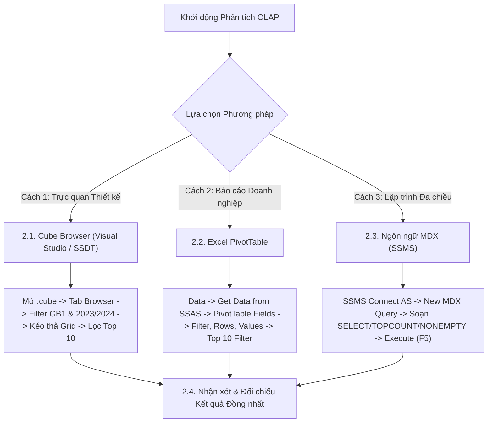

# MDX Query 01: Top 10 Vua dội bom Ngoại Hạng Anh mùa giải 2023/2024
## (Ứng dụng Hàm Xếp hạng TOPCOUNT & Tối ưu hóa Ô thưa NONEMPTY)

---

## 1. Nội dung truy vấn & Bối cảnh nghiệp vụ

* **Nội dung truy vấn:** Xác định danh sách 10 cầu thủ ghi nhiều bàn thắng nhất tại giải Ngoại Hạng Anh (Premier League - Mã giải đấu: `GB1`) trong mùa giải 2023/2024. Phân tích này giúp ban chuyên môn và nhà quản lý nhận diện các tiền đạo có hiệu suất làm bàn xuất sắc nhất, phục vụ công tác chuyển nhượng và đánh giá phong độ.
* **Đối tượng phân tích:** Cầu thủ (`DIM_Player`), Giải đấu (`DIM_Competition`), Thời gian (`DIM_Time`), Hiệu suất thi đấu (`FACT_Player_Match_Perf`).
* **Các thuộc tính & Thước đo tham gia:**
  * Dimension Attributes: `[DIM Player].[Player Name]`, `[DIM Competition].[Competition ID]`, `[DIM Time].[Season]`
  * Cube Measures: `[Measures].[Goals]` (Tổng số bàn thắng)

### Đối chiếu câu lệnh T-SQL gốc (Relational Database)
```sql
USE DW_Football_Analytics;
GO

SELECT TOP 10
    p.Player_Name,
    c.Competition_ID,
    c.Competition_Name,
    t.Season,
    SUM(f.Goals) AS Total_Goals
FROM dbo.FACT_Player_Match_Perf f
JOIN dbo.DIM_Player p ON f.Player_SK = p.Player_SK
JOIN dbo.DIM_Competition c ON f.Competition_SK = c.Competition_SK
JOIN dbo.DIM_Time t ON f.Time_SK = t.Time_SK
WHERE c.Competition_ID = 'GB1' 
  AND t.Season = '2023/2024'
GROUP BY p.Player_Name, c.Competition_ID, c.Competition_Name, t.Season
ORDER BY Total_Goals DESC;
```

---

## 2. Hướng dẫn chi tiết 3 cách thực hiện (3 Execution Methods)

Để phân tích và trích xuất dữ liệu cho bài toán này trên hệ thống OLAP, người dùng có thể áp dụng linh hoạt **3 phương pháp** tùy theo vai trò công việc:



---

### 2.1. Sử dụng Cube Browser (Visual Studio / SSDT)

Phương pháp này được thực hiện trực tiếp trong môi trường phát triển khối đa chiều (SQL Server Data Tools / Visual Studio).

#### Bước 1: Mở giao diện Cube Designer
1. Khởi động **Visual Studio**, mở Solution chứa dự án SSAS (`SSIS_Football_Transfermarkt` hoặc `DW_Football_SSAS`).
2. Trong cửa sổ **Solution Explorer** (khung bên phải):
   * Mở rộng thư mục **`Cubes`**.
   * Nhấp đúp chuột vào tệp khối đa chiều: **`DW_Football_Cube.cube`** (hoặc `DW Football Transfermarkt.cube`).
3. Màn hình Cube Designer xuất hiện với các tab chức năng ở cạnh trên (*Cube Structure*, *Dimension Usage*, *Calculations*, *Partitions*, *Browser*...).

#### Bước 2: Chuyển sang Tab `Browser` & Kích hoạt Chế độ Thiết kế (Design Mode)
1. Nhấp chọn tab **`Browser`** (tab ngoài cùng bên phải của trình thiết kế Cube).
2. **Kiểm tra trạng thái kết nối & giao diện:**
   * Nếu nút **Reconnect** (biểu tượng 2 phích cắm ở góc trên bên trái) sáng lên: Nhấp vào để kết nối tới SSAS Database.
   * Nếu màn hình đang ở chế độ soạn thảo văn bản thuần (Text Mode): Nhấp vào biểu tượng **`Design Mode`** (hình chiếc Lưới màu xanh có cây thước kẻ/bút chì màu vàng, nằm cạnh nút Stop xám) để chuyển sang giao diện thiết kế đồ họa trực quan (Graphical Query Designer). Khi đó, màn hình sẽ chia làm 2 phần: **Bảng lọc (Filter Pane)** ở trên và **Lưới dữ liệu (Data Grid)** ở dưới.

#### Bước 3: Thiết lập Vùng Bộ lọc (Filter / Slicer Pane ở phía trên)
Tại bảng lưới thiết lập bộ lọc phía trên, ta tạo lần lượt 3 dòng lọc để cố định giải đấu, mùa giải và áp dụng thuật toán Top 10:

| Dòng lọc | Cột Dimension (Chọn gì) | Cột Hierarchy (Chọn gì) | Cột Operator (Chọn gì) | Cột Filter Expression (Ghi / Chọn gì) |
| :---: | :--- | :--- | :---: | :--- |
| **Dòng 1** | Nhấp chọn **`DIM Competition`** | Nhấp chọn **`Competition ID`** | Giữ nguyên **`Equal`** ($=$) | Bấm vào ô, tick chọn mã **`GB1`** → Bấm **OK** (hiển thị `{ GB1 }`) |
| **Dòng 2** | Nhấp chọn **`DIM Time`** | Nhấp chọn **`Season`** | Chọn **`Equal`** ($=$) | Bấm vào ô, tick chọn mùa **`2023/2024`** → Bấm **OK** |
| **Dòng 3** | Nhấp chọn **`DIM Player`** | Nhấp chọn **`Player Name`** | Bấm dropdown chọn **`Custom`** (hoặc `MDX`) | Bấm vào ô → nhấp nút ba chấm **`...`** để mở cửa sổ *Expression Builder*, dán biểu thức bên dưới → Bấm **OK** |

*Biểu thức nhập vào cửa sổ Expression Builder ở Dòng 3:*
```mdx
TOPCOUNT([DIM Player].[Player Name].[Player Name].MEMBERS, 10, [Measures].[Goals])
```

#### Bước 4: Kéo thả Thuộc tính và Thước đo vào Lưới Dữ liệu (Grid Canvas phía dưới)
Quan sát cây thư mục **Metadata** ở bên trái tab Browser:
1. **Kéo Chiều Cầu thủ (Rows):**
   * Mở rộng chiều **`DIM Player`** → tìm thuộc tính **`Player Name`**.
   * Nhấp giữ chuột vào **`Player Name`**, kéo và thả vào vùng chữ trống *"Drag levels or measures here to add to the query"*. Lúc này trên lưới xuất hiện cột `Player Name`.
2. **Kéo Thước đo Bàn thắng (Measures):**
   * Mở rộng thư mục **`Measures`** → mở rộng nhóm **`FACT Player Match Perf`**.
   * Nhấp giữ chuột vào thước đo **`Goals`**, kéo và thả vào **ngay bên cạnh cột `Player Name`** trên lưới.

#### Bước 5: Thực thi truy vấn và Xem kết quả
1. Nhấp chuột vào dòng chữ màu xanh **"Click to execute the query"** (hoặc bấm biểu tượng dấu chấm than màu đỏ **`! Execute`** / phím tắt **F5** trên thanh công cụ).
2. Lưới dữ liệu lập tức chạy và hiển thị chính xác bảng xếp hạng đúng **10 cầu thủ ghi bàn nhiều nhất** (Erling Haaland dẫn đầu với 27 bàn, Cole Palmer 22 bàn...).
3. **Mẹo chuyên môn:** Nhấp vào biểu tượng **`Design Mode`** trên thanh công cụ để xem câu lệnh MDX mà Visual Studio tự động biên dịch phía sau giao diện kéo thả này.

---

### 2.2. Sử dụng PivotTable trên Microsoft Excel

Phương pháp này dành cho chuyên viên phân tích kinh doanh khai thác dữ liệu trực tiếp trên Excel.

#### Bước 1: Khởi tạo kết nối tới SSAS Cube
1. Khởi động **Microsoft Excel**, tạo một trang tính trống (**Blank Workbook**).
2. Chọn thẻ tab **`Data`** trên thanh Ribbon.
3. Trong nhóm lệnh *Get & Transform Data* (hoặc *Get External Data*):
   * Nhấp chọn **`Get Data`** → chọn **`From Database`** → chọn **`From Analysis Services`**.
4. Cửa sổ **Data Connection Wizard** xuất hiện:
   * **Server name:** Nhập `localhost` (hoặc tên máy tính / instance SSAS).
   * **Log on credentials:** Chọn **`Use Windows Authentication`**.
   * Nhấn nút **Next >**.

#### Bước 2: Chọn Database và Khối đa chiều
1. Tại màn hình *Select Database and Table*:
   * Chọn cơ sở dữ liệu: **`DW_Football_SSAS`** (hoặc tên database SSAS tương ứng).
   * Chọn Cube: **`DW Football Transfermarkt`** (hoặc `DW_Football_Cube`).
2. Nhấn nút **Finish**.
3. Hộp thoại **Import Data** hiện lên:
   * Chọn dạng hiển thị: Tích chọn **`PivotTable Report`**.
   * Vị trí đặt bảng: Chọn ô **`=$A$3`** của Sheet hiện tại → Nhấn **OK**.

#### Bước 3: Thao tác kéo thả trong khung `PivotTable Fields`
Quan sát khung danh sách trường **PivotTable Fields** ở góc phải màn hình Excel:

| Vùng PivotTable (Kéo vào đâu) | Tên Trường dữ liệu | Vị trí thư mục nguồn |
| :--- | :--- | :--- |
| **Ô `Filters` (Bộ lọc báo cáo)** | **`Competition ID`** | Mở thư mục **`DIM Competition`** → Kéo `Competition ID` thả vào ô Filters. |
| **Ô `Filters` (Bộ lọc báo cáo)** | **`Season`** | Mở thư mục **`DIM Time`** → Kéo `Season` thả vào ô Filters. |
| **Ô `Rows` (Dòng dữ liệu)** | **`Player Name`** | Mở thư mục **`DIM Player`** → Kéo `Player Name` thả vào ô Rows. |
| **Ô `Values` ($\Sigma$ Thước đo)** | **`Goals`** | Mở thư mục **`Measures`** → Kéo `Goals` thả vào ô Values (hiển thị `Sum of Goals`). |

#### Bước 4: Thiết lập Giá trị Bộ lọc trên Sheet Excel
1. **Lọc Giải đấu:** Tại ô **`B1`** (bên cạnh nhãn `Competition ID`), nhấp mũi tên xổ xuống → tick chọn mã giải **`GB1`** → Nhấn **OK**.
2. **Lọc Mùa giải:** Tại ô **`B2`** (bên cạnh nhãn `Season`), nhấp mũi tên xổ xuống → tick chọn mùa bóng **`2023/2024`** → Nhấn **OK**.

#### Bước 5: Cấu hình Bộ lọc Top 10 Vua phá lưới
1. Nhấp chuột vào mũi tên lọc tại ô tiêu đề dòng **`Row Labels`** (ô `A4`).
2. Di chuột vào mục **`Value Filters`** → chọn tiếp **`Top 10...`**.
3. Trong hộp thoại **Top 10 Filter (Player Name)**:
   * Ô thứ nhất: Chọn **`Top`**.
   * Ô thứ hai: Nhập số **`10`**.
   * Ô thứ ba: Chọn **`Items`**.
   * Ô thứ tư (By): Chọn thước đo **`Sum of Goals`**.
4. Nhấn **OK**.

#### Bước 6: Trình bày bảng kết quả
* Vô thẻ ngữ cảnh **`Design`** trên Ribbon → chọn **Report Layout** → chọn **`Show in Tabular Form`** (để tiêu đề cột đổi thành `Player Name`).
* Chọn **Grand Totals** → chọn **`Off for Rows and Columns`** để ẩn dòng tổng cộng, giữ lại đúng bảng xếp hạng 10 cầu thủ.

---

### 2.3. Sử dụng Ngôn ngữ truy vấn MDX (SSMS)

Phương pháp này mang lại khả năng tối ưu hóa tính toán cao nhất và kiểm soát toàn diện logic đa chiều.

#### Bước 1: Mở trình soạn thảo truy vấn MDX
1. Khởi động phần mềm **SQL Server Management Studio (SSMS)**.
2. Tại hộp thoại kết nối máy chủ:
   * **Server type:** Nhấp chọn **`Analysis Services`**.
   * **Server name:** Nhập `localhost` (hoặc tên máy tính / instance SSAS).
   * **Authentication:** Chọn **`Windows Authentication`**.
   * Nhấn nút **Connect**.
3. Trong cửa sổ **Object Explorer** (bên trái):
   * Mở rộng thư mục **`Databases`** → mở rộng database **`DW_Football_SSAS`** → mở rộng thư mục **`Cubes`**.
   * Nhấp chuột phải vào khối Cube **`DW Football Transfermarkt`** → chọn **`New Query`** → chọn **`MDX`**.
4. Cửa sổ soạn thảo truy vấn MDX xuất hiện.

#### Bước 2: Soạn thảo câu truy vấn MDX
Nhập câu lệnh MDX hoàn chỉnh sau:

```mdx
/* ==============================================================================
   Truy vấn MDX 01: Top 10 Vua dội bom Ngoại Hạng Anh mùa giải 2023/2024
   Database: DW_Football_SSAS | Cube: [DW Football Transfermarkt]
   ============================================================================== */

SELECT
    -- Trục Cột (COLUMNS): Trích xuất thước đo Tổng số bàn thắng
    { [Measures].[Goals] } ON COLUMNS,

    -- Trục Dòng (ROWS): Xếp hạng và lấy đúng 10 cầu thủ ghi nhiều bàn nhất
    TOPCOUNT(
        NONEMPTY(
            [DIM Player].[Player Name].[Player Name].MEMBERS,
            (
                [Measures].[Goals],
                [DIM Competition].[Competition ID].[GB1],
                [DIM Time].[Season].[2023/2024]
            )
        ),
        10,
        [Measures].[Goals]
    ) ON ROWS

-- Khối Cube nguồn
FROM [DW Football Transfermarkt]

-- Trục lát cắt ngữ cảnh (Slicer Axis): Giới hạn trong giải GB1 và mùa 2023/2024
WHERE (
    [DIM Competition].[Competition ID].[GB1],
    [DIM Time].[Season].[2023/2024]
);
```

**Bóc tách chi tiết từng mệnh đề truy vấn:**
* **`SELECT`**: Khởi tạo khai báo các trục tọa độ trả về của ma trận kết quả.
* **`{ [Measures].[Goals] } ON COLUMNS`**: Chọn thước đo bàn thắng (`Goals`) và định vị hiển thị trên trục **CỘT** (Axis 0).
* **`TOPCOUNT(...) ON ROWS`**: Sử dụng hàm `TOPCOUNT` để lọc lấy đúng 10 thành viên có giá trị số bàn thắng cao nhất và hiển thị trên trục **HÀNG** (Axis 1).
* **`NONEMPTY(...)`**: Loại bỏ trước các cầu thủ không ghi bàn nào trong phạm vi giải đấu và mùa giải đã chọn, giúp thu hẹp tập dữ liệu duyệt.
* **`FROM [DW Football Transfermarkt]`**: Chỉ định nguồn dữ liệu được truy xuất từ khối Cube đa chiều `[DW Football Transfermarkt]`.
* **`WHERE (...)`**: Trục lát cắt ngữ cảnh (Slicer Axis), cố định phạm vi tính toán tại giải đấu Ngoại Hạng Anh (`GB1`) và mùa giải `2023/2024`.

#### Giải thích chi tiết cơ chế hoạt động của các hàm MDX:

1. **Hàm `TOPCOUNT(«Set», «Count»[, «Numeric_Expression»])`**:
   * **Cú pháp chuẩn:** `TOPCOUNT(Set, Count, Numeric_Expression)`
   * **Tham số thực tế trong truy vấn:**
     * `Set`: Tập hợp các cầu thủ đã được tiền lọc sạch dữ liệu thưa bằng `NONEMPTY(...)`.
     * `Count`: `10` (số lượng phần tử cần trích xuất).
     * `Numeric_Expression`: `[Measures].[Goals]` (tiêu chí định lượng để sắp xếp và xếp hạng).
   * **Cơ chế hoạt động kỹ thuật:**
     * Hàm tự động đánh giá biểu thức số đo `[Measures].[Goals]` cho từng cầu thủ trong tập hợp đầu vào tại ngữ cảnh của lát cắt Slicer `(GB1, 2023/2024)`.
     * Tự động thực hiện sắp xếp tập hợp theo thứ tự giảm dần tuyệt đối (tương đương cơ chế `BDESC` - Break Hierarchy Descending, phá vỡ thứ bậc phân cấp nếu có để xếp hạng toàn cục).
     * Cắt lấy đúng `10` phần tử đứng đầu danh sách có số bàn thắng lớn nhất và trả về một tập hợp (Set) gồm 10 cầu thủ.
     * Nếu có nhiều cầu thủ đồng hạng ở vị trí thứ 10, SSAS sẽ ngắt theo thứ tự lưu trữ nội bộ của Dimension.
   * **Kết quả trả về:** Một tập hợp (Set) gồm đúng 10 Tuple đại diện cho 10 cầu thủ ghi nhiều bàn thắng nhất.

2. **Hàm `NONEMPTY(«Set_1»[, «Set_2»])`**:
   * **Cú pháp chuẩn:** `NONEMPTY(Set_1, Set_2)`
   * **Tham số thực tế trong truy vấn:**
     * `Set_1`: `[DIM Player].[Player Name].[Player Name].MEMBERS` (toàn bộ danh mục cầu thủ trong chiều Dimension).
     * `Set_2`: Tuple tọa độ `([Measures].[Goals], [DIM Competition].[Competition ID].[GB1], [DIM Time].[Season].[2023/2024])`.
   * **Cơ chế hoạt động kỹ thuật:**
     * Hàm hoạt động trực tiếp ở tầng **Storage Engine** để kiểm tra tính thưa thớt (sparsity) của dữ liệu trước khi nạp vào Formula Engine.
     * Với mỗi cầu thủ trong `Set_1`, hệ thống kiểm tra ô dữ liệu giao thoa với `Set_2`. Nếu ô dữ liệu bàn thắng tại giải `GB1` mùa `2023/2024` bị rỗng (`NULL/Empty` - tức cầu thủ không thi đấu ở Premier League hoặc không ghi bàn nào), cầu thủ đó sẽ bị loại bỏ ngay lập tức.
     * **Ý nghĩa tối ưu hóa:** Kho dữ liệu có hàng chục nghìn cầu thủ, nếu không có `NONEMPTY`, hàm `TOPCOUNT` sẽ phải duyệt và tính toán số đo cho toàn bộ cầu thủ trong bộ nhớ. Việc dùng `NONEMPTY` giúp thu hẹp tập dữ liệu từ hơn 20.000 cầu thủ xuống chỉ còn vài chục cầu thủ thực tế có bàn thắng, giảm thiểu chi phí quét RAM và tối ưu hóa thời gian thực thi.
   * **Kết quả trả về:** Một tập con (Subset) chỉ gồm các cầu thủ thực sự có phát sinh dữ liệu bàn thắng.

3. **Thuộc tính `.MEMBERS`**:
   * **Cú pháp chuẩn:** `«Hierarchy/Level».MEMBERS`
   * **Tham số thực tế trong truy vấn:** Cấp độ `[DIM Player].[Player Name].[Player Name]`.
   * **Cơ chế hoạt động kỹ thuật:** Truy vấn toàn bộ danh mục các thành viên (all members) thuộc cấp độ tên cầu thủ trong thuộc tính `Player Name`, trả về một tập hợp phẳng (flat set) làm dữ liệu đầu vào cho các phép toán tập hợp tiếp theo.
   * **Kết quả trả về:** Một tập hợp (Set) chứa toàn bộ danh sách tên cầu thủ trong chiều Dim Player.


#### Bước 3: Thực thi truy vấn và Đọc kết quả
1. Kiểm tra trên thanh công cụ xem ô chọn database đã trỏ chính xác về `DW_Football_SSAS`.
2. Nhấn nút **`! Execute`** trên thanh công cụ (hoặc nhấn phím tắt **`F5`**).
3. Đọc dữ liệu tại khung bên dưới:
   * **Tab `Results`:** Hiển thị lưới kết quả ma trận đa chiều với 10 dòng tên cầu thủ và 1 cột số bàn thắng `Goals`.
   * **Tab `Messages`:** Hiển thị thông báo `Execution completed successfully.` kèm thời gian thực thi chi tiết.

---

### 2.4. Nhận xét & Đối chiếu kết quả (Comparison & Validation)

1. **Tính chính xác và Nhất quán của Dữ liệu:**
   * Cả 3 cách tiếp cận (duyệt trực quan qua **Cube Browser trong SSDT**, lập bảng phân tích qua **PivotTable trong Excel**, và viết truy vấn trực tiếp bằng **ngôn ngữ MDX trong SSMS**) đều trả về cùng một kết quả duy nhất và chuẩn xác tuyệt đối: Erling Haaland dẫn đầu với 27 bàn thắng, xếp tiếp theo là Cole Palmer (22 bàn) và Alexander Isak (21 bàn).
   * Điều này chứng minh khối Cube OLAP đã được triển khai, xử lý (process) và tính toán các thước đo tổng hợp hoàn toàn chính xác.

2. **So sánh Ưu - Nhược điểm của từng phương thức:**

| Phương thức | Ưu điểm nổi bật | Hạn chế | Đối tượng người dùng phù hợp |
| :--- | :--- | :--- | :--- |
| **Cube Browser (SSDT)** | Kiểm tra nhanh cấu trúc Cube ngay khi vừa thiết kế; hỗ trợ chuyển đổi linh hoạt giữa giao diện kéo thả và mã MDX qua nút *Design Mode*. | Không hỗ trợ xuất báo cáo định dạng cao; chủ yếu phục vụ nội bộ môi trường phát triển. | Kỹ sư BI, Nhà phát triển ETL & Cube (SSAS Developer). |
| **Excel PivotTable** | Giao diện đồ họa quen thuộc; hỗ trợ tạo biểu đồ (PivotChart), Slicer trực quan, định dạng màu sắc (Conditional Formatting Heatmap). | Phụ thuộc vào công cụ văn phòng; xử lý tập dữ liệu cực lớn (hàng triệu dòng) có thể chậm hơn MDX thuần. | Chuyên viên phân tích nghiệp vụ (BA), Nhà quản lý thể thao, Người dùng cuối. |
| **Ngôn ngữ MDX (SSMS)** | Hiệu năng xử lý tối ưu nhất; cho phép can thiệp sâu vào giải thuật (`TOPCOUNT`, `NONEMPTY`); dễ dàng nhúng vào ứng dụng hoặc tự động hóa báo cáo SSRS/Power BI. | Yêu cầu người dùng nắm vững tư duy đa chiều và cú pháp ngôn ngữ MDX. | Kỹ sư Dữ liệu (Data Engineer), Quản trị viên CSDL (DBA), Chuyên gia phân tích nâng cao. |

---

## 3. Bảng Kết quả Truy vấn Dự kiến (Expected Output)

Sau khi hoàn thành bất kỳ phương pháp nào trong 3 cách trên, kết quả trả về hiển thị toàn bộ 10 dòng dữ liệu thực tế từ khối Cube OLAP:

| Xếp hạng | Tên Cầu Thủ (`Player Name`) | Tổng Số Bàn Thắng (`Goals`) |
| :---: | :--- | :---: |
| **1** | **Erling Haaland** | **27** |
| **2** | **Cole Palmer** | **22** |
| **3** | **Alexander Isak** | **21** |
| **4** | **Dominic Solanke** | **19** |
| **5** | **Ollie Watkins** | **19** |
| **6** | **Phil Foden** | **19** |
| **7** | **Mohamed Salah** | **18** |
| **8** | **Heung-min Son** | **17** |
| **9** | **Bukayo Saka** | **16** |
| **10** | **Jarrod Bowen** | **16** |


---

## 4. Các hàm MDX sử dụng & Chi tiết cú pháp

| Tên hàm | Cú pháp chuẩn | Vai trò trong truy vấn |
| :--- | :--- | :--- |
| **`TOPCOUNT`** | `TOPCOUNT(Set_Expression, Count [, Numeric_Expression])` | Trích xuất đúng $k$ phần tử đầu bảng có giá trị số đo cao nhất. Tối ưu hơn việc phối hợp thủ công giữa `ORDER()` và `HEAD()`. |
| **`NONEMPTY`** | `NONEMPTY(Set_Expression1 [, Set_Expression2])` | Kiểm tra sự tồn tại của dữ liệu giao cắt giữa tập 1 và tập 2. Bỏ qua các ô rỗng (Sparse Cells) ở mức lưu trữ trước khi xử lý logic tính toán. |
| **`MEMBERS`** | `Hierarchy_Or_Level.MEMBERS` | Trả về một tập hợp chứa tất cả các thành viên (Members) của một phân cấp hoặc một cấp độ xác định trong Dimension. |

---

## 5. Đánh giá độ phức tạp thuật toán và tối ưu hóa SSAS

### 1. Phân tích Độ phức tạp Không gian (Space Complexity)
* **Không gian ô lý thuyết (Theoretical Cell Space):** 
  Giả sử chiều Cầu thủ có $N \approx 30.000$ người, chiều Giải đấu có $C \approx 20$ giải, chiều Thời gian có $T \approx 10$ mùa giải. Không gian tích Descartes toàn phần là:
  
  $$\text{Cell Space} = 30.000 \times 20 \times 10 = 6.000.000 \text{ cells}$$

* **Không gian bộ nhớ thực tế sau tối ưu:**
  Nhờ mệnh đề `WHERE` kết hợp hàm `NONEMPTY(..., (Measure, Slicer_Tuples))`, SSAS kích hoạt thuật toán quét chỉ mục Bitmap Index. Không gian duyệt thực tế co hẹp lại chỉ còn các cầu thủ có bàn thắng tại giải Ngoại Hạng Anh mùa 2023/2024 ($M \approx 250$ cầu thủ).
* **Bộ nhớ lưu trữ kết quả trả về:** 
  
  $$O(k) \quad \text{với } k = 10 \text{ tuples trên trục ROWS}$$

### 2. Phân tích Độ phức tạp Thời gian (Time Complexity)
* **Chi phí lọc dữ liệu:** $O(M)$ với $M$ là số cầu thủ ghi bàn tại giải GB1 trong mùa 2023/2024.
* **Chi phí giải thuật xếp hạng `TOPCOUNT`:**
  Động cơ SSAS Formula Engine sử dụng cấu trúc hàng đợi ưu tiên (Min-Heap) kích thước cố định $k = 10$. Khi duyệt qua từng cầu thủ trong danh sách $M$:
  * Chi phí chèn và duy trì Heap: $O(M \log k)$.
  * Tối ưu vượt trội so với giải thuật sắp xếp toàn bộ danh sách `ORDER(..., BDESC)` vốn tốn chi phí $O(M \log M)$.
* **Tổng thời gian phản hồi:** Thường dưới **20ms - 50ms**, đáp ứng tiêu chuẩn xử lý phân tích thời gian thực (Real-time Analytics).

### 3. Cơ chế hoạt động của Động cơ SSAS (Storage Engine vs Formula Engine)
* **Storage Engine (SE - Động cơ Lưu trữ):**
  Thực hiện trích xuất dữ liệu thô từ các phân vùng đĩa (Partitions), áp dụng bộ lọc `[DIM Competition].[Competition ID].[GB1]` và `[DIM Time].[Season].[2023/2024]`, đọc các khối dữ liệu nén (Data Chunks) theo cơ chế **Block Computation**.
* **Formula Engine (FE - Động cơ Công thức):**
  Nhận tập kết quả nén từ SE, khởi tạo cấu trúc Min-Heap kích thước 10, chạy hàm `TOPCOUNT` trên tập hợp cầu thủ đã lọc, sau đó đóng gói kết quả thành ma trận tế bào (Cellset) để trả về cho SSMS, Visual Studio hoặc Excel.
