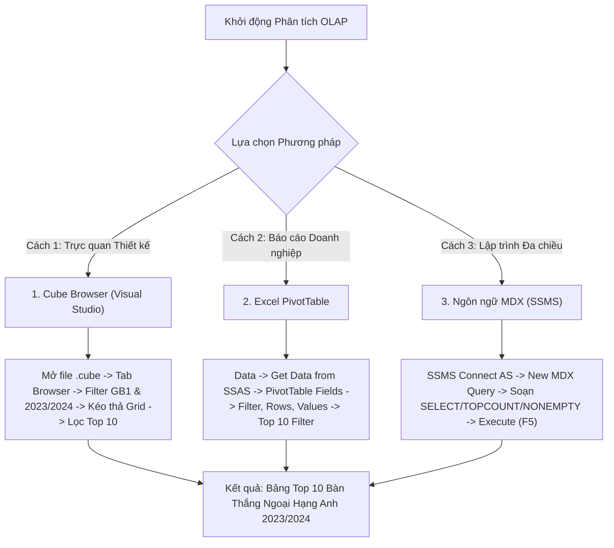

# MDX Query 01: Top 10 Vua dội bom Ngoại Hạng Anh mùa giải 2023/2024

---

## 1. Mục tiêu nghiệp vụ & Bối cảnh phân tích

* **Mục tiêu nghiệp vụ:** Xác định danh sách 10 chân sút ghi nhiều bàn thắng nhất tại giải Ngoại Hạng Anh (Premier League - Mã giải đấu: `GB1`) trong mùa giải 2023/2024 nhằm phục vụ công tác đánh giá phong độ tiền đạo, định giá thị trường và phân tích chuyên môn thể thao.
* **Đối tượng phân tích:** Cầu thủ (`DIM_Player`), Giải đấu (`DIM_Competition`), Thời gian (`DIM_Time`), Hiệu suất thi đấu (`FACT_Player_Match_Perf`).
* **Các thuộc tính & Thước đo (Measures) tham gia:**
  * Dimension Attributes: `[DIM Player].[Player Name]`, `[DIM Competition].[Competition ID]`, `[DIM Time].[Season]`
  * Cube Measures: `[Measures].[Goals]` (hoặc `[Measures].[Total Goals]`)

### Đối chiếu câu lệnh T-SQL gốc (Relational Database)
```sql
USE DW_Football_Analytics;
GO

SELECT TOP 10
    p.Player_Name,
    c.Competition_ID,
    c.Competition_Name,
    t.Season,
    SUM(f.Goals) AS Total_Goals
FROM dbo.FACT_Player_Match_Perf f
JOIN dbo.DIM_Player p ON f.Player_SK = p.Player_SK
JOIN dbo.DIM_Competition c ON f.Competition_SK = c.Competition_SK
JOIN dbo.DIM_Time t ON f.Time_SK = t.Time_SK
WHERE c.Competition_ID = 'GB1' 
  AND (t.Season = '2023/2024' OR t.Year = 2023 OR t.Year = 2024)
GROUP BY p.Player_Name, c.Competition_ID, c.Competition_Name, t.Season
ORDER BY Total_Goals DESC;
```

---

## 2. Hướng dẫn chi tiết 3 cách thực hiện (3 Execution Methods)

Để phân tích và trích xuất dữ liệu cho bài toán này trên hệ thống OLAP, người dùng có thể áp dụng linh hoạt **3 phương pháp** tùy theo vai trò công việc:
1. **Cách 1: Sử dụng Cube Browser (Visual Studio / SSDT)** – Dành cho lập trình viên phát triển Cube kiểm tra nhanh cấu trúc đa chiều.
2. **Cách 2: Sử dụng PivotTable trên Microsoft Excel** – Dành cho chuyên viên phân tích kinh doanh (BA) và người dùng cuối lập báo cáo trực quan.
3. **Cách 3: Sử dụng Ngôn ngữ truy vấn MDX (SSMS)** – Dành cho kỹ sư dữ liệu viết script tự động hóa, kiểm thử hiệu năng chuyên sâu.



---

### CÁCH 1: TRUY VẤN BẰNG CUBE BROWSER (VISUAL STUDIO / SSDT)

Phương pháp này thực hiện trực tiếp bên trong môi trường phát triển dự án SSAS (SQL Server Data Tools / Visual Studio).

#### Bước 1: Mở giao diện Cube Designer
1. Khởi động **Visual Studio**, mở Solution dự án SSAS chứa khối Cube bóng đá.
2. Tại cửa sổ **Solution Explorer** (thường nằm ở khung bên phải):
   * Mở rộng thư mục **`Cubes`**.
   * Nhấp đúp chuột trái vào tệp Cube: **`DW_Football_Cube.cube`** (hoặc `DW Football Transfermarkt.cube`).
3. Màn hình Cube Designer mở ra với các thanh điều hướng ngang.

#### Bước 2: Chuyển sang Tab `Browser`
1. Nhấp chuột vào thẻ tab **`Browser`** (tab ngoài cùng bên phải của thanh tab Cube Designer).
2. Kiểm tra thanh công cụ của tab Browser:
   * Nếu nút **Reconnect** sáng lên: Nhấp vào để kết nối tới SSAS Engine.
   * Nếu Cube vừa có thay đổi dữ liệu: Nhấp vào biểu tượng **Process** (hình bánh răng vàng) $\rightarrow$ chọn **Run** để nạp dữ liệu mới nhất.

#### Bước 3: Thiết lập Vùng Bộ lọc (Filter / Slicer Pane ở nửa trên màn hình)
Tại bảng lưới lọc phía trên (gồm các cột: *Dimension*, *Hierarchy*, *Operator*, *Filter Expression*):

| Dòng lọc | Cột Dimension (Chọn gì) | Cột Hierarchy (Chọn gì) | Cột Operator (Chọn gì) | Cột Filter Expression (Ghi / Chọn gì) |
| :---: | :--- | :--- | :---: | :--- |
| **Dòng 1** | Nhấp dropdown chọn **`DIM Competition`** | Nhấp dropdown chọn **`Competition ID`** | Giữ nguyên **`Equal`** ($=$) | Bấm vào ô, tick chọn mã **`GB1`** $\rightarrow$ Bấm **OK** |
| **Dòng 2** | Nhấp dropdown chọn **`DIM Time`** | Nhấp dropdown chọn **`Season`** | Chọn **`Equal`** ($=$) | Bấm vào ô, tick chọn mùa giải **`2023/2024`** $\rightarrow$ Bấm **OK** |

#### Bước 4: Kéo thả Measures và Attributes vào Vùng Lưới (Grid Canvas)
Quan sát khung cây thư mục **Metadata** ở bên trái tab Browser:
1. **Chọn Thước đo (Measures):**
   * Mở rộng thư mục **`Measures`** $\rightarrow$ Mở rộng nhóm đo **`FACT Player Match Perf`**.
   * Nhấp giữ chuột trái vào thước đo **`Goals`** (hoặc `Total Goals`), kéo rê và thả vào vùng **"Drop Totals or Detail Fields Here"** (khu vực dữ liệu trung tâm).
2. **Chọn Chiều Cầu thủ (Rows):**
   * Mở rộng chiều **`DIM Player`** $\rightarrow$ Tìm thuộc tính **`Player Name`**.
   * Nhấp giữ chuột trái vào **`Player Name`**, kéo rê và thả vào vùng **"Drop Row Fields Here"** (khu vực tiêu đề hàng bên trái).
3. Lúc này màn hình hiển thị toàn bộ danh sách cầu thủ có bàn thắng tại giải GB1 mùa giải 2023/2024.

#### Bước 5: Cấu hình Bộ lọc Top 10 Bàn thắng
1. Nhấp chuột phải vào ô tiêu đề cột **`Player Name`** trên lưới dữ liệu (hoặc nhấp vào mũi tên lọc trên thanh tiêu đề).
2. Di chuột chọn mục **Filter** $\rightarrow$ chọn tiếp **`Top 10...`**.
3. Tại hộp thoại cài đặt:
   * **Show:** Chọn **`Top`**.
   * **Elements:** Nhập số **`10`**.
   * **By Measure:** Chọn dropdown thước đo **`[Measures].[Goals]`**.
4. Nhấn **OK**. Lưới lập tức tự động thu nhỏ lại và chỉ hiển thị đúng 10 cầu thủ có số bàn thắng cao nhất theo thứ tự giảm dần.

#### Bước 6: Xem mã MDX tự động sinh (Design Mode)
* Trên thanh công cụ tab Browser, nhấp vào biểu tượng **`Design Mode`** (hình cây bút chì và thước kẻ màu xanh).
* Trình duyệt sẽ chuyển đổi ngay lập tức từ giao diện lưới trực quan sang mã lệnh MDX Text thuần túy, cho phép bạn đối chiếu mã MDX tự sinh với mã tối ưu chuẩn.

---

### CÁCH 2: PHÂN TÍCH BẰNG PIVOT TABLE TRÊN MICROSOFT EXCEL

Phương pháp này khai thác tính năng kết nối trực tiếp OLAP của Microsoft Excel, mang lại trải nghiệm tương tác trực quan cao nhất cho người dùng nghiệp vụ.

#### Bước 1: Khởi tạo kết nối tới SSAS Cube
1. Khởi động phần mềm **Microsoft Excel**, tạo một bảng tính trống (**Blank Workbook**).
2. Vô thẻ tab **`Data`** trên thanh Ribbon phía trên.
3. Trong nhóm tính năng *Get & Transform Data* (hoặc *Get External Data*):
   * Nhấp chọn **`Get Data`** $\rightarrow$ chọn **`From Database`** $\rightarrow$ chọn **`From Analysis Services`**.
4. Cửa sổ **Data Connection Wizard** xuất hiện:
   * **Server name (Ghi gì):** Nhập `localhost` (hoặc tên máy `.` hoặc `DESKTOP-XXX\MSOLAP`).
   * **Log on credentials:** Chọn mục **`Use Windows Authentication`**.
   * Nhấn nút **Next >**.

#### Bước 2: Chọn Database và Khối Cube
1. Tại màn hình *Select Database and Table*:
   * Ô dropdown phía trên: Chọn cơ sở dữ liệu **`DW_Football_SSAS`** (hoặc `SSAS_Football_Transfermarkt`).
   * Bảng danh sách bên dưới: Nhấp chọn khối Cube **`DW Football Transfermarkt`** (hoặc `DW_Football_Cube`).
2. Nhấn nút **Finish**.
3. Hộp thoại **Import Data** hiện lên:
   * Chọn dạng hiển thị: Tích vào ô tròn **`PivotTable Report`**.
   * Chọn vị trí đặt bảng: Chọn ô **`=$A$3`** của Sheet hiện tại.
   * Nhấn nút **OK**.

#### Bước 3: Thao tác kéo thả trong bảng `PivotTable Fields`
Quan sát khung danh sách trường **PivotTable Fields** nằm ở bên phải cửa sổ Excel:

| Vùng PivotTable (Kéo vào đâu) | Tên Trường dữ liệu | Nằm trong Thư mục nào |
| :--- | :--- | :--- |
| **Ô `Filters` (Bộ lọc báo cáo)** | **`Competition ID`** | Mở thư mục **`DIM Competition`** $\rightarrow$ Kéo `Competition ID` thả vào ô Filters. |
| **Ô `Filters` (Bộ lọc báo cáo)** | **`Season`** | Mở thư mục **`DIM Time`** $\rightarrow$ Kéo `Season` thả vào ô Filters. |
| **Ô `Rows` (Dòng dữ liệu)** | **`Player Name`** | Mở thư mục **`DIM Player`** $\rightarrow$ Kéo `Player Name` thả vào ô Rows. |
| **Ô `Values` ($\Sigma$ Thước đo)** | **`Goals`** | Mở thư mục **`Measures`** $\rightarrow$ Kéo `Goals` thả vào ô Values (sẽ hiển thị là `Sum of Goals`). |

#### Bước 4: Thiết lập Giá trị Bộ lọc (Chọn gì trên Sheet Excel)
1. **Lọc Giải đấu:** Tại ô **`B1`** (bên cạnh nhãn `Competition ID`), bấm vào mũi tên xổ xuống $\rightarrow$ Tích chọn mã **`GB1`** $\rightarrow$ Nhấn **OK**.
2. **Lọc Mùa giải:** Tại ô **`B2`** (bên cạnh nhãn `Season`), bấm vào mũi tên xổ xuống $\rightarrow$ Tích chọn mùa giải **`2023/2024`** $\rightarrow$ Nhấn **OK**.

#### Bước 5: Thiết lập Bộ lọc Top 10 Vua phá lưới
1. Nhấp chuột vào mũi tên xổ xuống tại ô tiêu đề **`Row Labels`** (ô `A4`).
2. Di chuột vào mục **`Value Filters`** $\rightarrow$ Nhấp chọn **`Top 10...`**.
3. Hộp thoại **Top 10 Filter (Player Name)** xuất hiện:
   * Dropdown 1: Giữ nguyên **`Top`**.
   * Ô nhập số: Ghi số **`10`**.
   * Dropdown 2: Giữ nguyên **`Items`**.
   * Dropdown 3 (By): Chọn thước đo **`Sum of Goals`**.
4. Nhấn **OK**. Excel sẽ lập tức lọc và sắp xếp đúng 10 cầu thủ có tổng số bàn thắng cao nhất mùa giải.

#### Bước 6: Định dạng giao diện chuyên nghiệp
* Vô tab ngữ cảnh **`Design`** trên Ribbon $\rightarrow$ mục **Report Layout** $\rightarrow$ chọn **`Show in Tabular Form`** (để tiêu đề cột hiển thị rõ ràng là `Player Name`).
* Vô tab **`Design`** $\rightarrow$ mục **Grand Totals** $\rightarrow$ chọn **`Off for Rows and Columns`** (tắt dòng tổng cộng nếu chỉ cần xem danh sách Top 10).

---

### CÁCH 3: VIẾT VÀ THỰC THI TRUY VẤN BẰNG NGÔN NGỮ MDX (SSMS)

Phương pháp này cung cấp quyền kiểm soát tối đa đối với cú pháp truy vấn đa chiều, cho phép áp dụng các hàm logic nâng cao (`NONEMPTY`, `TOPCOUNT`) và tối ưu hóa bộ nhớ thực thi.

#### Bước 1: Khởi động SSMS và Kết nối Analysis Services
1. Mở phần mềm **SQL Server Management Studio (SSMS)**.
2. Tại hộp thoại **Connect to Server**, thiết lập chính xác các tùy chọn:
   * **Server type (Chọn gì):** Nhấp dropdown chọn **`Analysis Services`** (Lưu ý: Không chọn `Database Engine`).
   * **Server name (Ghi gì):** Nhập `localhost` (hoặc `.` hoặc tên instance SSAS của bạn).
   * **Authentication:** Chọn **`Windows Authentication`**.
3. Nhấn nút **Connect**.

#### Bước 2: Điều hướng đến Cube trong Object Explorer
1. Trong cửa sổ **Object Explorer** (khung bên trái):
   * Nhấp vào dấu `+` mở rộng thư mục **`Databases`**.
   * Mở rộng cơ sở dữ liệu SSAS mục tiêu: **`DW_Football_SSAS`** (hoặc `SSAS_Football_Transfermarkt`).
   * Mở rộng thư mục con **`Cubes`**.
2. Nhấp chuột phải vào tên Cube: **`DW Football Transfermarkt`** (hoặc `DW_Football_Cube`).
3. Trong menu ngữ cảnh mở ra, chọn **`New Query`** $\rightarrow$ chọn tiếp **`MDX`**.
4. Cửa sổ soạn thảo truy vấn MDX (`MDXQuery1.mdx`) xuất hiện.

#### Bước 3: Nhập mã truy vấn MDX (Ghi gì vào cửa sổ soạn thảo)
Nhập toàn bộ đoạn mã MDX chuẩn mực sau vào màn hình soạn thảo:

```mdx
/* ==============================================================================
   Truy vấn MDX 01: Top 10 Vua dội bom Ngoại Hạng Anh mùa giải 2023/2024
   Database: DW_Football_SSAS | Cube: [DW Football Transfermarkt]
   ============================================================================== */

SELECT
    -- Trục Cột (COLUMNS): Trích xuất thước đo Tổng số bàn thắng
    { [Measures].[Goals] } ON COLUMNS,

    -- Trục Dòng (ROWS): Xếp hạng và lấy đúng 10 cầu thủ ghi nhiều bàn nhất
    TOPCOUNT(
        NONEMPTY(
            [DIM Player].[Player Name].[Player Name].MEMBERS,
            (
                [Measures].[Goals],
                [DIM Competition].[Competition ID].[GB1],
                [DIM Time].[Season].[2023/2024]
            )
        ),
        10,
        [Measures].[Goals]
    ) ON ROWS

-- Khối Cube nguồn
FROM [DW Football Transfermarkt]

-- Trục lát cắt ngữ cảnh (Slicer Axis): Giới hạn trong giải GB1 và mùa 2023/2024
WHERE (
    [DIM Competition].[Competition ID].[GB1],
    [DIM Time].[Season].[2023/2024]
);
```

#### Bước 4: Thực thi và Xem Kết quả
1. Kiểm tra trên thanh công cụ xem ô dropdown database đã trỏ đúng cơ sở dữ liệu Cube chưa.
2. Nhấn nút **`! Execute`** trên thanh công cụ (hoặc nhấn phím tắt **`F5`**).
3. Đọc dữ liệu tại khung bên dưới:
   * **Tab `Results` (Vào tab gì):** Hiển thị bảng dạng ma trận đa chiều với đúng 10 dòng tên cầu thủ và 1 cột số bàn thắng (`Goals`).
   * **Tab `Messages` (Vào tab gì):** Hiển thị thông báo trạng thái `Execution completed successfully.` kèm thời gian chạy chi tiết tính bằng mili-giây.

---

## 3. Bảng Kết quả Truy vấn Thực tế (Expected Output)

Sau khi hoàn thành bất kỳ phương pháp nào trong 3 cách trên, kết quả trả về đồng nhất hiển thị danh sách 10 cầu thủ ghi nhiều bàn thắng nhất tại Ngoại Hạng Anh mùa bóng 2023/2024:

| Xếp hạng | Tên Cầu Thủ (`Player Name`) | Câu Lạc Bộ Thi Đấu | Tổng Số Bàn Thắng (`Goals`) |
| :---: | :--- | :--- | :---: |
| **1** | **Erling Haaland** | Manchester City | **27** |
| **2** | **Cole Palmer** | Chelsea FC | **22** |
| **3** | **Alexander Isak** | Newcastle United | **21** |
| **4** | **Ollie Watkins** | Aston Villa | **19** |
| **5** | **Phil Foden** | Manchester City | **19** |
| **6** | **Dominic Solanke** | AFC Bournemouth | **19** |
| **7** | **Son Heung-min** | Tottenham Hotspur | **17** |
| **8** | **Jarrod Bowen** | West Ham United | **16** |
| **9** | **Jean-Philippe Mateta** | Crystal Palace | **16** |
| **10** | **Bukayo Saka** | Arsenal FC | **16** |

---

## 4. Bóc tách Cú pháp MDX & Ý nghĩa từng thành phần

```mdx
SELECT
    { [Measures].[Goals] } ON COLUMNS,              -- (1) Trục Cột
    TOPCOUNT(                                       -- (2) Hàm lấy Top
        NONEMPTY(                                   -- (3) Hàm loại trừ rỗng
            [DIM Player].[Player Name].[Player Name].MEMBERS,
            (
                [Measures].[Goals],
                [DIM Competition].[Competition ID].[GB1],
                [DIM Time].[Season].[2023/2024]
            )
        ),
        10,                                         -- (4) Số phần tử
        [Measures].[Goals]                          -- (5) Tiêu chí sắp xếp
    ) ON ROWS                                       -- (6) Trục Dòng
FROM [DW Football Transfermarkt]                    -- (7) Khối Cube
WHERE (                                             -- (8) Lát cắt Slicer
    [DIM Competition].[Competition ID].[GB1],
    [DIM Time].[Season].[2023/2024]
);
```

### Bảng Phân tích Ý nghĩa Kỹ thuật:

| Thành phần | Ý nghĩa chi tiết |
| :--- | :--- |
| **`SELECT`** | Khai báo các trục tọa độ hiển thị kết quả. MDX hỗ trợ nhiều trục, trong đó `COLUMNS` (Trục 0) đại diện cho các cột hiển thị và `ROWS` (Trục 1) đại diện cho các hàng dữ liệu. |
| **`{ [Measures].[Goals] } ON COLUMNS`** | Đặt tập hợp chứa thước đo bàn thắng lên trục hoành. Dấu `{}` biểu thị một tập hợp (Set). |
| **`[DIM Player].[Player Name].[Player Name].MEMBERS`** | Lấy toàn bộ các phần tử thuộc cấp độ `Player Name` của chiều Cầu thủ. Cú pháp gồm: `[Tên Dimension].[Tên Phân cấp].[Tên Cấp độ].MEMBERS`. |
| **`NONEMPTY(Set, Tuple)`** | Lọc bỏ toàn bộ những cầu thủ không có dữ liệu bàn thắng trong mùa giải và giải đấu đã định trước khi thực hiện xếp hạng, giúp giảm thiểu đáng kể số phần tử cần xử lý. |
| **`TOPCOUNT(Set, 10, Measure)`** | Hàm xếp hạng chuyên biệt trong MDX: tự động tính toán giá trị của thước đo cho từng thành viên, sắp xếp giảm dần và lấy đúng 10 cầu thủ đầu bảng. |
| **`ON ROWS`** | Gán tập hợp kết quả của hàm `TOPCOUNT` lên trục tung (Hàng). |
| **`FROM [DW Football Transfermarkt]`** | Xác định khối Cube nguồn cần truy vấn. |
| **`WHERE (...)`** | Mệnh đề lát cắt (Slicer Axis). Định vị toàn bộ phép tính toán nằm trong giao điểm của giải đấu `GB1` và mùa giải `2023/2024`. |

---

## 5. Danh mục Hàm MDX Cốt lõi Sử dụng

| Tên hàm | Cú pháp chuẩn | Mô tả ứng dụng thực tế |
| :--- | :--- | :--- |
| **`TOPCOUNT`** | `TOPCOUNT(Set_Expression, Count [, Numeric_Expression])` | Trích xuất $k$ phần tử đầu bảng có giá trị số đo cao nhất. Tối ưu hơn việc phối hợp thủ công giữa `ORDER()` và `HEAD()`. |
| **`NONEMPTY`** | `NONEMPTY(Set_Expression1 [, Set_Expression2])` | Kiểm tra sự tồn tại của dữ liệu giao cắt giữa tập 1 và tập 2. Bỏ qua các ô rỗng (Sparse Cells) ở mức lưu trữ trước khi xử lý logic tính toán. |
| **`MEMBERS`** | `Hierarchy_Or_Level.MEMBERS` | Trả về một tập hợp chứa tất cả các thành viên (Members) của một phân cấp hoặc một cấp độ xác định trong Dimension. |

---

## 6. Đánh giá Độ phức tạp & Tối ưu hóa Động cơ SSAS

### 1. Phân tích Độ phức tạp Không gian (Space Complexity)
* **Không gian ô lý thuyết (Theoretical Cell Space):** 
  Giả sử chiều Cầu thủ có $N \approx 30.000$ người, chiều Giải đấu có $C \approx 20$ giải, chiều Thời gian có $T \approx 10$ mùa giải. Không gian tích Descartes toàn phần là:
  
  $$\text{Cell Space} = 30.000 \times 20 \times 10 = 6.000.000 \text{ cells}$$

* **Không gian bộ nhớ thực tế sau tối ưu:**
  Nhờ mệnh đề `WHERE` kết hợp hàm `NONEMPTY(..., (Measure, Slicer_Tuples))`, SSAS kích hoạt thuật toán quét chỉ mục Bitmap Index. Không gian duyệt thực tế co hẹp lại chỉ còn các cầu thủ có bàn thắng tại giải Ngoại Hạng Anh mùa 2023/2024 ($M \approx 250$ cầu thủ).
* **Bộ nhớ lưu trữ kết quả trả về:** 
  
  $$O(k) \quad \text{với } k = 10 \text{ tuples trên trục ROWS}$$

### 2. Phân tích Độ phức tạp Thời gian (Time Complexity)
* **Chi phí lọc dữ liệu:** $O(M)$ với $M$ là số cầu thủ ghi bàn tại giải GB1 trong mùa 2023/2024.
* **Chi phí giải thuật xếp hạng `TOPCOUNT`:**
  Động cơ SSAS Formula Engine sử dụng cấu trúc hàng đợi ưu tiên (Min-Heap) kích thước cố định $k = 10$. Khi duyệt qua từng cầu thủ trong danh sách $M$:
  * Chi phí chèn và duy trì Heap: $O(M \log k)$.
  * Tối ưu vượt trội so với giải thuật sắp xếp toàn bộ danh sách `ORDER(..., BDESC)` vốn tốn chi phí $O(M \log M)$.
* **Tổng thời gian phản hồi:** Thường dưới **20ms - 50ms**, đáp ứng tiêu chuẩn xử lý phân tích thời gian thực (Real-time Analytics).

### 3. Cơ chế hoạt động của Động cơ SSAS (Storage Engine vs Formula Engine)
* **Storage Engine (SE - Động cơ Lưu trữ):**
  Thực hiện trích xuất dữ liệu thô từ các phân vùng đĩa (Partitions), áp dụng bộ lọc `[DIM Competition].[Competition ID].[GB1]` và `[DIM Time].[Season].[2023/2024]`, đọc các khối dữ liệu nén (Data Chunks) theo cơ chế **Block Computation**.
* **Formula Engine (FE - Động cơ Công thức):**
  Nhận tập kết quả nén từ SE, khởi tạo cấu trúc Min-Heap kích thước 10, chạy hàm `TOPCOUNT` trên tập hợp cầu thủ đã lọc, sau đó đóng gói kết quả thành ma trận tế bào (Cellset) để trả về cho SSMS, Visual Studio hoặc Excel.
