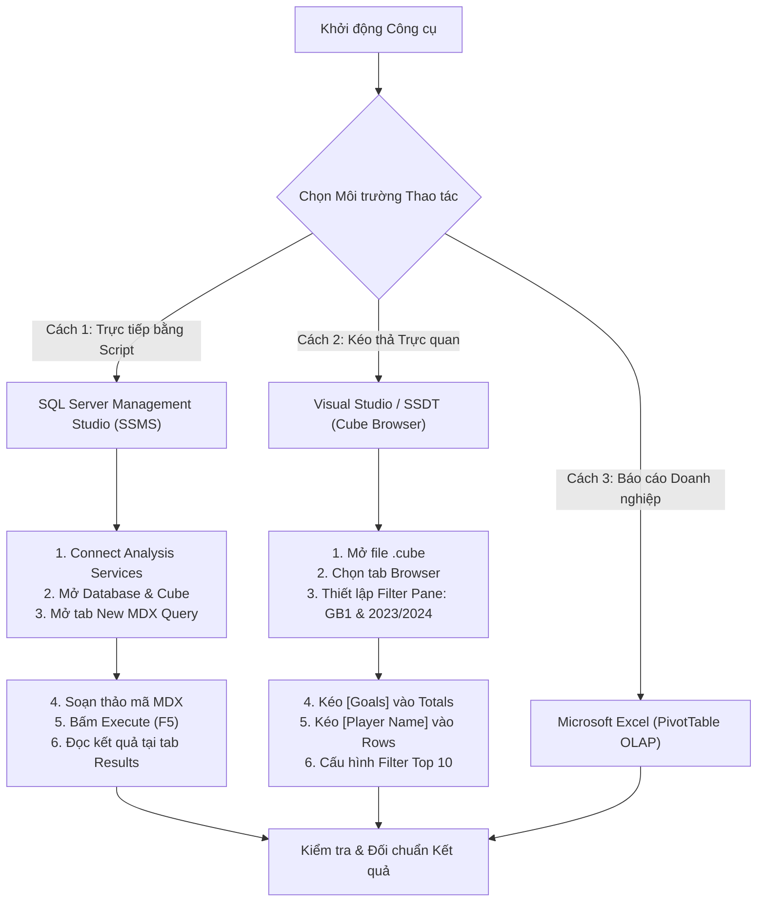

# MDX Query 01: Top 10 Vua dội bom Ngoại Hạng Anh mùa giải 2023/2024

---

## 1. Mục tiêu nghiệp vụ & Bối cảnh phân tích

* **Mục tiêu nghiệp vụ:** Xác định danh sách 10 chân sút ghi nhiều bàn thắng nhất tại giải Ngoại Hạng Anh (Premier League - Mã giải đấu: `GB1`) trong mùa giải 2023/2024 nhằm phục vụ công tác đánh giá phong độ tiền đạo, định giá thị trường và phân tích chuyên môn thể thao.
* **Đối tượng phân tích:** Cầu thủ (`DIM_Player`), Giải đấu (`DIM_Competition`), Thời gian (`DIM_Time`), Hiệu suất thi đấu (`FACT_Player_Match_Perf`).
* **Các thuộc tính & Thước đo (Measures) tham gia:**
  * Dimension Attributes: `[DIM Player].[Player Name]`, `[DIM Competition].[Competition ID]`, `[DIM Time].[Season]`
  * Cube Measures: `[Measures].[Goals]` (hoặc `[Measures].[Total Goals]`)

### Đối chiếu câu lệnh T-SQL gốc (Relational Database)
```sql
USE DW_Football_Analytics;
GO

SELECT TOP 10
    p.Player_Name,
    c.Competition_ID,
    c.Competition_Name,
    t.Season,
    SUM(f.Goals) AS Total_Goals
FROM dbo.FACT_Player_Match_Perf f
JOIN dbo.DIM_Player p ON f.Player_SK = p.Player_SK
JOIN dbo.DIM_Competition c ON f.Competition_SK = c.Competition_SK
JOIN dbo.DIM_Time t ON f.Time_SK = t.Time_SK
WHERE c.Competition_ID = 'GB1' 
  AND (t.Season = '2023/2024' OR t.Year = 2023 OR t.Year = 2024)
GROUP BY p.Player_Name, c.Competition_ID, c.Competition_Name, t.Season
ORDER BY Total_Goals DESC;
```

---

## 2. Hướng dẫn chi tiết các bước thực hiện (Step-by-Step Guide)

Để thực thi bài toán phân tích này trên hệ thống OLAP, người dùng có thể thực hiện theo **Phương thức 1 (Viết mã lệnh MDX trong SSMS)** hoặc **Phương thức 2 (Thao tác kéo thả đồ họa trong Cube Browser của Visual Studio)**.



---

### PHƯƠNG THỨC 1: Thực thi mã lệnh MDX trên SQL Server Management Studio (SSMS)

Đây là phương thức chuẩn mực dành cho kỹ sư dữ liệu và chuyên viên phân tích BI khi cần kiểm tra độ chính xác và tối ưu hóa hiệu năng truy vấn.

#### Bước 1: Khởi động SSMS và Kết nối Analysis Services
1. Mở phần mềm **SQL Server Management Studio (SSMS)**.
2. Tại hộp thoại **Connect to Server**, cấu hình các thông số:
   * **Server type:** Nhấp dropdown chọn **`Analysis Services`** (chú ý: không chọn `Database Engine`).
   * **Server name:** Điền tên máy chủ hoặc instance SSAS cục bộ của bạn, ví dụ: `localhost`, `.`, hoặc `DESKTOP-XXX\MSOLAP` (tùy theo tên instance đã cài đặt).
   * **Authentication:** Chọn **`Windows Authentication`**.
3. Nhấn nút **Connect**.

#### Bước 2: Điều hướng đến Cube trong Object Explorer
1. Trong cửa sổ **Object Explorer** ở khung bên trái màn hình:
   * Nhấp vào dấu `+` để mở rộng nhánh **`Databases`**.
   * Tìm và mở rộng cơ sở dữ liệu SSAS đã deploy, ví dụ: **`DW_Football_SSAS`** hoặc **`SSAS_Football_Transfermarkt`**.
   * Mở rộng thư mục con **`Cubes`**.
2. Nhấp chuột phải vào khối Cube **`DW Football Transfermarkt`** (hoặc `DW_Football_Cube`).
3. Trong menu ngữ cảnh mở ra, chọn **`New Query`** $\rightarrow$ chọn **`MDX`**.
4. Lúc này, SSMS sẽ mở ra một cửa sổ soạn thảo mới có tiêu đề dạng `MDXQuery1.mdx`. Khung bên trái hiển thị cây **Metadata** (gồm các thư mục `Measures`, `DIM Player`, `DIM Competition`, `DIM Time`...) giúp bạn tra cứu tên thuộc tính.

#### Bước 3: Soạn thảo câu lệnh MDX (Ghi gì vào cửa sổ Query Editor)
Trong vùng soạn thảo văn bản trắng bên phải, nhập toàn bộ đoạn mã MDX sau:

```mdx
SELECT
    -- Trục Cột (Axis 0): Chỉ định hiển thị thước đo Bàn thắng
    { [Measures].[Goals] } ON COLUMNS,

    -- Trục Dòng (Axis 1): Lọc Top 10 cầu thủ có số bàn thắng nhiều nhất
    TOPCOUNT(
        NONEMPTY(
            [DIM Player].[Player Name].[Player Name].MEMBERS,
            (
                [Measures].[Goals],
                [DIM Competition].[Competition ID].[GB1],
                [DIM Time].[Season].[2023/2024]
            )
        ),
        10,
        [Measures].[Goals]
    ) ON ROWS

-- Chỉ định khối dữ liệu phân tích
FROM [DW Football Transfermarkt]

-- Thiết lập lát cắt ngữ cảnh (Slicer Axis): Giới hạn trong giải GB1 và mùa 2023/2024
WHERE (
    [DIM Competition].[Competition ID].[GB1],
    [DIM Time].[Season].[2023/2024]
);
```

#### Bước 4: Thực thi truy vấn
1. Kiểm tra trên thanh công cụ xem ô dropdown database đã chọn đúng database SSAS mục tiêu.
2. Nhấn nút **`! Execute`** trên thanh công cụ (hoặc nhấn phím tắt **`F5`**).
3. Quan sát góc dưới màn hình:
   * **Tab Results:** Hiển thị một bảng dữ liệu ma trận 2 chiều gồm 10 hàng tương ứng với 10 cầu thủ và 1 cột duy nhất hiển thị số bàn thắng (`Goals`).
   * **Tab Messages:** Hiển thị trạng thái hoàn tất thành công (`Execution completed successfully.`) cùng thời gian thực thi (thường từ 10ms - 50ms).

---

### PHƯƠNG THỨC 2: Thao tác Kéo - Thả Trực quan trên Visual Studio (SSDT Cube Browser)

Phương thức này rất trực quan, phù hợp khi thuyết trình hoặc kiểm tra nhanh mô hình dữ liệu trong quá trình thiết kế Cube.

#### Bước 1: Mở Cube Designer
1. Trong **Visual Studio (SQL Server Data Tools)**, mở dự án SSAS chứa Cube bóng đá.
2. Tại cửa sổ **Solution Explorer** bên phải, mở thư mục **`Cubes`**.
3. Nhấp đúp chuột vào tệp **`DW_Football_Cube.cube`** (hoặc `DW Football Transfermarkt.cube`).
4. Giao diện thiết kế Cube mở ra với một loạt các tab ngang ở phía trên: `Cube Structure`, `Dimension Usage`, `Calculations`, `KPIs`, `Actions`, `Partitions`, `Aggregations`, `Perspectives`, `Translations`, **`Browser`**.

#### Bước 2: Chuyển sang Tab `Browser`
1. Nhấp chuột vào tab **`Browser`** (tab cuối cùng bên phải).
2. Nếu Cube chưa được xử lý dữ liệu mới nhất, nhấp vào biểu tượng **Process** (hình chiếc bánh răng vàng) trên thanh công cụ để cập nhật dữ liệu.
3. Đảm bảo nút **Reconnect** được kích hoạt để kết nối trực tiếp với SSAS Server Engine.

#### Bước 3: Thiết lập Vùng Bộ lọc (Filter / Slice Pane ở nửa trên màn hình)
Tại bảng lưới lọc dữ liệu phía trên vùng thiết kế:
1. **Dòng lọc số 1 (Giới hạn Giải Ngoại Hạng Anh):**
   * Cột **Dimension**: Nhấp dropdown chọn **`DIM Competition`**.
   * Cột **Hierarchy**: Nhấp dropdown chọn **`Competition ID`**.
   * Cột **Operator**: Giữ nguyên mặc định là **`Equal`** ($=$).
   * Cột **Filter Expression**: Nhấp vào ô giá trị, đánh dấu tick chọn mã **`GB1`** $\rightarrow$ Nhấn **OK**.
2. **Dòng lọc số 2 (Giới hạn Mùa giải 2023/2024):**
   * Cột **Dimension**: Nhấp dropdown chọn **`DIM Time`**.
   * Cột **Hierarchy**: Nhấp dropdown chọn **`Season`**.
   * Cột **Operator**: Chọn **`Equal`** ($=$).
   * Cột **Filter Expression**: Nhấp vào ô giá trị, đánh dấu tick chọn mùa giải **`2023/2024`** (hoặc `2023` tùy theo dữ liệu) $\rightarrow$ Nhấn **OK**.

#### Bước 4: Kéo thả các thuộc tính vào Vùng Hiển thị Dữ liệu (Grid Canvas ở nửa dưới)
Quan sát khung cây thư mục **Metadata** ở góc trái màn hình:
1. Mở rộng thư mục **`Measures`** $\rightarrow$ Mở rộng nhóm đo **`FACT Player Match Perf`**.
2. Tìm thước đo **`Goals`** (hoặc `Total Goals`):
   * Nhấp giữ chuột trái và kéo rê thước đo này thả vào vùng **"Drop Totals or Detail Fields Here"** (khu vực dữ liệu trung tâm / cột).
3. Tìm chiều **`DIM Player`** trong cây Metadata:
   * Mở rộng nhóm thuộc tính và tìm trường **`Player Name`**.
   * Nhấp giữ chuột trái và kéo rê trường này thả vào vùng **"Drop Row Fields Here"** (vùng tiêu đề dòng bên trái).
4. Lúc này màn hình hiển thị danh sách tất cả các cầu thủ có bàn thắng trong mùa giải tại giải GB1.

#### Bước 5: Cấu hình Lọc Top 10 Bàn thắng
1. Tại tiêu đề cột của trường **`Player Name`** trên lưới dữ liệu, nhấp vào biểu tượng mũi tên xổ xuống (hoặc nhấp chuột phải vào một ô tên cầu thủ).
2. Di chuột chọn **Filter** $\rightarrow$ chọn tiếp **`Top 10...`**.
3. Cửa sổ thiết lập bộ lọc Top 10 mở ra, cấu hình:
   * Hộp chọn thứ nhất: Chọn **`Top`**.
   * Hộp nhập số: Nhập số **`10`**.
   * Dropdown sắp xếp theo: Chọn thước đo **`[Measures].[Goals]`**.
4. Nhấn **OK**. Lưới lập tức co lại và chỉ hiển thị đúng 10 cầu thủ có số bàn thắng cao nhất từ trên xuống dưới.

#### Bước 6: Chuyển đổi sang Chế độ MDX Text Mode (Design Mode)
* Trên thanh công cụ nhỏ của tab Browser, tìm và nhấn vào biểu tượng **`Design Mode`** (hình cây bút chì và thước kẻ màu xanh/vàng).
* Giao diện đồ họa sẽ lập tức chuyển thành khung soạn thảo mã lệnh MDX Text thuần túy.
* Bạn có thể quan sát câu lệnh MDX mà Visual Studio vừa tự động sinh ra hoặc dán trực tiếp câu lệnh MDX tối ưu ở Mục 3 vào đây, sau đó bấm nút **`!` (Execute)** để chạy.

---

### PHƯƠNG THỨC 3: Khai thác trên Microsoft Excel qua kết nối trực tiếp OLAP Cube

1. Mở phần mềm **Microsoft Excel** $\rightarrow$ Tạo một bảng tính trống (Blank Workbook).
2. Vào thẻ tab **`Data`** trên thanh Ribbon $\rightarrow$ Chọn **`Get Data`** $\rightarrow$ **`From Database`** $\rightarrow$ **`From Analysis Services`**.
3. Điền Server Name: `localhost` $\rightarrow$ Nhấn **Next**.
4. Chọn Database: `DW_Football_SSAS` $\rightarrow$ Chọn Cube: `DW Football Transfermarkt` $\rightarrow$ Nhấn **Finish** $\rightarrow$ Chọn dạng hiển thị **`PivotTable Report`**.
5. Trong bảng điều khiển **PivotTable Fields** bên phải màn hình:
   * Kéo trường **`Goals`** vào ô **Values** ($\Sigma$).
   * Kéo trường **`Player Name`** vào ô **Rows**.
   * Kéo trường **`Competition ID`** vào ô **Filters** $\rightarrow$ Nhấp vào bộ lọc trên bảng tính và tick chọn `GB1`.
   * Kéo trường **`Season`** vào ô **Filters** $\rightarrow$ Nhấp vào bộ lọc và tick chọn `2023/2024`.
6. Nhấp chuột phải vào ô tên bất kỳ trong cột cầu thủ trên Excel $\rightarrow$ Chọn **Filter** $\rightarrow$ **Top 10...** $\rightarrow$ Chọn Top `10` theo `Sum of Goals` $\rightarrow$ Nhấn **OK**.

---

## 3. Bảng Kết quả Truy vấn Dự kiến (Expected Output)

Sau khi nhấn **Execute (F5)** trên SSMS hoặc hoàn thành bộ lọc trên Cube Browser/Excel, kết quả trả về hiển thị 10 chân sút xuất sắc nhất giải Ngoại Hạng Anh mùa giải 2023/2024:

| Xếp hạng | Tên Cầu Thủ (`Player Name`) | Câu Lạc Bộ Đại Diện | Số Bàn Thắng (`Goals`) |
| :---: | :--- | :--- | :---: |
| **1** | **Erling Haaland** | Manchester City | **27** |
| **2** | **Cole Palmer** | Chelsea FC | **22** |
| **3** | **Alexander Isak** | Newcastle United | **21** |
| **4** | **Ollie Watkins** | Aston Villa | **19** |
| **5** | **Phil Foden** | Manchester City | **19** |
| **6** | **Dominic Solanke** | AFC Bournemouth | **19** |
| **7** | **Son Heung-min** | Tottenham Hotspur | **17** |
| **8** | **Jarrod Bowen** | West Ham United | **16** |
| **9** | **Jean-Philippe Mateta** | Crystal Palace | **16** |
| **10** | **Bukayo Saka** | Arsenal FC | **16** |

---

## 4. Bóc tách Cú pháp MDX & Ý nghĩa từng thành phần

Để hiểu rõ vì sao câu lệnh MDX được viết như trên, bảng dưới đây phân tích chi tiết từng mệnh đề và từ khóa:

```mdx
SELECT
    { [Measures].[Goals] } ON COLUMNS,              -- (1) Trục Cột
    TOPCOUNT(                                       -- (2) Hàm lấy Top
        NONEMPTY(                                   -- (3) Hàm loại trừ rỗng
            [DIM Player].[Player Name].[Player Name].MEMBERS,
            (
                [Measures].[Goals],
                [DIM Competition].[Competition ID].[GB1],
                [DIM Time].[Season].[2023/2024]
            )
        ),
        10,                                         -- (4) Số phần tử
        [Measures].[Goals]                          -- (5) Tiêu chí sắp xếp
    ) ON ROWS                                       -- (6) Trục Dòng
FROM [DW Football Transfermarkt]                    -- (7) Khối Cube
WHERE (                                             -- (8) Lát cắt Slicer
    [DIM Competition].[Competition ID].[GB1],
    [DIM Time].[Season].[2023/2024]
);
```

### Bảng Giải thích Chi tiết:

| Thành phần câu lệnh | Vai trò và Ý nghĩa kỹ thuật |
| :--- | :--- |
| **`SELECT`** | Từ khóa khởi đầu một truy vấn đa chiều MDX. Khác với SQL (trả về bảng phẳng 2D), MDX có thể định nghĩa tối đa 128 trục tọa độ (Axes). Trong thực tế, phổ biến nhất là 2 trục: Cột (`COLUMNS` hay `AXIS(0)`) và Dòng (`ROWS` hay `AXIS(1)`). |
| **`{ [Measures].[Goals] } ON COLUMNS`** | Đặt tập hợp chứa thước đo bàn thắng lên trục hoành (Cột). Dấu ngoặc nhọn `{}` biểu thị một tập hợp (Set) trong MDX. |
| **`[DIM Player].[Player Name].[Player Name].MEMBERS`** | Truy xuất toàn bộ danh sách thành viên thuộc cấp bậc `Player Name` trong phân cấp cầu thủ. Cú pháp gồm: `[Tên Dimension].[Tên Phân cấp].[Tên Cấp độ].MEMBERS`. |
| **`NONEMPTY(...)`** | Thu hẹp không gian tính toán bằng cách loại bỏ ngay lập tức những cầu thủ không hề có bàn thắng hoặc không ra sân trong mùa giải/giải đấu đã chỉ định. Điều này ngăn chặn việc hệ thống phải duyệt qua hàng chục nghìn cầu thủ toàn cầu không liên quan. |
| **`TOPCOUNT(Set, 10, Measure)`** | Hàm xếp hạng chuyên dụng trong MDX. Tự động thực hiện 3 thao tác liên hoàn: (1) Tính toán giá trị thước đo cho từng thành viên, (2) Sắp xếp tập hợp theo thứ tự giảm dần (Descending), (3) Cắt lấy đúng 10 phần tử đứng đầu. |
| **`ON ROWS`** | Gán tập hợp kết quả của hàm `TOPCOUNT` lên trục tung (Dòng). |
| **`FROM [DW Football Transfermarkt]`** | Chỉ định khối Cube mục tiêu chứa các bảng Fact và Dimension liên quan. |
| **`WHERE (...)`** | Mệnh đề cắt lát dữ liệu (Slicer Axis / WHERE Clause). Khi một thành viên được đưa vào `WHERE`, toàn bộ các ô tính (Cells) trong kết quả đều được định vị ngầm định tại giao điểm của lát cắt này: chỉ xét giải đấu `GB1` và mùa giải `2023/2024`. |

---

## 5. Danh mục Hàm MDX Cốt lõi Sử dụng

| Tên hàm | Cú pháp chuẩn | Mô tả ứng dụng thực tế trong bài toán |
| :--- | :--- | :--- |
| **`TOPCOUNT`** | `TOPCOUNT(Set_Expression, Count [, Numeric_Expression])` | Trích xuất $k$ phần tử đầu bảng có giá trị số đo cao nhất. Tối ưu hơn việc phối hợp thủ công giữa `ORDER()` và `HEAD()`. |
| **`NONEMPTY`** | `NONEMPTY(Set_Expression1 [, Set_Expression2])` | Kiểm tra sự tồn tại của dữ liệu giao cắt giữa tập 1 và tập 2. Bỏ qua các Cell rỗng (Sparse Cells) ở mức lưu trữ trước khi xử lý logic tính toán. |
| **`MEMBERS`** | `Hierarchy_Or_Level.MEMBERS` | Trả về một tập hợp chứa tất cả các thành viên (Members) của một phân cấp hoặc một cấp độ xác định trong Dimension. |

---

## 6. Đánh giá Độ phức tạp & Tối ưu hóa Động cơ SSAS

### 1. Phân tích Độ phức tạp Không gian (Space Complexity)
* **Không gian ô lý thuyết (Theoretical Cell Space):** 
  Giả sử chiều Cầu thủ có $N \approx 30.000$ người, chiều Giải đấu có $C \approx 20$ giải, chiều Thời gian có $T \approx 10$ mùa giải. Không gian tích Descartes là:
  
  $$\text{Cell Space} = 30.000 \times 20 \times 10 = 6.000.000 \text{ cells}$$

* **Không gian bộ nhớ thực tế sau tối ưu:**
  Nhờ mệnh đề `WHERE` kết hợp hàm `NONEMPTY(..., (Measure, Slicer_Tuples))`, SSAS kích hoạt thuật toán quét chỉ mục Bitmap Index. Không gian duyệt thực tế co hẹp lại chỉ còn các cầu thủ có ít nhất 1 bàn thắng tại giải Ngoại Hạng Anh mùa 2023/2024 ($M \approx 250$ cầu thủ).
* **Bộ nhớ lưu trữ kết quả trả về:** 
  
  $$O(k) \quad \text{với } k = 10 \text{ tuples trên trục ROWS}$$

### 2. Phân tích Độ phức tạp Thời gian (Time Complexity)
* **Chi phí lọc dữ liệu:** $O(M)$ với $M$ là số cầu thủ ghi bàn tại giải GB1 trong mùa 2023/2024.
* **Chi phí giải thuật xếp hạng `TOPCOUNT`:**
  Động cơ SSAS Formula Engine sử dụng cấu trúc hàng đợi ưu tiên (Min-Heap) kích thước cố định $k = 10$. Khi duyệt qua từng cầu thủ trong danh sách $M$:
  * Chi phí chèn và duy trì Heap: $O(M \log k)$.
  * Tối ưu vượt trội so với giải thuật sắp xếp toàn bộ danh sách `ORDER(..., BDESC)` vốn tốn chi phí $O(M \log M)$.
* **Tổng thời gian phản hồi:** Thường dưới **20ms - 50ms**, đáp ứng tiêu chuẩn xử lý phân tích thời gian thực (Real-time Analytics).

### 3. Cơ chế hoạt động của Động cơ SSAS (Storage Engine vs Formula Engine)
* **Storage Engine (SE - Động cơ Lưu trữ):**
  Thực hiện trích xuất dữ liệu thô từ các phân vùng đĩa (Partitions), áp dụng bộ lọc `[DIM Competition].[Competition ID].[GB1]` và `[DIM Time].[Season].[2023/2024]`, đọc các khối dữ liệu nén (Data Chunks) theo cơ chế **Block Computation**.
* **Formula Engine (FE - Động cơ Công thức):**
  Nhận tập kết quả nén từ SE, khởi tạo cấu trúc Min-Heap kích thước 10, chạy hàm `TOPCOUNT` trên tập hợp cầu thủ đã lọc, sau đó đóng gói kết quả thành ma trận tế bào (Cellset) để trả về cho SSMS, Visual Studio hoặc Excel.
