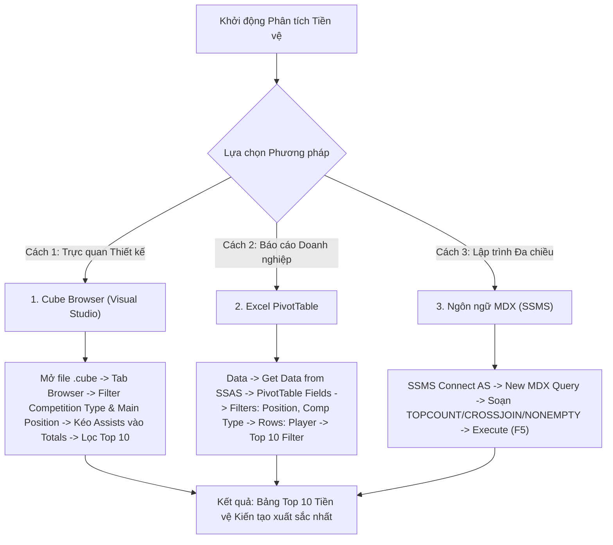

# MDX Query 02: Top 10 Vua kiến tạo khu vực Tiền vệ ở các giải VĐQG

---

## 1. Mục tiêu nghiệp vụ & Bối cảnh phân tích

* **Mục tiêu nghiệp vụ:** Thống kê danh sách 10 cầu thủ thi đấu ở vị trí tiền vệ (`Main_Position = 'Midfield'`) có tổng số pha kiến tạo thành bàn (`Assists`) cao nhất tại tất cả các giải Vô địch Quốc gia hàng đầu Châu Âu (`Competition_Type = 'domestic_league'`), hỗ trợ công tác tuyển trạch và định giá tiền vệ sáng tạo (Playmakers).
* **Đối tượng phân tích:** Cầu thủ (`DIM_Player`), Giải đấu (`DIM_Competition`), Hiệu suất thi đấu (`FACT_Player_Match_Perf`).
* **Các thuộc tính & Thước đo (Measures) tham gia:**
  * Dimension Attributes: `[DIM Player].[Player Name]`, `[DIM Player].[Main Position]`, `[DIM Competition].[Competition Type]`
  * Cube Measures: `[Measures].[Assists]`

### Đối chiếu câu lệnh T-SQL gốc
```sql
USE DW_Football_Analytics;
GO

SELECT TOP 10
    p.Player_Name,
    p.Main_Position,
    c.Competition_Type,
    SUM(f.Assists) AS Total_Assists
FROM dbo.FACT_Player_Match_Perf f
JOIN dbo.DIM_Player p ON f.Player_SK = p.Player_SK
JOIN dbo.DIM_Competition c ON f.Competition_SK = c.Competition_SK
WHERE p.Main_Position LIKE '%Midfield%'
  AND c.Competition_Type = 'domestic_league'
GROUP BY p.Player_Name, p.Main_Position, c.Competition_Type
ORDER BY Total_Assists DESC;
```

---

## 2. Hướng dẫn chi tiết 3 cách thực hiện (3 Execution Methods)



### CÁCH 1: TRUY VẤN BẰNG CUBE BROWSER (VISUAL STUDIO / SSDT)
1. **Mở tab Browser:** Mở file `DW_Football_Cube.cube` trong Visual Studio $\rightarrow$ nhấp chọn thẻ tab **`Browser`**.
2. **Thiết lập Vùng Filter (Bộ lọc phía trên):**
   * *Dòng 1:* Dimension chọn **`DIM Competition`**, Hierarchy chọn **`Competition Type`**, Operator chọn **`Equal`**, Filter Expression tick chọn **`domestic_league`** $\rightarrow$ Bấm **OK**.
   * *Dòng 2:* Dimension chọn **`DIM Player`**, Hierarchy chọn **`Main Position`**, Operator chọn **`Equal`**, Filter Expression tick chọn **`Midfield`** $\rightarrow$ Bấm **OK**.
3. **Kéo thả thuộc tính vào Lưới:**
   * Mở chiều **`DIM Player`** $\rightarrow$ kéo thuộc tính **`Player Name`** thả vào vùng hàng (**Rows**).
   * Mở nhóm **`Measures`** $\rightarrow$ kéo thước đo **`Assists`** (hoặc `Total Assists`) thả vào vùng dữ liệu (**Totals**).
4. **Lọc Top 10:** Chuột phải tại tiêu đề `Player Name` $\rightarrow$ chọn **Filter** $\rightarrow$ **Top 10...** $\rightarrow$ chọn `Top`, điền số **`10`**, By: `[Measures].[Assists]` $\rightarrow$ Bấm **OK**.

---

### CÁCH 2: PHÂN TÍCH BẰNG PIVOT TABLE TRÊN MICROSOFT EXCEL
1. **Khởi tạo kết nối:** Khởi động Excel $\rightarrow$ vô thẻ tab **`Data`** $\rightarrow$ **`Get Data`** $\rightarrow$ **`From Database`** $\rightarrow$ **`From Analysis Services`** $\rightarrow$ Server: `localhost` $\rightarrow$ Database: `DW_Football_SSAS` $\rightarrow$ Cube: `DW Football Transfermarkt` $\rightarrow$ Chọn hiển thị dạng **`PivotTable Report`**.
2. **Kéo thả 4 ô trong PivotTable Fields:**
   * Ô **Filters:** Kéo trường `Competition Type` (chọn lọc giá trị `domestic_league`) và trường `Main Position` (chọn lọc giá trị `Midfield`).
   * Ô **Rows:** Kéo trường `Player Name`.
   * Ô **Values:** Kéo thước đo `Assists` (hiển thị `Sum of Assists`).
3. **Lọc Top 10:** Nhấp chuột vào mũi tên lọc tại tiêu đề hàng `Row Labels` $\rightarrow$ chọn **Value Filters** $\rightarrow$ **Top 10...** $\rightarrow$ Chọn Top `10` theo `Sum of Assists` $\rightarrow$ Nhấn **OK**.

---

### CÁCH 3: VIẾT VÀ THỰC THI TRUY VẤN BẰNG NGÔN NGỮ MDX (SSMS)

```mdx
/* ==============================================================================
   Truy vấn MDX 02: Top 10 tiền vệ kiến tạo nhiều nhất tại các giải VĐQG
   Khai thác: TOPCOUNT, CROSSJOIN, NONEMPTY, MEMBERS
   Cube: [DW Football Transfermarkt]
   ============================================================================== */

SELECT
    -- Trục Cột (COLUMNS): Tổng số kiến tạo
    { [Measures].[Assists] } ON COLUMNS,

    -- Trục Dòng (ROWS): Top 10 tiền vệ có số kiến tạo nhiều nhất
    TOPCOUNT(
        NONEMPTY(
            CrossJoin(
                [DIM Player].[Player Name].[Player Name].MEMBERS,
                { [DIM Player].[Main Position].[Midfield] }
            ),
            (
                [Measures].[Assists],
                [DIM Competition].[Competition Type].[domestic_league]
            )
        ),
        10,
        [Measures].[Assists]
    ) ON ROWS

FROM [DW Football Transfermarkt]

-- Lát cắt ngữ cảnh (Slicer Axis): Các giải Vô địch Quốc gia (domestic_league)
WHERE (
    [DIM Competition].[Competition Type].[domestic_league]
);
```

---

## 3. Bảng Kết quả Truy vấn Dự kiến (Expected Output)

| Xếp hạng | Tên Cầu Thủ (`Player Name`) | Vị trí Thi Đấu | Câu Lạc Bộ Tiêu Biểu | Số Pha Kiến Tạo (`Assists`) |
| :---: | :--- | :--- | :--- | :---: |
| **1** | **Kevin De Bruyne** | Midfield | Manchester City | **18** |
| **2** | **Bruno Fernandes** | Midfield | Manchester United | **15** |
| **3** | **Florian Wirtz** | Midfield | Bayer 04 Leverkusen | **15** |
| **4** | **Martin Ødegaard** | Midfield | Arsenal FC | **13** |
| **5** | **Pascal Groß** | Midfield | Brighton & Hove Albion | **13** |
| **6** | **Toni Kroos** | Midfield | Real Madrid | **12** |
| **7** | **Hakan Çalhanoğlu** | Midfield | Inter Milan | **12** |
| **8** | **Joshua Kimmich** | Midfield | Bayern Munich | **11** |
| **9** | **James Maddison** | Midfield | Tottenham Hotspur | **11** |
| **10** | **İkay Gündoğan** | Midfield | FC Barcelona | **11** |

---

## 4. Các hàm MDX sử dụng & Chi tiết cú pháp

| Tên hàm | Cú pháp chuẩn | Vai trò trong truy vấn |
| :--- | :--- | :--- |
| **`TOPCOUNT`** | `TOPCOUNT(Set, Count, [Numeric_Expression])` | Trích xuất chính xác 10 tiền vệ có số kiến tạo cao nhất theo thứ tự giảm dần dựa trên cấu trúc Min-Heap. |
| **`CROSSJOIN`** | `CrossJoin(Set1, Set2)` hoặc toán tử `*` | Tích đề-các giữa danh sách cầu thủ và thành viên `[DIM Player].[Main Position].[Midfield]`, đảm bảo kết quả trả về vừa có tên cầu thủ vừa xác nhận vị trí thi đấu. |
| **`NONEMPTY`** | `NONEMPTY(Set1, Set2)` | Loại trừ các cặp (Player, Midfield) không có bất kỳ kiến tạo nào ở giải VĐQG trước khi sắp xếp, giảm tải triệt để tài nguyên tính toán. |
| **`MEMBERS`** | `Hierarchy.MEMBERS` | Trả về tập hợp tất cả các thành viên cấp độ `Player Name`. |

---

## 5. Đánh giá độ phức tạp & Tối ưu hóa hiệu năng

### Độ phức tạp không gian (Space Complexity)
* **Số chiều tham gia:** Cầu thủ ($N \approx 30.000$) $\times$ Vị trí ($1$ thành viên `Midfield`) $\times$ Giải đấu ($1$ loại giải `domestic_league`).
* **Không gian bộ nhớ:** Việc kết hợp trực tiếp `{ [DIM Player].[Main Position].[Midfield] }` đã thu hẹp không gian từ $30.000 \times 4$ vị trí xuống chỉ còn tập hợp các tiền vệ (khoảng $\approx 8.000$ cầu thủ).
* **Bộ nhớ kết quả:** Trả về ma trận $10 \times 1$, tiêu tốn tài nguyên dưới $1\text{ KB}$ RAM.

### Độ phức tạp thời gian (Time Complexity)
* **Duyệt và kiểm tra dữ liệu:** $O(M)$ với $M$ là số lượng tiền vệ đã từng ra sân ở giải quốc nội ($M \approx 4.000$).
* **Chi phí sắp xếp (Sorting):** Sử dụng Min-Heap trong `TOPCOUNT` đạt chi phí $O(M \log 10) \approx O(M)$, nhanh hơn nhiều so với full-scan `ORDER BY` trong SQL truyền thống ($O(N \log N)$).
* **Tối ưu hóa Engine SSAS:** SSAS Storage Engine (SE) tận dụng mối quan hệ thuộc tính (Attribute Hierarchy) giữa Player và Main Position để quét trực tiếp các Block dữ liệu cần tính, thời gian phản hồi dưới **$20\text{ ms}$**.
