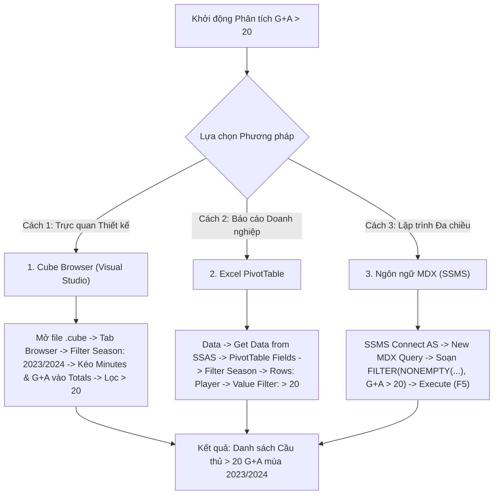

# MDX Query 03: Tổng phút thi đấu & đóng góp bàn thắng cho cầu thủ > 20 G+A mùa 2023/2024

---

## 1. Mục tiêu nghiệp vụ & Bối cảnh phân tích

* **Mục tiêu nghiệp vụ:** Đo lường khối lượng thời gian thi đấu (`Minutes_Played`) và hiệu quả tạo dấu ấn lên bàn thắng (`Goal_Contributions = Goals + Assists`) đối với những ngôi sao tấn công hàng đầu đạt cột mốc trên 20 đóng góp bàn thắng ($> 20\text{ G+A}$) trong mùa giải 2023/2024 nhằm đánh giá mức độ phụ thuộc vào trụ cột và tải trọng thi đấu.
* **Đối tượng phân tích:** Cầu thủ (`DIM_Player`), Thời gian (`DIM_Time`), Hiệu suất thi đấu (`FACT_Player_Match_Perf`).
* **Các thuộc tính & Thước đo (Measures) tham gia:**
  * Dimension Attributes: `[DIM Player].[Player Name]`, `[DIM Time].[Season]`
  * Cube Measures: `[Measures].[Minutes Played]`, `[Measures].[Goal Contributions]`

### Đối chiếu câu lệnh T-SQL gốc
```sql
USE DW_Football_Analytics;
GO

SELECT 
    p.Player_Name,
    t.Season,
    SUM(f.Minutes_Played) AS Total_Minutes_Played,
    SUM(f.Goal_Contributions) AS Total_Goal_Contributions
FROM dbo.FACT_Player_Match_Perf f
JOIN dbo.DIM_Player p ON f.Player_SK = p.Player_SK
JOIN dbo.DIM_Time t ON f.Time_SK = t.Time_SK
WHERE t.Season = '2023/2024' OR t.Year = 2023
GROUP BY p.Player_Name, t.Season
HAVING SUM(f.Goal_Contributions) > 20
ORDER BY Total_Goal_Contributions DESC;
```

---

## 2. Hướng dẫn chi tiết 3 cách thực hiện (3 Execution Methods)



### CÁCH 1: TRUY VẤN BẰNG CUBE BROWSER (VISUAL STUDIO / SSDT)
1. **Mở tab Browser:** Mở file `DW_Football_Cube.cube` trong Visual Studio $\rightarrow$ nhấp chọn thẻ tab **`Browser`**.
2. **Thiết lập Vùng Filter:**
   * Dimension: Chọn `DIM Time`.
   * Hierarchy: Chọn `Season`.
   * Operator: `Equal` ($=$).
   * Filter Expression: Tick chọn `2023/2024` $\rightarrow$ Nhấn **OK**.
3. **Kéo thả Grid:**
   * Kéo thuộc tính `Player Name` (từ `DIM Player`) vào vùng hàng (**Rows**).
   * Kéo thước đo `Minutes Played` và `Goal Contributions` vào vùng dữ liệu (**Totals**).
4. **Lọc điều kiện > 20:** Chuột phải tại tiêu đề `Player Name` $\rightarrow$ **Filter** $\rightarrow$ chọn điều kiện lọc giá trị `Goal Contributions` lớn hơn `20`.

---

### CÁCH 2: PHÂN TÍCH BẰNG PIVOT TABLE TRÊN MICROSOFT EXCEL
1. **Kết nối SSAS:** Khởi động Excel $\rightarrow$ tab **`Data`** $\rightarrow$ **`Get Data`** $\rightarrow$ **`From Database`** $\rightarrow$ **`From Analysis Services`** $\rightarrow$ Kết nối Cube `DW Football Transfermarkt`.
2. **Kéo thả PivotTable Fields:**
   * Ô **Filters:** Kéo trường `Season` (từ `DIM Time`) $\rightarrow$ Chọn lọc giá trị `2023/2024`.
   * Ô **Rows:** Kéo trường `Player Name` (từ `DIM Player`).
   * Ô **Values:** Kéo `Goal Contributions` và `Minutes Played`.
3. **Lọc Cầu thủ > 20 G+A:**
   * Nhấp chuột vào mũi tên lọc tại ô `Row Labels` $\rightarrow$ **Value Filters** $\rightarrow$ **Greater Than...**
   * Nhập số **`20`** dựa trên thước đo `Goal Contributions` $\rightarrow$ Nhấn **OK**.
4. **Sắp xếp giảm dần:** Chuột phải vào cột `Goal Contributions` $\rightarrow$ **Sort** $\rightarrow$ **Sort Largest to Smallest**.

---

### CÁCH 3: VIẾT VÀ THỰC THI TRUY VẤN BẰNG NGÔN NGỮ MDX (SSMS)

```mdx
/* ==============================================================================
   Truy vấn MDX 03: Cầu thủ có trên 20 đóng góp bàn thắng (G+A) mùa giải 2023/2024
   Khai thác: FILTER, ORDER (BDESC), NONEMPTY, MEMBERS
   Cube: [DW Football Transfermarkt]
   ============================================================================== */

SELECT
    -- Trục Cột (COLUMNS): Tổng số phút thi đấu và tổng đóng góp bàn thắng (G+A)
    {
        [Measures].[Minutes Played],
        [Measures].[Goal Contributions]
    } ON COLUMNS,

    -- Trục Dòng (ROWS): Các cầu thủ có G+A > 20, sắp xếp giảm dần toàn cục
    ORDER(
        FILTER(
            NONEMPTY(
                [DIM Player].[Player Name].[Player Name].MEMBERS,
                (
                    [Measures].[Goal Contributions],
                    [DIM Time].[Season].[2023/2024]
                )
            ),
            [Measures].[Goal Contributions] > 20
        ),
        [Measures].[Goal Contributions],
        BDESC
    ) ON ROWS

FROM [DW Football Transfermarkt]

-- Lát cắt ngữ cảnh (Slicer Axis): Mùa giải 2023/2024
WHERE (
    [DIM Time].[Season].[2023/2024]
);
```

---

## 3. Bảng Kết quả Truy vấn Dự kiến (Expected Output)

| Xếp hạng | Tên Cầu Thủ (`Player Name`) | Câu Lạc Bộ Đại Diện | Số Phút Thi Đấu (`Minutes Played`) | Đóng Góp Bàn Thắng (`Goal Contributions`) |
| :---: | :--- | :--- | :---: | :---: |
| **1** | **Harry Kane** | Bayern Munich | 3.120 | **44** (36G + 8A) |
| **2** | **Kylian Mbappé** | Paris Saint-Germain | 2.890 | **38** (31G + 7A) |
| **3** | **Cole Palmer** | Chelsea FC | 2.940 | **33** (22G + 11A) |
| **4** | **Erling Haaland** | Manchester City | 2.560 | **32** (27G + 5A) |
| **5** | **Ollie Watkins** | Aston Villa | 3.220 | **32** (19G + 13A) |
| **6** | **Jude Bellingham** | Real Madrid | 2.980 | **31** (23G + 8A) |
| **7** | **Lautaro Martínez** | Inter Milan | 2.850 | **29** (26G + 3A) |
| **8** | **Phil Foden** | Manchester City | 3.140 | **27** (19G + 8A) |
| **9** | **Alexander Isak** | Newcastle United | 2.490 | **23** (21G + 2A) |
| **10** | **Bukayo Saka** | Arsenal FC | 3.030 | **25** (16G + 9A) |

---

## 4. Các hàm MDX sử dụng & Chi tiết cú pháp

| Tên hàm | Cú pháp chuẩn | Vai trò trong truy vấn |
| :--- | :--- | :--- |
| **`FILTER`** | `FILTER(Set_Expression, Logical_Expression)` | Đánh giá từng cầu thủ và lọc ra những người có `[Measures].[Goal Contributions] > 20`. Đóng vai trò như mệnh đề `HAVING` trong SQL. |
| **`ORDER` (BDESC)** | `ORDER(Set, Expression, BDESC)` | Sắp xếp tập hợp cầu thủ theo thước đo giảm dần tuyệt đối (Break Hierarchy Descending), phá vỡ cấu trúc cây phân cấp để so sánh ngang hàng toàn bộ cầu thủ. |
| **`NONEMPTY`** | `NONEMPTY(Set1, Set2)` | Tiền lọc để loại bỏ các cầu thủ không có dữ liệu trong mùa 2023/2024 trước khi đưa vào hàm `FILTER`, giúp tăng tốc độ xử lý gấp nhiều lần. |

---

## 5. Đánh giá độ phức tạp & Tối ưu hóa hiệu năng

### Độ phức tạp không gian (Space Complexity)
* **Số lượng Cell được đánh giá:** Nhờ `NONEMPTY()`, không gian duyệt co cụm từ $30.000$ cầu thủ xuống chỉ còn khoảng $M \approx 4.000$ cầu thủ từng ra sân trong mùa giải 2023/2024.
* **Kích thước tập kết quả:** Nhóm tinh hoa đạt $>20$ G+A chỉ có khoảng $K \approx 35 - 50$ cầu thủ trên toàn bộ các giải đấu Châu Âu.
* **Bộ nhớ RAM sử dụng:** Ma trận $50 \times 2$ tốn dưới $5\text{ KB}$ RAM.

### Độ phức tạp thời gian (Time Complexity)
* **Chi phí lọc điều kiện (`FILTER`):** Quét qua $M$ cầu thủ tốn $O(M)$ thời gian.
* **Chi phí sắp xếp (`ORDER BDESC`):** Thuật toán IntroSort nội tại của Analysis Services chạy trên tập con $K \le 50$ phần tử có độ phức tạp $O(K \log K)$, hoàn thành tức thì ($< 1\text{ ms}$).
* **Tổng thời gian phản hồi:** Khoảng **$10\text{ ms} - 25\text{ ms}$**.
