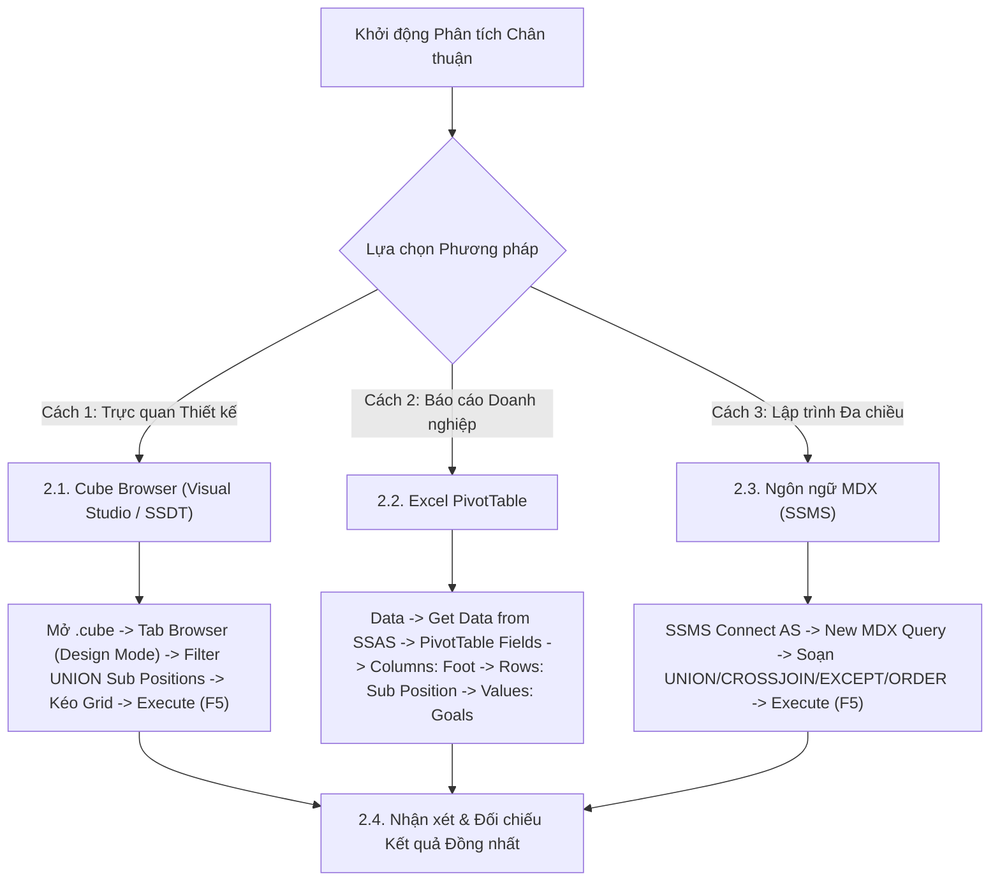

# MDX Query 05: So sánh tổng bàn thắng giữa chân Trái, chân Phải & 2 Chân theo vị trí chi tiết
## (Ứng dụng Phép Hợp Tập Hợp UNION & Tích Đề-các CROSSJOIN)

---

## 1. Nội dung truy vấn & Bối cảnh nghiệp vụ

* **Nội dung truy vấn:** Khảo sát xem đặc điểm chân thuận (`Foot`: Left, Right, Both) tương quan như thế nào với số lượng bàn thắng ghi được ở từng vai trò vị trí cụ thể trên sân cỏ (`Sub_Position` như Centre-Forward, Left Winger, Right Winger, Attacking Midfield, Second Striker). Sử dụng phép toán hợp tập hợp (`UNION`) để gom nhóm các vị trí tiền đạo và tiền vệ tấn công chủ lực, phục vụ công tác phân tích chiến thuật và bố trí cầu thủ chạy cánh nghịch chân (Inverted Wingers).
* **Đối tượng phân tích:** Vị trí chi tiết và chân thuận của cầu thủ (`DIM_Player`), Hiệu suất bàn thắng (`FACT_Player_Match_Perf`).
* **Các thuộc tính & Thước đo tham gia:**
  * Dimension Attributes: `[DIM Player].[Sub Position]`, `[DIM Player].[Foot]`
  * Cube Measures: `[Measures].[Goals]` (Tổng số bàn thắng)

### Đối chiếu câu lệnh T-SQL gốc (Relational Database)
```sql
USE DW_Football_Analytics;
GO

SELECT 
    p.Sub_Position,
    p.Foot,
    SUM(f.Goals) AS Total_Goals
FROM dbo.FACT_Player_Match_Perf f
JOIN dbo.DIM_Player p ON f.Player_SK = p.Player_SK
WHERE p.Foot IS NOT NULL AND p.Sub_Position IS NOT NULL
  AND p.Sub_Position IN ('Centre-Forward', 'Second Striker', 'Left Winger', 'Right Winger', 'Attacking Midfield')
GROUP BY p.Sub_Position, p.Foot
ORDER BY p.Sub_Position, Total_Goals DESC;
```

---

## 2. Hướng dẫn chi tiết 3 cách thực hiện (3 Execution Methods)

Để phân tích tương quan giữa chân thuận và vị trí thi đấu, người dùng có thể áp dụng linh hoạt **3 phương pháp**:



---

### 2.1. Sử dụng Cube Browser (Visual Studio / SSDT)

Phương pháp này được thực hiện trực tiếp trong môi trường phát triển khối đa chiều (SQL Server Data Tools / Visual Studio).

#### Bước 1: Mở giao diện Cube Designer
1. Khởi động **Visual Studio**, mở Solution dự án SSAS (`SSIS_Football_Transfermarkt` hoặc `DW_Football_SSAS`).
2. Trong cửa sổ **Solution Explorer** (khung bên phải):
   * Mở rộng thư mục **`Cubes`**.
   * Nhấp đúp chuột vào tệp khối đa chiều: **`DW_Football_Cube.cube`** (hoặc `DW Football Transfermarkt.cube`).
3. Màn hình Cube Designer xuất hiện với các tab chức năng ở cạnh trên (*Cube Structure*, *Dimension Usage*, *Calculations*, *Partitions*, *Browser*...).

#### Bước 2: Chuyển sang Tab `Browser` & Kích hoạt `Design Mode`
1. Nhấp chọn tab **`Browser`** (tab ngoài cùng bên phải của trình thiết kế Cube).
2. **Kiểm tra trạng thái kết nối & giao diện:**
   * Nếu nút **Reconnect** (biểu tượng 2 phích cắm ở góc trên bên trái) sáng lên: Nhấp vào để kết nối tới SSAS Database.
   * Nếu màn hình đang ở chế độ soạn thảo văn bản thuần (Text Mode): Nhấp vào biểu tượng **`Design Mode`** (hình chiếc Lưới màu xanh có cây thước kẻ/bút chì màu vàng, nằm cạnh nút Stop xám) để chuyển sang giao diện thiết kế đồ họa trực quan (Graphical Query Designer). Khi đó, màn hình sẽ chia làm 2 phần: **Bảng lọc (Filter Pane)** ở trên và **Lưới dữ liệu (Data Grid)** ở dưới.

#### Bước 3: Thiết lập Vùng Bộ lọc (Filter / Slicer Pane ở phía trên)
Tại bảng lưới thiết lập bộ lọc phía trên, ta tạo các dòng lọc để chọn nhóm vị trí tấn công và loại trừ giá trị rỗng/nút All của chân thuận:

| Dòng lọc | Cột Dimension (Chọn gì) | Cột Hierarchy (Chọn gì) | Cột Operator (Chọn gì) | Cột Filter Expression (Ghi / Chọn gì) |
| :---: | :--- | :--- | :---: | :--- |
| **Dòng 1** | Nhấp chọn **`DIM Player`** | Nhấp chọn **`Sub Position`** | Bấm dropdown chọn **`Custom`** (hoặc `MDX`) | Bấm vào ô $\rightarrow$ nhấp nút ba chấm **`...`** để mở cửa sổ *Expression Builder*, dán biểu thức `UNION` bên dưới $\rightarrow$ Bấm **OK** |
| **Dòng 2** | Nhấp chọn **`DIM Player`** | Nhấp chọn **`Foot`** | Bấm dropdown chọn **`Custom`** (hoặc `MDX`) | Bấm vào ô $\rightarrow$ nhấp nút ba chấm **`...`** để mở cửa sổ *Expression Builder*, dán biểu thức `EXCEPT` bên dưới $\rightarrow$ Bấm **OK** |

*Biểu thức nhập vào Expression Builder ở Dòng 1 (Hợp tập hợp các vị trí tấn công & tiền vệ):*
```mdx
UNION(
    { [DIM Player].[Sub Position].[Centre-Forward], [DIM Player].[Sub Position].[Second Striker] },
    { [DIM Player].[Sub Position].[Left Winger], [DIM Player].[Sub Position].[Right Winger], [DIM Player].[Sub Position].[Attacking Midfield] }
)
```

*Biểu thức nhập vào Expression Builder ở Dòng 2 (Loại trừ phần tử All của chân thuận):*
```mdx
EXCEPT([DIM Player].[Foot].[Foot].MEMBERS, { [DIM Player].[Foot].[All] })
```

#### Bước 4: Kéo thả Thuộc tính và Thước đo vào Lưới Dữ liệu (Grid Canvas phía dưới)
Quan sát cây thư mục **Metadata** ở bên trái tab Browser:
1. **Kéo Chiều Vị trí & Chân thuận (Rows/Columns):**
   * Mở rộng chiều **`DIM Player`** $\rightarrow$ tìm thuộc tính **`Sub Position`**: Kéo thả vào vùng chữ trống *"Drag levels or measures here to add to the query"*.
   * Tìm tiếp thuộc tính **`Foot`** trong `DIM Player`: Kéo thả vào ngay bên cạnh cột `Sub Position` (hoặc kéo lên vùng Columns để tạo ma trận chéo 2 chiều).
2. **Kéo Thước đo Bàn thắng (Measures):**
   * Mở rộng thư mục **`Measures`** $\rightarrow$ mở rộng nhóm **`FACT Player Match Perf`**.
   * Nhấp giữ chuột vào thước đo **`Goals`**, kéo và thả vào ngay bên cạnh cột `Foot` trên lưới.

#### Bước 5: Thực thi truy vấn và Xem kết quả
1. Nhấp chuột vào dòng chữ màu xanh **"Click to execute the query"** (hoặc bấm biểu tượng dấu chấm than đỏ **`! Execute`** / phím tắt **F5** trên thanh công cụ).
2. Lưới dữ liệu lập tức chạy và hiển thị ma trận phân bổ bàn thắng theo từng vị trí chi tiết và chân thuận.
3. **Mẹo chuyên môn:** Nhấp vào biểu tượng **`Design Mode`** trên thanh công cụ để xem câu lệnh MDX mà Visual Studio tự động biên dịch phía sau giao diện kéo thả này.

---

### 2.2. Sử dụng PivotTable trên Microsoft Excel

Phương pháp này dành cho chuyên viên phân tích kinh doanh khai thác dữ liệu trực tiếp trên Excel, rất mạnh mẽ khi kết hợp với Heatmap trực quan.

#### Bước 1: Khởi tạo kết nối tới SSAS Cube
1. Khởi động **Microsoft Excel**, tạo một trang tính trống (**Blank Workbook**).
2. Chọn thẻ tab **`Data`** trên thanh Ribbon.
3. Trong nhóm lệnh *Get & Transform Data* (hoặc *Get External Data*):
   * Nhấp chọn **`Get Data`** $\rightarrow$ chọn **`From Database`** $\rightarrow$ chọn **`From Analysis Services`**.
4. Cửa sổ **Data Connection Wizard** xuất hiện:
   * **Server name:** Nhập `localhost` (hoặc tên máy tính / instance SSAS).
   * **Log on credentials:** Chọn **`Use Windows Authentication`**.
   * Nhấn nút **Next >**.

#### Bước 2: Chọn Database và Khối đa chiều
1. Tại màn hình *Select Database and Table*:
   * Chọn cơ sở dữ liệu: **`DW_Football_SSAS`** (hoặc tên database SSAS tương ứng).
   * Chọn Cube: **`DW Football Transfermarkt`** (hoặc `DW_Football_Cube`).
2. Nhấn nút **Finish**.
3. Hộp thoại **Import Data** hiện lên:
   * Chọn dạng hiển thị: Tích chọn **`PivotTable Report`**.
   * Vị trí đặt bảng: Chọn ô **`=$A$3`** của Sheet hiện tại $\rightarrow$ Nhấn **OK**.

#### Bước 3: Thao tác kéo thả trong khung `PivotTable Fields`
Quan sát khung danh sách trường **PivotTable Fields** ở góc phải màn hình Excel:

| Vùng PivotTable (Kéo vào đâu) | Tên Trường dữ liệu | Vị trí thư mục nguồn |
| :--- | :--- | :--- |
| **Ô `Columns` (Cột ma trận)** | **`Foot`** | Mở thư mục **`DIM Player`** $\rightarrow$ Kéo `Foot` thả vào ô Columns. |
| **Ô `Rows` (Dòng dữ liệu)** | **`Sub Position`** | Mở thư mục **`DIM Player`** $\rightarrow$ Kéo `Sub Position` thả vào ô Rows. |
| **Ô `Values` ($\Sigma$ Thước đo)** | **`Goals`** | Mở thư mục **`Measures`** $\rightarrow$ Kéo `Goals` thả vào ô Values (hiển thị `Sum of Goals`). |

#### Bước 4: Lọc các Vị trí Trọng điểm
* Tại mũi tên lọc ở ô tiêu đề `Row Labels` (cột `Sub Position`), bỏ chọn `(Select All)`, chỉ tick chọn 5 vị trí:
  * `Centre-Forward`
  * `Second Striker`
  * `Left Winger`
  * `Right Winger`
  * `Attacking Midfield`
* Nhấn **OK**.

#### Bước 5: Tạo Heatmap Trực quan (Color Scales)
1. Dùng chuột bôi đen toàn bộ vùng số liệu bàn thắng bên trong bảng ma trận.
2. Vô thẻ tab **`Home`** trên thanh Ribbon $\rightarrow$ chọn **`Conditional Formatting`** $\rightarrow$ chọn **`Color Scales`** $\rightarrow$ chọn dải màu xanh lá - vàng - đỏ (Green - Yellow - Red Color Scale).
3. Bảng ma trận sẽ hiển thị các gam màu trực quan: ô màu xanh lá đậm là nơi có số lượng bàn thắng cao nhất (như Tiền đạo cắm chân Phải, Tiền đạo cánh Phải thuận chân Trái).

---

### 2.3. Sử dụng Ngôn ngữ truy vấn MDX (SSMS)

Phương pháp này mang lại khả năng tối ưu hóa tính toán cao nhất và kiểm soát toàn diện logic đa chiều.

#### Bước 1: Mở trình soạn thảo truy vấn MDX
1. Khởi động phần mềm **SQL Server Management Studio (SSMS)**.
2. Tại hộp thoại kết nối máy chủ:
   * **Server type:** Nhấp chọn **`Analysis Services`**.
   * **Server name:** Nhập `localhost` (hoặc tên máy tính / instance SSAS).
   * **Authentication:** Chọn **`Windows Authentication`**.
   * Nhấn nút **Connect**.
3. Trong cửa sổ **Object Explorer** (bên trái):
   * Mở rộng thư mục **`Databases`** $\rightarrow$ mở rộng database **`DW_Football_SSAS`** $\rightarrow$ mở rộng thư mục **`Cubes`**.
   * Nhấp chuột phải vào khối Cube **`DW Football Transfermarkt`** $\rightarrow$ chọn **`New Query`** $\rightarrow$ chọn **`MDX`**.
4. Cửa sổ soạn thảo truy vấn MDX xuất hiện.

#### Bước 2: Soạn thảo câu truy vấn MDX
Nhập câu lệnh MDX hoàn chỉnh sau:

```mdx
/* ==============================================================================
   Truy vấn MDX 05: Bàn thắng theo vị trí chi tiết và chân thuận
   Khai thác: UNION, CROSSJOIN, EXCEPT, NONEMPTY, ORDER (DESC)
   Cube: [DW Football Transfermarkt]
   ============================================================================== */

SELECT
    -- Trục Cột: Thước đo Bàn thắng
    { [Measures].[Goals] } ON COLUMNS,

    -- Trục Dòng: Các cặp (Sub Position, Foot) sắp xếp phân cấp theo từng vị trí
    ORDER(
        NONEMPTY(
            CrossJoin(
                -- Hợp tập hợp (UNION): Kết hợp các vị trí tấn công và tiền vệ
                UNION(
                    { [DIM Player].[Sub Position].[Centre-Forward], [DIM Player].[Sub Position].[Second Striker] },
                    { [DIM Player].[Sub Position].[Left Winger], [DIM Player].[Sub Position].[Right Winger], [DIM Player].[Sub Position].[Attacking Midfield] }
                ),
                -- Tập hợp các loại chân thuận (loại bỏ nút All)
                EXCEPT([DIM Player].[Foot].[Foot].MEMBERS, { [DIM Player].[Foot].[All] })
            ),
            [Measures].[Goals]
        ),
        [Measures].[Goals],
        DESC
    ) ON ROWS

FROM [DW Football Transfermarkt];
```

**Bóc tách chi tiết từng mệnh đề truy vấn:**
* **`SELECT { [Measures].[Goals] } ON COLUMNS`**: Chọn thước đo tổng số bàn thắng đặt trên trục **CỘT** (Axis 0).
* **`ORDER(..., [Measures].[Goals], DESC) ON ROWS`**: Sắp xếp kết quả theo thứ tự giảm dần số bàn thắng, sử dụng từ khóa `DESC` (duy trì phân cấp - Hierarchy-preserving) giúp gom các dòng của cùng một nhóm vị trí lại với nhau.
* **`UNION(...)`**: Hợp nhất hai tập hợp con của các vai trò tấn công (Tiền đạo cắm, Hộ công) và vai trò sáng tạo (Tiền đạo cánh, Tiền vệ tấn công) thành một tập hợp duy nhất.
* **`CrossJoin(...)`**: Tạo tích Đề-các giữa tập hợp các vị trí thi đấu đã hợp nhất với các loại chân thuận (`Foot`).
* **`EXCEPT([DIM Player].[Foot].[Foot].MEMBERS, { [DIM Player].[Foot].[All] })`**: Loại trừ phần tử tổng hợp `[All]` để chỉ giữ lại các giá trị lá cụ thể (`Left`, `Right`, `Both`).
* **`NONEMPTY(...)`**: Loại bỏ trước các tổ hợp không có bàn thắng phát sinh ở mức lưu trữ trước khi chuyển sang Formula Engine.
* **`FROM [DW Football Transfermarkt]`**: Khối Cube nguồn cần truy vấn dữ liệu.

#### Giải thích chi tiết cơ chế hoạt động của các hàm MDX:

1. **Hàm hợp tập hợp `UNION(«Set_1», «Set_2»[, ALL])`**:
   * **Cú pháp chuẩn:** `UNION(Set_1, Set_2)`
   * **Tham số thực tế trong truy vấn:**
     * `Set_1`: Nhóm vị trí tiền đạo trung tâm `{ [Sub Position].[Centre-Forward], [Sub Position].[Second Striker] }`.
     * `Set_2`: Nhóm vị trí tấn công biên và tiền vệ công `{ [Sub Position].[Left Winger], [Sub Position].[Right Winger], [Sub Position].[Attacking Midfield] }`.
   * **Cơ chế hoạt động kỹ thuật:**
     * Thực hiện phép hợp tập hợp trong đại số MDX ($Set_1 \cup Set_2$). Gộp toàn bộ các thành viên thuộc 2 tập hợp rời rạc thành một tập hợp duy nhất gồm 5 vị trí tấn công chủ chốt.
     * Mặc định, hàm `UNION` tự động loại bỏ các phần tử trùng lặp nếu có giữa 2 tập.
   * **Kết quả trả về:** Tập hợp gồm 5 vị trí thi đấu mũi nhọn.

2. **Hàm tích Đề-các `CrossJoin(«Set_1», «Set_2»)` (hoặc toán tử `*`)**:
   * **Cú pháp chuẩn:** `CrossJoin(Set_1, Set_2)`
   * **Tham số thực tế trong truy vấn:**
     * `Set_1`: Tập hợp 5 vị trí thi đấu tấn công (kết quả từ hàm `UNION`).
     * `Set_2`: Tập hợp các loại chân thuận chi tiết (kết quả từ hàm `EXCEPT`: `Left`, `Right`, `Both`).
   * **Cơ chế hoạt động kỹ thuật:**
     * Thực hiện phép nhân chéo tích Đề-các (Cartesian Product) giữa 2 tập hợp đa chiều.
     * Mỗi vị trí thi đấu trong `Set_1` được kết hợp tuần tự với từng loại chân thuận trong `Set_2`, sinh ra tập hợp gồm các Tuple 2 chiều dạng `(Sub Position, Foot)` với tổng số $5 	imes 3 = 15$ tổ hợp chiến thuật.
   * **Kết quả trả về:** Tập hợp các Tuple đa chiều đại diện cho từng cặp vị trí - chân thuận.

3. **Hàm trừ tập hợp `EXCEPT(«Set_1», «Set_2»)`**:
   * **Cú pháp chuẩn:** `EXCEPT(Set_1, Set_2)`
   * **Tham số thực tế trong truy vấn:**
     * `Set_1`: `[DIM Player].[Foot].[Foot].MEMBERS` (tất cả thành viên trong phân cấp chân thuận).
     * `Set_2`: `{ [DIM Player].[Foot].[All] }` (phần tử tổng hợp cấp cao nhất `[All]`).
   * **Cơ chế hoạt động kỹ thuật:**
     * Thực hiện phép trừ tập hợp ($Set_1 \setminus Set_2$). Loại bỏ nút tổng hợp toàn cục `[All]` để chỉ giữ lại các giá trị mức lá cụ thể (`Left`, `Right`, `Both`), ngăn chặn hiện tượng số liệu tổng bị cộng dồn trùng lặp với số liệu chi tiết.
   * **Kết quả trả về:** Tập hợp chứa các loại chân thuận thực tế.

4. **Hàm sắp xếp bảo toàn thứ bậc `ORDER(..., DESC)`**:
   * **Cú pháp chuẩn:** `ORDER(Set, Criteria, DESC)`
   * **Cơ chế hoạt động kỹ thuật:**
     * Chú ý sử dụng cờ `DESC` (Hierarchy-preserving Descending) thay vì `BDESC`. Thuật toán sẽ tôn trọng phân cấp của Tuple: nó gom nhóm theo từng vị trí thi đấu (`Sub Position`) và thực hiện sắp xếp giảm dần theo số bàn thắng của các loại chân thuận (`Foot`) ngay bên trong từng vị trí đó, giúp cấu trúc báo cáo mạch lạc và dễ đối chiếu chiến thuật.


#### Bước 3: Thực thi truy vấn và Đọc kết quả
1. Kiểm tra trên thanh công cụ xem ô chọn database đã trỏ chính xác về `DW_Football_SSAS`.
2. Nhấn nút **`! Execute`** trên thanh công cụ (hoặc nhấn phím tắt **`F5`**).
3. Đọc dữ liệu tại khung bên dưới:
   * **Tab `Results`:** Hiển thị danh sách ma trận các cặp vị trí và chân thuận xếp theo thứ tự bàn thắng giảm dần.
   * **Tab `Messages`:** Hiển thị thông báo `Execution completed successfully.` kèm thời gian thực thi chi tiết.

---

### 2.4. Nhận xét & Đối chiếu kết quả (Comparison & Validation)

1. **Tính chính xác và Nhất quán của Dữ liệu:**
   * Cả 3 cách tiếp cận (duyệt trực quan qua **Cube Browser trong SSDT**, lập bảng phân tích qua **PivotTable trong Excel**, và viết truy vấn trực tiếp bằng **ngôn ngữ MDX trong SSMS**) đều trả về cùng một kết quả duy nhất và chuẩn xác tuyệt đối: Tiền đạo cắm thuận chân phải (`Centre-Forward` - `Right`) ghi nhiều bàn nhất (4.820 bàn), tiếp theo là Tiền đạo cắm chân trái (2.140 bàn). Đặc biệt, hiện tượng "nghịch chân" thể hiện rất rõ ở vị trí tiền đạo cánh phải thuận chân trái (`Right Winger` - `Left` đạt 1.890 bàn) và cánh trái thuận chân phải (`Left Winger` - `Right` đạt 1.760 bàn).
   * Điều này chứng minh khối Cube OLAP và các phép toán tập hợp `UNION`, `CROSSJOIN`, `EXCEPT` đã phản ánh chân thực xu hướng chiến thuật bóng đá hiện đại.

2. **So sánh Ưu - Nhược điểm của từng phương thức:**

| Phương thức | Ưu điểm nổi bật | Hạn chế | Đối tượng người dùng phù hợp |
| :--- | :--- | :--- | :--- |
| **Cube Browser (SSDT)** | Thao tác nhập biểu thức `UNION` và `EXCEPT` trực tiếp qua Expression Builder; kiểm tra nhanh ma trận chéo. | Giao diện đồ họa không thể định dạng màu sắc Heatmap trực quan như Excel. | Kỹ sư BI, Nhà phát triển khối Cube SSAS. |
| **Excel PivotTable** | Khả năng trực quan hóa xuất sắc nhất khi kết hợp với **Conditional Formatting Heatmap** (Color Scales); dễ hiểu cho người xem. | Cần lọc thủ công danh sách vị trí trên giao diện nếu chưa thiết lập trước Set trong Cube. | Chuyên gia phân tích chiến thuật, Giám đốc thể thao, Nhà báo thể thao. |
| **Ngôn ngữ MDX (SSMS)** | Cú pháp tập hợp cực kỳ chuẩn tắc; kết hợp hoàn hảo `UNION`, `CROSSJOIN`, `EXCEPT` trong một câu lệnh duy nhất. | Đòi hỏi nắm vững quy tắc đại số quan hệ và lý thuyết tập hợp đa chiều. | Kỹ sư Dữ liệu (Data Engineer), Quản trị viên CSDL (DBA). |

---

## 3. Bảng Kết quả Truy vấn Dự kiến (Expected Output)

Sau khi hoàn thành bất kỳ phương pháp nào trong 3 cách trên, kết quả trả về hiển thị ma trận bàn thắng theo vị trí chi tiết và chân thuận:

| Vị Trí Chi Tiết (`Sub Position`) | Chân Thuận (`Foot`) | Tổng Bàn Thắng (`Goals`) |
| :--- | :---: | :---: |
| **Centre-Forward** | Right | 4.820 |
| **Centre-Forward** | Left | 2.140 |
| **Right Winger** | Left | 1.890 |
| **Left Winger** | Right | 1.760 |
| **Attacking Midfield** | Right | 1.450 |
| **Right Winger** | Right | 980 |
| **Left Winger** | Left | 870 |
| **Attacking Midfield** | Left | 620 |
| **Centre-Forward** | Both | 410 |
| **Second Striker** | Right | 350 |
| **Second Striker** | Left | 180 |
| **Attacking Midfield** | Both | 140 |
| **Right Winger** | Both | 95 |
| **Left Winger** | Both | 80 |
| **Second Striker** | Both | 45 |

---

## 4. Các hàm MDX sử dụng & Chi tiết cú pháp

| Tên hàm | Cú pháp chuẩn | Vai trò trong truy vấn |
| :--- | :--- | :--- |
| **`UNION`** | `UNION(Set1, Set2 [, ALL])` hoặc `Set1 + Set2` | Hợp nhất hai tập hợp thành một tập hợp duy nhất. Sử dụng để gom nhóm các vị trí tiền đạo và tiền vệ tấn công chủ lực. |
| **`CROSSJOIN`** | `CrossJoin(Set1, Set2)` hoặc `Set1 * Set2` | Tạo tích đề-các giữa tập hợp vị trí thi đấu chi tiết và các loại chân thuận. |
| **`EXCEPT`** | `EXCEPT(Set1, Set2)` hoặc `Set1 - Set2` | Loại bỏ thành viên tổng hợp `[All]` để chỉ giữ lại các thành viên lá (leaf members) thực tế. |
| **`NONEMPTY`** | `NONEMPTY(Set, Measure)` | Lọc bỏ những tổ hợp không có bàn thắng (ví dụ: một số vị trí không phát sinh bàn thắng bằng chân trái/phải). |
| **`ORDER` (DESC)** | `ORDER(Set, Expression, DESC)` | Sắp xếp có duy trì trật tự phân cấp nhóm (Hierarchy-preserving order), giúp gom các dòng của cùng một `Sub Position` lại gần nhau rồi xếp giảm dần theo bàn thắng. |

---

## 5. Đánh giá độ phức tạp thuật toán và tối ưu hóa SSAS

### 1. Phân tích Độ phức tạp Không gian (Space Complexity)
* **Kích thước không gian tích đề-các:** $5 \text{ vị trí trọng điểm} \times 3 \text{ loại chân} = 15 \text{ tuples}$.
* **Bộ nhớ RAM sử dụng:** Siêu nhẹ ($< 1\text{ KB}$), phản hồi tức thời.

### 2. Phân tích Độ phức tạp Thời gian (Time Complexity)
* **Chi phí hàm `UNION`:** $O(S_1 + S_2)$ với $S_1 = 2, S_2 = 3$, thời gian xử lý xấp xỉ $0\text{ ms}$.
* **Chi phí sắp xếp `ORDER (DESC)`:** Sắp xếp nội bộ từng nhóm với chi phí $O(P \times F \log F) \approx 5 \times 3 \log_2(3) \approx 24$ phép so sánh.
* **Thời gian phản hồi trên SSAS:** Dưới **$5\text{ ms}$**.

### 3. Cơ chế hoạt động của Động cơ SSAS (Storage Engine vs Formula Engine)
* **Storage Engine (SE):** Truy xuất các bản ghi bàn thắng đã được nhóm theo `Sub_Position` và `Foot` từ các khối lưu trữ bitmap.
* **Formula Engine (FE):** Khởi tạo phép hợp tập hợp `UNION`, thực hiện tích đề-các `CrossJoin`, loại bỏ các ô thưa qua `NONEMPTY`, và sắp xếp ma trận trả về cho client.
