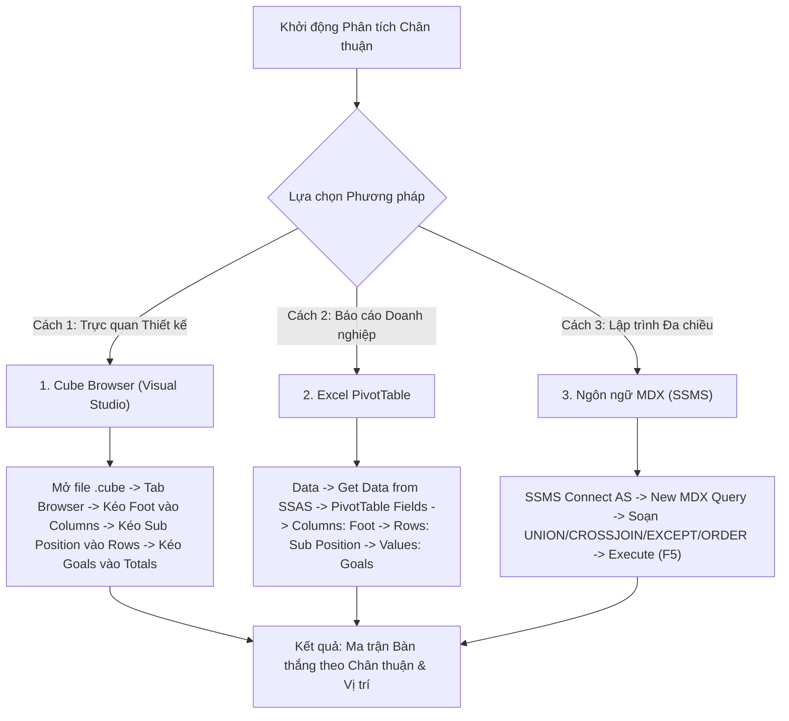

# MDX Query 05: So sánh tổng bàn thắng giữa chân Trái, chân Phải & 2 Chân theo vị trí chi tiết
## (Ứng dụng Phép Hợp Tập Hợp UNION & Tích Đề-các CROSSJOIN)

---

## 1. Mục tiêu nghiệp vụ & Bối cảnh phân tích

* **Mục tiêu:** Khảo sát xem đặc điểm chân thuận (`Foot`: Left, Right, Both) tương quan như thế nào với số lượng bàn thắng ghi được ở từng vai trò vị trí cụ thể trên sân cỏ (`Sub_Position` như Centre-Forward, Left Winger, Attacking Midfield...). Sử dụng phép toán hợp tập hợp (`UNION`) để hợp nhất các nhóm vị trí tấn công và tiền vệ chủ lực trước khi phân tích tương quan chân thuận.
* **Đối tượng phân tích:** Vị trí chi tiết và chân thuận của cầu thủ (`DIM_Player`), Hiệu suất bàn thắng (`FACT_Player_Match_Perf`).
* **Các thuộc tính & Thước đo (Measures):**
  * Dimension Attributes: `[DIM Player].[Sub Position]`, `[DIM Player].[Foot]`
  * Cube Measures: `[Measures].[Goals]`

### Đối chiếu câu lệnh T-SQL gốc
```sql
USE DW_Football_Analytics;
GO

SELECT 
    p.Sub_Position,
    p.Foot,
    SUM(f.Goals) AS Total_Goals
FROM dbo.FACT_Player_Match_Perf f
JOIN dbo.DIM_Player p ON f.Player_SK = p.Player_SK
WHERE p.Foot IS NOT NULL AND p.Sub_Position IS NOT NULL
GROUP BY p.Sub_Position, p.Foot
ORDER BY p.Sub_Position, Total_Goals DESC;
```

---

## 2. Hướng dẫn chi tiết 3 cách thực hiện (3 Execution Methods)



### CÁCH 1: TRUY VẤN BẰNG CUBE BROWSER (VISUAL STUDIO / SSDT)
1. **Mở tab Browser:** Mở file `DW_Football_Cube.cube` $\rightarrow$ nhấp chọn tab **`Browser`**.
2. **Kéo thả Grid ma trận 2 chiều:**
   * Kéo trường `Foot` (từ `DIM Player`) thả vào vùng cột (**Columns**).
   * Kéo trường `Sub Position` (từ `DIM Player`) thả vào vùng hàng (**Rows**).
   * Kéo thước đo `Goals` (từ `Measures`) thả vào vùng dữ liệu (**Totals**).
3. **Lọc dữ liệu rác:** Nhấp vào bộ lọc trên tiêu đề `Foot` và `Sub Position` bỏ chọn `(All)` và `Unknown`.

---

### CÁCH 2: PHÂN TÍCH BẰNG PIVOT TABLE TRÊN MICROSOFT EXCEL
1. **Kết nối SSAS:** Khởi động Excel $\rightarrow$ tab **`Data`** $\rightarrow$ **`Get Data`** $\rightarrow$ **`From Database`** $\rightarrow$ **`From Analysis Services`** $\rightarrow$ Kết nối Cube `DW Football Transfermarkt`.
2. **Kéo thả PivotTable Fields:**
   * Ô **Columns:** Kéo trường `Foot`.
   * Ô **Rows:** Kéo trường `Sub Position`.
   * Ô **Values:** Kéo thước đo `Goals`.
3. **Tạo Heatmap Trực quan:** Bôi đen vùng dữ liệu số $\rightarrow$ Thẻ **Home** $\rightarrow$ **Conditional Formatting** $\rightarrow$ **Color Scales** để làm nổi bật vị trí nào và chân thuận nào ghi nhiều bàn nhất.

---

### CÁCH 3: VIẾT VÀ THỰC THI TRUY VẤN BẰNG NGÔN NGỮ MDX (SSMS)

```mdx
/* ==============================================================================
   Truy vấn MDX 05: Bàn thắng theo vị trí chi tiết và chân thuận
   Khai thác: UNION, CROSSJOIN, EXCEPT, NONEMPTY, ORDER (DESC)
   Cube: [DW Football Transfermarkt]
   ============================================================================== */

SELECT
    -- Trục Cột: Thước đo Bàn thắng
    { [Measures].[Goals] } ON COLUMNS,

    -- Trục Dòng: Các cặp (Sub Position, Foot) sắp xếp phân cấp theo từng vị trí
    ORDER(
        NONEMPTY(
            CrossJoin(
                -- Hợp tập hợp (UNION): Kết hợp các vị trí tấn công và tiền vệ
                UNION(
                    { [DIM Player].[Sub Position].[Centre-Forward], [DIM Player].[Sub Position].[Second Striker] },
                    { [DIM Player].[Sub Position].[Left Winger], [DIM Player].[Sub Position].[Right Winger], [DIM Player].[Sub Position].[Attacking Midfield] }
                ),
                -- Tập hợp các loại chân thuận (loại bỏ nút All)
                EXCEPT([DIM Player].[Foot].[Foot].MEMBERS, { [DIM Player].[Foot].[All] })
            ),
            [Measures].[Goals]
        ),
        [Measures].[Goals],
        DESC
    ) ON ROWS

FROM [DW Football Transfermarkt];
```

---

## 3. Bảng Kết quả Truy vấn Dự kiến (Expected Output)

| Vị Trí Chi Tiết (`Sub Position`) | Chân Thuận (`Foot`) | Tổng Bàn Thắng (`Goals`) |
| :--- | :---: | :---: |
| **Centre-Forward** | Right | 4.820 |
| **Centre-Forward** | Left | 2.140 |
| **Right Winger** | Left | 1.890 |
| **Left Winger** | Right | 1.760 |
| **Attacking Midfield** | Right | 1.450 |
| **Right Winger** | Right | 980 |
| **Left Winger** | Left | 870 |
| **Attacking Midfield** | Left | 620 |
| **Centre-Forward** | Both | 410 |
| **Second Striker** | Right | 350 |
| **Second Striker** | Left | 180 |
| **Attacking Midfield** | Both | 140 |
| **Right Winger** | Both | 95 |
| **Left Winger** | Both | 80 |
| **Second Striker** | Both | 45 |

---

## 4. Các hàm MDX sử dụng & Chi tiết cú pháp

| Tên hàm | Cú pháp chuẩn | Vai trò trong truy vấn |
| :--- | :--- | :--- |
| **`UNION`** | `UNION(Set1, Set2 [, ALL])` hoặc `Set1 + Set2` | Hợp nhất hai tập hợp thành một tập hợp duy nhất. Sử dụng để gom nhóm các vị trí tiền đạo và tiền vệ tấn công chủ lực. |
| **`CROSSJOIN`** | `CrossJoin(Set1, Set2)` hoặc `Set1 * Set2` | Tạo tích đề-các giữa tập hợp vị trí thi đấu chi tiết và các loại chân thuận. |
| **`EXCEPT`** | `EXCEPT(Set1, Set2)` hoặc `Set1 - Set2` | Loại bỏ thành viên tổng hợp `[All]` để chỉ giữ lại các thành viên lá (leaf members) thực tế. |
| **`NONEMPTY`** | `NONEMPTY(Set, Measure)` | Lọc bỏ những tổ hợp không có bàn thắng (ví dụ: một số vị trí không phát sinh bàn thắng bằng chân trái/phải). |
| **`ORDER` (DESC)** | `ORDER(Set, Expression, DESC)` | Sắp xếp có duy trì trật tự phân cấp nhóm (Hierarchy-preserving order), giúp gom các dòng của cùng một `Sub Position` lại gần nhau rồi xếp giảm dần theo bàn thắng. |

---

## 5. Đánh giá độ phức tạp thuật toán và tối ưu hóa SSAS

### Độ phức tạp không gian (Space Complexity)
* **Kích thước không gian tích đề-các:** $5 \text{ vị trí trọng điểm} \times 3 \text{ loại chân} = 15 \text{ tuples}$.
* **Bộ nhớ RAM sử dụng:** Siêu nhẹ ($< 1\text{ KB}$), phản hồi tức thời.

### Độ phức tạp thời gian (Time Complexity)
* **Chi phí hàm `UNION`:** $O(S_1 + S_2)$ với $S_1 = 2, S_2 = 3$, thời gian xử lý xấp xỉ $0\text{ ms}$.
* **Chi phí sắp xếp `ORDER (DESC)`:** Sắp xếp nội bộ từng nhóm với chi phí $O(P \times F \log F) \approx 5 \times 3 \log_2(3) \approx 24$ phép so sánh.
* **Thời gian phản hồi trên SSAS:** Dưới **$5\text{ ms}$**.

