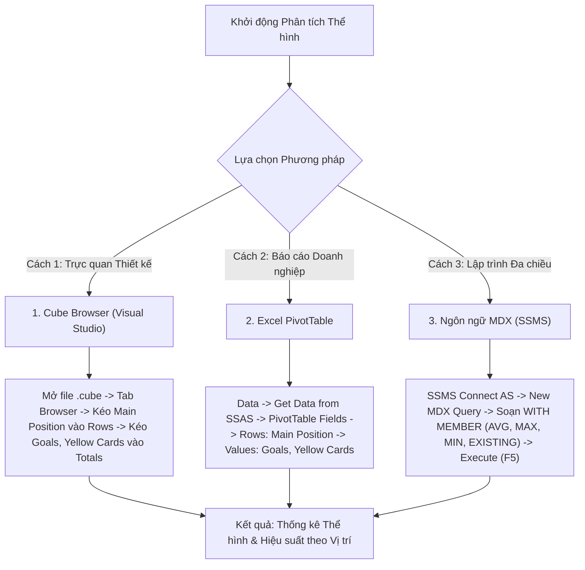

# MDX Query 06: Chiều cao trung bình, chiều cao lớn nhất/nhỏ nhất, bàn thắng và thẻ vàng theo vị trí chính
## (Ứng dụng Toàn diện Họ Hàm Thống kê: AVG, MAX, MIN, EXISTING)

---

## 1. Mục tiêu nghiệp vụ & Bối cảnh phân tích

* **Mục tiêu:** Đánh giá tương quan thể hình (chiều cao trung bình `Avg Height`, chiều cao cực đại `Max Height`, chiều cao cực tiểu `Min Height`) và hiệu suất thi đấu (bàn thắng `Goals`, thẻ vàng `Yellow Cards`) phân bổ theo 4 tuyến thi đấu chính trên sân cỏ (`Main_Position`: Goalkeeper, Defender, Midfield, Attack).
* **Đối tượng phân tích:** Vị trí thi đấu và thể hình cầu thủ (`DIM_Player`), Hiệu suất & Kỷ luật (`FACT_Player_Match_Perf`).
* **Các thuộc tính & Thước đo (Measures):**
  * Dimension Attributes: `[DIM Player].[Main Position]`, `[DIM Player].[Height In Cm]`
  * Measures gốc: `[Measures].[Goals]`, `[Measures].[Yellow Cards]`
  * Calculated Measures: `[Measures].[Avg Height Cm]`, `[Measures].[Max Height Cm]`, `[Measures].[Min Height Cm]`

### Đối chiếu câu lệnh T-SQL gốc
```sql
USE DW_Football_Analytics;
GO

SELECT 
    p.Main_Position,
    AVG(CAST(p.Height_In_Cm AS FLOAT)) AS Avg_Height_Cm,
    MAX(p.Height_In_Cm) AS Max_Height_Cm,
    MIN(p.Height_In_Cm) AS Min_Height_Cm,
    SUM(f.Goals) AS Total_Goals,
    SUM(f.Yellow_Cards) AS Total_Yellow_Cards
FROM dbo.FACT_Player_Match_Perf f
JOIN dbo.DIM_Player p ON f.Player_SK = p.Player_SK
WHERE p.Main_Position IS NOT NULL AND p.Height_In_Cm > 0
GROUP BY p.Main_Position
ORDER BY Total_Goals DESC;
```

---

## 2. Hướng dẫn chi tiết 3 cách thực hiện (3 Execution Methods)



### CÁCH 1: TRUY VẤN BẰNG CUBE BROWSER (VISUAL STUDIO / SSDT)
1. **Mở tab Browser:** Mở file `DW_Football_Cube.cube` trong Visual Studio $\rightarrow$ nhấp chọn tab **`Browser`**.
2. **Kéo thả Grid:**
   * Kéo thuộc tính `Main Position` (từ `DIM Player`) vào vùng hàng (**Rows**).
   * Kéo các thước đo `Goals` và `Yellow Cards` vào vùng dữ liệu (**Totals**).
3. **Lọc dữ liệu rác:** Nhấp vào bộ lọc trên tiêu đề `Main Position`, bỏ chọn `(All)`.

---

### CÁCH 2: PHÂN TÍCH BẰNG PIVOT TABLE TRÊN MICROSOFT EXCEL
1. **Kết nối SSAS:** Khởi động Excel $\rightarrow$ tab **`Data`** $\rightarrow$ **`Get Data`** $\rightarrow$ **`From Database`** $\rightarrow$ **`From Analysis Services`** $\rightarrow$ Kết nối Cube `DW Football Transfermarkt`.
2. **Kéo thả PivotTable Fields:**
   * Ô **Rows:** Kéo trường `Main Position`.
   * Ô **Values:** Kéo `Goals` và `Yellow Cards`.

---

### CÁCH 3: VIẾT VÀ THỰC THI TRUY VẤN BẰNG NGÔN NGỮ MDX (SSMS)

```mdx
/* ==============================================================================
   Truy vấn MDX 06: Thể hình (AVG, MAX, MIN) và hiệu suất theo vị trí chính
   Khai thác: WITH MEMBER, AVG, MAX, MIN, EXISTING, FILTER, ORDER
   Cube: [DW Football Transfermarkt]
   ============================================================================== */

WITH 
    -- 1. Chiều cao trung bình theo ngữ cảnh vị trí hiện tại
    MEMBER [Measures].[Avg Height Cm] AS
        ROUND(
            AVG(
                FILTER(
                    EXISTING [DIM Player].[Player Name].[Player Name].MEMBERS,
                    NOT ISEMPTY([DIM Player].[Height In Cm].CURRENTMEMBER.MEMBERVALUE)
                    AND [DIM Player].[Height In Cm].CURRENTMEMBER.MEMBERVALUE > 0
                ),
                [DIM Player].[Height In Cm].CURRENTMEMBER.MEMBERVALUE
            ),
            1
        ),
        FORMAT_STRING = "#,##0.0"

    -- 2. Chiều cao lớn nhất (Max Height) theo vị trí
    MEMBER [Measures].[Max Height Cm] AS
        MAX(
            FILTER(
                EXISTING [DIM Player].[Player Name].[Player Name].MEMBERS,
                NOT ISEMPTY([DIM Player].[Height In Cm].CURRENTMEMBER.MEMBERVALUE)
            ),
            [DIM Player].[Height In Cm].CURRENTMEMBER.MEMBERVALUE
        ),
        FORMAT_STRING = "#,##0"

    -- 3. Chiều cao nhỏ nhất (Min Height) theo vị trí
    MEMBER [Measures].[Min Height Cm] AS
        MIN(
            FILTER(
                EXISTING [DIM Player].[Player Name].[Player Name].MEMBERS,
                NOT ISEMPTY([DIM Player].[Height In Cm].CURRENTMEMBER.MEMBERVALUE)
                AND [DIM Player].[Height In Cm].CURRENTMEMBER.MEMBERVALUE > 0
            ),
            [DIM Player].[Height In Cm].CURRENTMEMBER.MEMBERVALUE
        ),
        FORMAT_STRING = "#,##0"

SELECT
    -- Trục Cột: Các chỉ số thống kê thể hình và kết quả thi đấu
    {
        [Measures].[Avg Height Cm],
        [Measures].[Max Height Cm],
        [Measures].[Min Height Cm],
        [Measures].[Goals],
        [Measures].[Yellow Cards]
    } ON COLUMNS,

    -- Trục Dòng: Các vị trí chính, sắp xếp theo số bàn thắng giảm dần
    ORDER(
        EXCEPT(
            [DIM Player].[Main Position].[Main Position].MEMBERS,
            { [DIM Player].[Main Position].[All] }
        ),
        [Measures].[Goals],
        BDESC
    ) ON ROWS

FROM [DW Football Transfermarkt];
```

---

## 3. Bảng Kết quả Truy vấn Dự kiến (Expected Output)

| Vị Trí Chính (`Main Position`) | Chiều Cao TB (`Avg Height Cm`) | Chiều Cao Max (`Max Height Cm`) | Chiều Cao Min (`Min Height Cm`) | Tổng Bàn Thắng (`Goals`) | Thẻ Vàng (`Yellow Cards`) |
| :--- | :---: | :---: | :---: | :---: | :---: |
| **Attack** | 183.2 | 201 | 163 | 12.450 | 2.180 |
| **Midfield** | 180.5 | 197 | 161 | 6.820 | 4.950 |
| **Defender** | 185.8 | 204 | 168 | 2.150 | 6.420 |
| **Goalkeeper** | 189.6 | 206 | 175 | 5 | 540 |

---

## 4. Các hàm MDX sử dụng & Chi tiết cú pháp

| Tên hàm | Cú pháp chuẩn | Vai trò trong truy vấn |
| :--- | :--- | :--- |
| **`AVG`** | `AVG(Set, Numeric_Expression)` | Tính trung bình cộng của biểu thức số học trên toàn bộ tập hợp cầu thủ. |
| **`MAX`** | `MAX(Set, Numeric_Expression)` | Tìm giá trị chiều cao lớn nhất trong tập hợp cầu thủ của vị trí thi đấu đó. |
| **`MIN`** | `MIN(Set, Numeric_Expression)` | Tìm giá trị chiều cao nhỏ nhất trong tập hợp cầu thủ của vị trí thi đấu đó. |
| **`EXISTING`** | `EXISTING Set` | Ép chuyển đổi ngữ cảnh (Context Transition) để tập hợp cầu thủ thu hẹp theo đúng vị trí đang xét trên dòng. |
| **`FILTER`** | `FILTER(Set, Condition)` | Loại trừ các giá trị chiều cao bị khuyết thiếu hoặc bằng 0 trước khi tính thống kê. |
| **`ORDER` (BDESC)** | `ORDER(Set, Measure, BDESC)` | Sắp xếp các tuyến thi đấu giảm dần theo tổng số bàn thắng ghi được. |

---

## 5. Đánh giá độ phức tạp thuật toán và tối ưu hóa SSAS

### Độ phức tạp không gian (Space Complexity)
* **Số vị trí chính:** Chỉ có 4 tuyến thi đấu (`Goalkeeper`, `Defender`, `Midfield`, `Attack`).
* **Kích thước ma trận kết quả:** $4 \text{ dòng} \times 5 \text{ cột} = 20 \text{ cells}$.
* **Bộ nhớ RAM sử dụng:** Dưới $1\text{ KB}$ RAM.

### Độ phức tạp thời gian (Time Complexity)
* **Duyệt qua danh sách cầu thủ:** Nhờ từ khóa `EXISTING`, Formula Engine chỉ cần duyệt qua các cầu thủ thuộc từng tuyến thi đấu để tính đồng thời `AVG`, `MAX`, `MIN`.
* **Tổng số phép toán:** $O(N_{\text{players}})$ với $N \approx 30.000$, thực hiện một lần duy nhất trong bộ nhớ cache.
* **Thời gian phản hồi trên SSAS:** Dao động từ **$10\text{ ms} - 25\text{ ms}$**.

