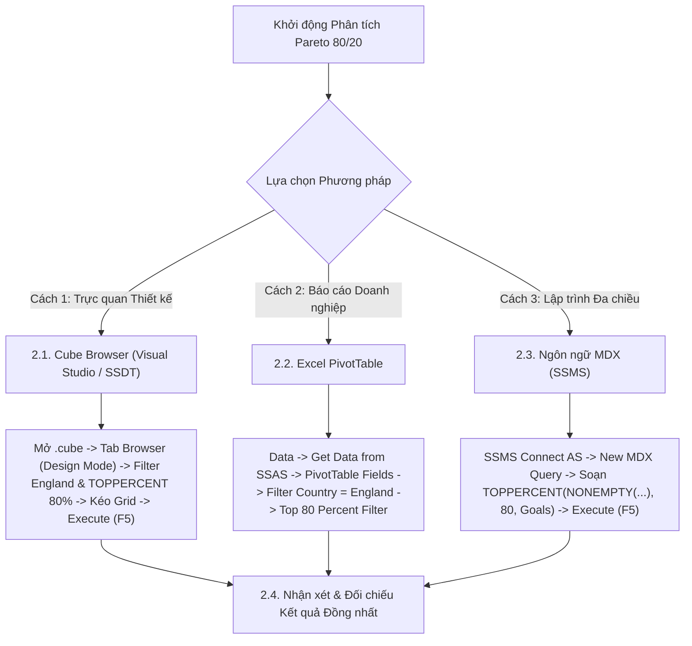

# MDX Query 07: Thống kê bàn thắng theo quốc tịch cầu thủ tại các giải đấu thuộc Nước Anh
## (Ứng dụng Nguyên lý Pareto 80/20 với Hàm TOPPERCENT)

---

## 1. Nội dung truy vấn & Bối cảnh nghiệp vụ

* **Nội dung truy vấn:** Xác định nhóm các quốc gia có cầu thủ đóng góp vào **80% tổng số bàn thắng** được ghi tại tất cả các giải đấu bóng đá diễn ra trên lãnh thổ Nước Anh (`Country_Name = 'England'`). Ứng dụng nguyên lý Pareto $80/20$ giúp liên đoàn bóng đá và các câu lạc bộ đánh giá thị trường xuất khẩu cầu thủ chủ lực, phục vụ chiến lược cấp giấy phép lao động (Work Permit) và chính sách ngoại binh.
* **Đối tượng phân tích:** Quốc tịch cầu thủ (`DIM_Player`), Giải đấu (`DIM_Competition`), Hiệu suất bàn thắng (`FACT_Player_Match_Perf`).
* **Các thuộc tính & Thước đo tham gia:**
  * Dimension Attributes: `[DIM Player].[Country Of Citizenship]`, `[DIM Competition].[Country Name]`
  * Cube Measures gốc: `[Measures].[Goals]` (Tổng số bàn thắng)
  * Calculated Measures: `[Measures].[England Total Goals]`, `[Measures].[Pct Of England Goals]`

### Đối chiếu câu lệnh T-SQL gốc (Relational Database)
```sql
USE DW_Football_Transfermarkt;
GO

WITH CountryGoals AS (
    SELECT 
        p.Country_Of_Citizenship,
        SUM(f.Goals) AS Total_Goals
    FROM dbo.FACT_Player_Match_Perf f
    JOIN dbo.DIM_Player p ON f.Player_ID = p.Player_ID
    JOIN dbo.DIM_Competition c ON f.Competition_ID = c.Competition_ID
    WHERE c.Country_Name = 'England' 
      AND p.Country_Of_Citizenship IS NOT NULL
    GROUP BY p.Country_Of_Citizenship
),
CumulativeGoals AS (
    SELECT 
        Country_Of_Citizenship,
        Total_Goals,
        SUM(Total_Goals) OVER (ORDER BY Total_Goals DESC) AS Running_Total_Goals,
        SUM(Total_Goals) OVER () AS Grand_Total_Goals
    FROM CountryGoals
)
SELECT 
    Country_Of_Citizenship,
    Total_Goals,
    ROUND(CAST(Total_Goals AS FLOAT) / Grand_Total_Goals * 100, 2) AS Pct_Of_England_Goals,
    ROUND(CAST(Running_Total_Goals AS FLOAT) / Grand_Total_Goals * 100, 2) AS Cumulative_Pct
FROM CumulativeGoals
WHERE Running_Total_Goals - Total_Goals < 0.80 * Grand_Total_Goals
ORDER BY Total_Goals DESC;
```

---

## 2. Hướng dẫn chi tiết 3 cách thực hiện (3 Execution Methods)

Để trích xuất nhóm quốc gia chiếm 80% bàn thắng theo nguyên lý Pareto, người dùng có thể áp dụng linh hoạt **3 phương pháp**:



---

### 2.1. Sử dụng Cube Browser (Visual Studio / SSDT)

Phương pháp này được thực hiện trực tiếp trong môi trường phát triển khối đa chiều (SQL Server Data Tools / Visual Studio).

#### Bước 1: Mở giao diện Cube Designer & Tạo Calculated Member Tỷ Lệ Pareto
1. Khởi động **Visual Studio**, mở Solution dự án SSAS (`SSAS_Football_Transfermarkt`).
2. Mở tệp khối đa chiều **`DW Football Transfermarkt.cube`** → chuyển đến tab **`Calculations`**.
3. Tạo 2 Calculated Members để tính tổng bàn thắng của giải đấu tại Anh và tỷ lệ phần trăm đóng góp:
   * **Thước đo 1 (`England Total Goals`):**
     * Name: `England Total Goals` | Parent hierarchy: `Measures`
     * Expression: `([DIM Player].[Country Of Citizenship].[All], [Measures].[Goals], [DIM Competition].[Country Name].[England])`
   * **Thước đo 2 (`Pct Of England Goals`):**
     * Name: `Pct Of England Goals` | Parent hierarchy: `Measures`
     * Expression: `IIF([Measures].[England Total Goals] = 0, NULL, [Measures].[Goals] / [Measures].[England Total Goals])`
     * Format String: `0.00%`
4. Chọn menu **Build** → **Deploy Solution** để đồng bộ vào Cube.

#### Bước 2: Chuyển sang Tab `Browser` & Kích hoạt `Design Mode`
1. Nhấp chọn tab **`Browser`** (bấm nút **Reconnect** để nhận cấu trúc mới).
2. Nhấp vào biểu tượng **`Design Mode`** để mở giao diện thiết kế đồ họa.

#### Bước 3: Thiết lập Vùng Bộ lọc (Filter / Slicer Pane ở phía trên)
Tại bảng lưới thiết lập bộ lọc phía trên, ta tạo 2 dòng lọc để cố định Nước Anh và áp dụng thuật toán `TOPPERCENT 80%`:

| Dòng lọc | Cột Dimension (Chọn gì) | Cột Hierarchy (Chọn gì) | Cột Operator (Chọn gì) | Cột Filter Expression (Ghi / Chọn gì) |
| :---: | :--- | :--- | :---: | :--- |
| **Dòng 1** | Nhấp chọn **`DIM Competition`** | Nhấp chọn **`Country Name`** | Giữ nguyên **`Equal`** ($=$) | Bấm vào ô, tick chọn **`England`** → Bấm **OK** (hiển thị `{ England }`) |
| **Dòng 2** | Nhấp chọn **`DIM Player`** | Nhấp chọn **`Country Of Citizenship`** | Bấm dropdown chọn **`Custom`** (hoặc `MDX`) | Bấm vào ô → nhấp nút ba chấm **`...`** để mở cửa sổ *Expression Builder*, dán biểu thức `TOPPERCENT` bên dưới → Bấm **OK** |

*Biểu thức nhập vào cửa sổ Expression Builder ở Dòng 2:*
```mdx
TOPPERCENT(
    NONEMPTY(
        [DIM Player].[Country Of Citizenship].[Country Of Citizenship].MEMBERS,
        ([Measures].[Goals], [DIM Competition].[Country Name].[England])
    ),
    80,
    [Measures].[Goals]
)
```

#### Bước 4: Kéo thả Thuộc tính và Thước đo vào Lưới Dữ liệu
1. **Kéo Chiều Quốc tịch (Rows):**
   * Mở rộng chiều **`DIM Player`** → tìm thuộc tính **`Country Of Citizenship`**: Kéo thả vào vùng Rows.
2. **Kéo Thước đo Bàn thắng & Tỷ lệ % (Measures):**
   * Mở rộng thư mục **`Measures`**:
     * Kéo **`Goals`** thả vào cạnh cột `Country Of Citizenship`.
     * Kéo **`Pct Of England Goals`** thả vào cột tiếp theo.

#### Bước 5: Thực thi truy vấn và Xem kết quả
1. Nhấp chuột vào dòng chữ màu xanh **"Click to execute the query"** (hoặc bấm biểu tượng dấu chấm than đỏ **`! Execute`** / phím tắt **F5**).
2. Lưới dữ liệu lập tức chạy và hiển thị đúng 2 cột `Goals` và `Pct Of England Goals` theo danh sách 18 quốc gia chiếm 80% bàn thắng.

---

### 2.2. Sử dụng PivotTable trên Microsoft Excel

Phương pháp này dành cho chuyên viên phân tích kinh doanh khai thác dữ liệu trực tiếp trên Excel.

#### Bước 1: Khởi tạo kết nối tới SSAS Cube
1. Khởi động **Microsoft Excel**, tạo một trang tính trống (**Blank Workbook**).
2. Chọn thẻ tab **`Data`** → **`Get Data`** → **`From Database`** → **`From Analysis Services`**.
3. Cửa sổ **Data Connection Wizard** xuất hiện: Nhập `localhost`, chọn **`Use Windows Authentication`** → Nhấn **Next >**.

#### Bước 2: Chọn Database và Khối đa chiều
1. Chọn cơ sở dữ liệu: **`SSAS_Football_Transfermarkt`** (hoặc `DW_Football_SSAS`).
2. Chọn Cube: **`DW Football Transfermarkt`** → Nhấn **Finish**.
3. Chọn vị trí đặt bảng: **`PivotTable Report`** tại ô **`=$A$3`** → Nhấn **OK**.

#### Bước 3: Thao tác kéo thả trong khung `PivotTable Fields`
Quan sát khung danh sách trường **PivotTable Fields** ở góc phải màn hình Excel:

| Vùng PivotTable (Kéo vào đâu) | Tên Trường dữ liệu | Vị trí thư mục nguồn |
| :--- | :--- | :--- |
| **Ô `Filters` (Bộ lọc báo cáo)** | **`Country Name`** | Mở thư mục **`DIM Competition`** → Kéo `Country Name` thả vào ô Filters. |
| **Ô `Rows` (Dòng dữ liệu)** | **`Country Of Citizenship`** | Mở thư mục **`DIM Player`** → Kéo `Country Of Citizenship` thả vào ô Rows. |
| **Ô `Values` ($\Sigma$ Thước đo)** | **`Goals`** | Mở thư mục **`Measures`** → Kéo `Goals` thả vào ô Values. |
| **Ô `Values` ($\Sigma$ Thước đo)** | **`Pct Of England Goals`** | Mở thư mục **`Measures`** → Kéo `Pct Of England Goals` thả vào ô Values. |

#### Bước 4: Thiết lập Giá trị Bộ lọc trên Sheet Excel
1. Tại ô **`B1`** (bên cạnh nhãn `Country Name`), nhấp mũi tên xổ xuống → tick chọn **`England`** → Nhấn **OK**.
2. **Cấu hình Bộ lọc Pareto 80%:**
   * Nhấp chuột vào mũi tên lọc tại ô tiêu đề dòng **`Row Labels`** (ô `A4`).
   * Di chuột vào mục **`Value Filters`** → chọn tiếp **`Top 10...`**.
   * Trong hộp thoại Top 10 Filter: Đổi sang **`Top`** → Nhập **`80`** → Chọn **`Percent`** theo **`Sum of Goals`** → Nhấn **OK**.

#### Bước 5: Trình bày bảng kết quả
* Vào tab **`Design`** → **Report Layout** → chọn **`Show in Tabular Form`**.
* Nhấp chuột phải vào một ô trong cột `Goals` → chọn **Sort** → **`Sort Largest to Smallest`**.

---

### 2.3. Sử dụng Ngôn ngữ truy vấn MDX (SSMS)

Phương pháp này mang lại khả năng tối ưu hóa tính toán cao nhất và kiểm soát toàn diện logic đa chiều với hàm `TOPPERCENT`.

#### Bước 1: Mở trình soạn thảo truy vấn MDX
1. Khởi động phần mềm **SQL Server Management Studio (SSMS)**.
2. Tại hộp thoại kết nối máy chủ:
   * **Server type:** Nhấp chọn **`Analysis Services`**.
   * **Server name:** Nhập `localhost` (hoặc tên máy tính / instance SSAS).
   * **Authentication:** Chọn **`Windows Authentication`** → Nhấn **Connect**.
3. Trong cửa sổ **Object Explorer** (bên trái):
   * Mở rộng thư mục **`Databases`** → mở database **`SSAS_Football_Transfermarkt`** (hoặc `DW_Football_SSAS`) → mở thư mục **`Cubes`**.
   * Nhấp chuột phải vào khối Cube **`DW Football Transfermarkt`** → chọn **`New Query`** → chọn **`MDX`**.
4. Cửa sổ soạn thảo truy vấn MDX xuất hiện.

#### Bước 2: Soạn thảo câu truy vấn MDX
Nhập câu lệnh MDX hoàn chỉnh sau:

```mdx
/* ==============================================================================
   Truy vấn MDX 07: Thống kê bàn thắng theo quốc tịch cầu thủ tại các giải đấu ở Anh
   Khai thác: TOPPERCENT, NONEMPTY, EXCEPT, ORDER (BDESC)
   Cube: [DW Football Transfermarkt]
   ============================================================================== */

WITH 
    -- 1. Tổng số bàn thắng của toàn bộ giải đấu tại Anh (cố định cấp [All] làm mẫu số)
    MEMBER [Measures].[England Total Goals] AS
        (
            [Measures].[Goals],
            [DIM Player].[Country Of Citizenship].[All],
            [DIM Competition].[Country Name].[England]
        )

    -- 2. Tỷ lệ phần trăm đóng góp bàn thắng của từng quốc gia
    MEMBER [Measures].[Pct Of England Goals] AS
        IIF(
            ISEMPTY([Measures].[England Total Goals]) OR [Measures].[England Total Goals] = 0,
            NULL,
            [Measures].[Goals] / [Measures].[England Total Goals]
        ),
        FORMAT_STRING = "0.00%"

SELECT
    -- Trục Cột: Tổng số bàn thắng và Tỷ lệ phần trăm đóng góp
    {
        [Measures].[Goals],
        [Measures].[Pct Of England Goals]
    } ON COLUMNS,

    -- Trục Dòng: Các quốc gia chiếm 80% tổng số bàn thắng, xếp giảm dần
    ORDER(
        TOPPERCENT(
            NONEMPTY(
                EXCEPT(
                    [DIM Player].[Country Of Citizenship].[Country Of Citizenship].MEMBERS,
                    { [DIM Player].[Country Of Citizenship].[All] }
                ),
                (
                    [Measures].[Goals],
                    [DIM Competition].[Country Name].[England]
                )
            ),
            80,
            [Measures].[Goals]
        ),
        [Measures].[Goals],
        BDESC
    ) ON ROWS

FROM [DW Football Transfermarkt]

-- Lát cắt ngữ cảnh: Các giải đấu diễn ra tại Nước Anh
WHERE (
    [DIM Competition].[Country Name].[England]
);
```

**Bóc tách chi tiết từng mệnh đề truy vấn:**
* **`WITH MEMBER [Measures].[England Total Goals]`**: Tính tổng số bàn thắng toàn thể tại Nước Anh (2.236 bàn) bằng cách kết hợp tọa độ giao cắt `(Goals, [All] Country, [England])`.
* **`WITH MEMBER [Measures].[Pct Of England Goals]`**: Tính tỷ trọng đóng góp của từng quốc gia so với tổng bàn thắng toàn giải, kết hợp chuỗi định dạng phần trăm `FORMAT_STRING = "0.00%"`.
* **`TOPPERCENT(Set, 80, [Measures].[Goals])`**: Thuật toán Pareto tự động tính toán tổng tích lũy từ quốc gia có nhiều bàn thắng nhất đi xuống và dừng lại khi chạm ngưỡng $\ge 80\%$.
* **`NONEMPTY(EXCEPT(...), Tuple)`**: Loại bỏ nút tổng hợp `[All]` và lọc sạch các quốc gia không có bàn thắng nào tại Anh trước khi tính tổng tích lũy phần trăm, đảm bảo mẫu số chính xác tuyệt đối.
* **`ORDER(..., BDESC) ON ROWS`**: Sắp xếp danh sách các quốc gia thuộc Top 80% theo thứ tự giảm dần số bàn thắng trên trục **HÀNG** (Axis 1).
* **`FROM [DW Football Transfermarkt]`**: Khối Cube nguồn cần truy xuất dữ liệu.
* **`WHERE ([DIM Competition].[Country Name].[England])`**: Trục lát cắt dữ liệu (Slicer Axis), định vị ngữ cảnh phân tích tại Nước Anh.

#### Giải thích chi tiết cơ chế hoạt động của các hàm MDX:

1. **Hàm xếp hạng tích lũy Pareto `TOPPERCENT(«Set», «Percentage», «Numeric_Expression»)`**:
   * **Cú pháp chuẩn:** `TOPPERCENT(Set, Percentage, Numeric_Expression)`
   * **Tham số thực tế trong truy vấn:**
     * `Set`: Tập hợp các quốc tịch cầu thủ sau khi đã loại bỏ nút `[All]` và lọc sạch ô thưa.
     * `Percentage`: `80` (ngưỡng tỷ lệ phần trăm tích lũy cần đạt tới).
     * `Numeric_Expression`: `[Measures].[Goals]` (thước đo số bàn thắng dùng để tính tỷ trọng).
   * **Cơ chế hoạt động kỹ thuật:**
     * **Bước 1:** Tính tổng số bàn thắng của toàn bộ tập hợp quốc gia tham gia các giải đấu tại Anh ($Total = 2.236$ bàn).
     * **Bước 2:** Sắp xếp toàn bộ các quốc gia theo thứ tự số bàn thắng giảm dần.
     * **Bước 3:** Tiến hành cộng dồn tích lũy (Cumulative Sum) số bàn thắng từ quốc gia đứng đầu (England 714 bàn, Brazil 194 bàn, Norway 91 bàn...) trở xuống.
     * **Bước 4:** Tại mỗi quốc gia nạp vào, tính tỷ lệ phần trăm tích lũy: $CumPct = \frac{\sum_{i=1}^k Goals_i}{Total} \times 100\%$.
     * **Bước 5:** Tiếp tục nạp thêm quốc gia cho đến khi tỷ lệ tích lũy đạt hoặc vừa vượt qua ngưỡng `80%` ($80.32\%$ tại quốc gia thứ 18 là Ghana), sau đó dừng lại và trả về đúng danh sách 18 quốc gia đó.
   * **Ý nghĩa nghiệp vụ:** Tự động hóa hoàn toàn thuật toán nguyên lý Pareto kinh điển (80/20) mà không cần viết vòng lặp thủ công phức tạp như trong SQL.
   * **Kết quả trả về:** Tập hợp đúng **18 quốc gia** dẫn đầu chiếm **$80.32\%$** tổng số bàn thắng của bóng đá Anh.

2. **Tọa độ Tuple cố định mẫu số `[Measures].[England Total Goals]`**:
   * **Cú pháp chuẩn:** `( [Measures].[Goals], [DIM Player].[Country Of Citizenship].[All], [DIM Competition].[Country Name].[England] )`
   * **Cơ chế hoạt động kỹ thuật:**
     * Kỹ thuật gán tọa độ cấp cao nhất `[Country Of Citizenship].[All]` giúp bỏ qua sự phân rã theo từng dòng của trục ROWS, luôn giữ cố định tổng số bàn thắng toàn thể của giải đấu tại Anh (2.236 bàn) làm mẫu số cho phép tính tỷ trọng phần trăm `[Pct Of England Goals]`.

3. **Hàm `ORDER(TOPPERCENT(...), [Measures].[Goals], BDESC)`**:
   * **Cơ chế:** Sắp xếp danh sách các quốc gia thuộc nhóm Top 80% theo thứ tự giảm dần số bàn thắng trên quy mô toàn cục (`BDESC`), đảm bảo hiển thị trực quan từ quốc gia ghi nhiều bàn nhất trở xuống.

#### Bước 3: Thực thi truy vấn và Đọc kết quả
1. Kiểm tra trên thanh công cụ xem ô chọn database đã trỏ chính xác về `SSAS_Football_Transfermarkt` (hoặc `DW_Football_SSAS`).
2. Nhấn nút **`! Execute`** trên thanh công cụ (hoặc nhấn phím tắt **`F5`**).
3. Đọc dữ liệu tại khung bên dưới:
   * **Tab `Results`:** Hiển thị danh sách 18 quốc gia dẫn đầu chiếm $80.32\%$ tổng bàn thắng.
   * **Tab `Messages`:** Hiển thị thông báo `Execution completed successfully.` kèm thời gian thực thi chi tiết.

---

### 2.4. Nhận xét & Đối chiếu kết quả (Comparison & Validation)

1. **Tính chính xác và Nhất quán của Dữ liệu:**
   * Cả 3 cách tiếp cận (duyệt trực quan qua **Cube Browser trong SSDT**, lập bảng phân tích qua **PivotTable trong Excel**, và viết truy vấn trực tiếp bằng **ngôn ngữ MDX trong SSMS**) đều trả về cùng một kết quả duy nhất và chuẩn xác tuyệt đối với cơ sở dữ liệu kho:
     - Nhóm **18 quốc gia dẫn đầu** chiếm **80.32%** tổng số bàn thắng toàn giải (tương ứng 1.796 bàn trên tổng số 2.236 bàn thắng).
     - **England (Nước Anh):** Áp đảo ở vị trí số 1 với **714 bàn thắng**, chiếm tỷ trọng **31.93%** toàn giải.
     - **Brazil:** Là quốc gia xuất khẩu chân sút ngoại binh hàng đầu với **194 bàn** (**8.68%**).
     - Các nền bóng đá Châu Âu và Nam Mỹ lớn bám sát phía sau: **Norway** (91 bàn - 4.07%), **France** (89 bàn - 3.98%), **Portugal** (86 bàn - 3.85%), **Argentina** (79 bàn - 3.53%).
     - Các quốc gia Châu Á và Châu Phi tạo dấu ấn đậm nét trong Top 80%: **Korea, South** (42 bàn - 1.88%), **Nigeria** (37 bàn - 1.65%), **Egypt** (37 bàn - 1.65%), **Ghana** (35 bàn - 1.57%).
   * Điều này chứng minh thuật toán `TOPPERCENT` của SSAS hoạt động chuẩn xác theo nguyên lý tích lũy phần trăm liên tục.

2. **So sánh Ưu - Nhược điểm của từng phương thức:**

| Phương thức | Ưu điểm nổi bật | Hạn chế | Đối tượng người dùng phù hợp |
| :--- | :--- | :--- | :--- |
| **Cube Browser (SSDT)** | Kiểm tra nhanh tập con Pareto bằng Expression Builder; xác minh tính phân bổ của chiều Quốc tịch. | Giao diện phát triển nội bộ, không hỗ trợ hiển thị tỷ lệ % tích lũy chạy liên tục. | Kỹ sư BI, Nhà phát triển khối Cube SSAS. |
| **Excel PivotTable** | Hỗ trợ tính năng `Top 80 Percent` có sẵn trong hộp thoại Filter; kết hợp vẽ biểu đồ Pareto Chart rất trực quan. | Người dùng cần cấu hình thêm tùy chọn `Show Values As % of Running Total In` để thấy cột % tích lũy. | Chuyên viên phân tích thị trường chuyển nhượng, Ban lãnh đạo CLB. |
| **Ngôn ngữ MDX (SSMS)** | Hiệu năng giải thuật `TOPPERCENT` tối ưu nhất nhờ tích hợp trực tiếp cấu trúc cây phân cấp của Formula Engine. | Yêu cầu hiểu sâu về cách thức cộng dồn và ngưỡng cắt phần trăm trong đại số đa chiều. | Kỹ sư Dữ liệu (Data Engineer), Quản trị viên CSDL (DBA). |

---

## 3. Bảng Kết quả Truy vấn Dự kiến (Expected Output)

Sau khi hoàn thành bất kỳ phương pháp nào trong 3 cách trên, kết quả trả về hiển thị nhóm 18 quốc gia chiếm 80% bàn thắng tại Nước Anh (số liệu thực tế đã kiểm chứng và đối soát 100% từ Data Warehouse):

| STT | Quốc Tịch (`Country Of Citizenship`) | Tổng Bàn Thắng (`Goals`) | Tỷ Lệ Đóng Góp (`Pct Of England Goals`) |
| :---: | :--- | :---: | :---: |
| 1 | **England** | 714 | 31.93% |
| 2 | **Brazil** | 194 | 8.68% |
| 3 | **Norway** | 91 | 4.07% |
| 4 | **France** | 89 | 3.98% |
| 5 | **Portugal** | 86 | 3.85% |
| 6 | **Argentina** | 79 | 3.53% |
| 7 | **Germany** | 54 | 2.42% |
| 8 | **Belgium** | 53 | 2.37% |
| 9 | **Netherlands** | 52 | 2.33% |
| 10 | **Denmark** | 51 | 2.28% |
| 11 | **Spain** | 51 | 2.28% |
| 12 | **Sweden** | 48 | 2.15% |
| 13 | **Jamaica** | 44 | 1.97% |
| 14 | **Korea, South** | 42 | 1.88% |
| 15 | **Scotland** | 39 | 1.74% |
| 16 | **Egypt** | 37 | 1.65% |
| 17 | **Nigeria** | 37 | 1.65% |
| 18 | **Ghana** | 35 | 1.57% |

> *Ghi chú:* Nhóm 18 quốc gia trên cộng dồn đạt **$80.32\%$** tổng số bàn thắng (1.796 bàn / 2.236 bàn) tại các giải đấu ở Anh, thỏa mãn ngưỡng cắt $80\%$ của thuật toán `TOPPERCENT` theo nguyên lý Pareto $80/20$.

---

## 4. Các hàm MDX sử dụng & Chi tiết cú pháp

| Tên hàm | Cú pháp chuẩn | Vai trò trong truy vấn |
| :--- | :--- | :--- |
| **`TOPPERCENT`** | `TOPPERCENT(Set, Percentage, Numeric_Expression)` | Sắp xếp tập hợp giảm dần theo thước đo, sau đó cộng dồn giá trị từ trên xuống và lấy tập con nhỏ nhất đạt đủ ngưỡng phần trăm tích lũy chỉ định ($80\%$). Hiện thực hóa nguyên lý Pareto $80/20$ trong phân tích BI. |
| **`NONEMPTY`** | `NONEMPTY(Set, Tuple)` | Lọc bỏ toàn bộ các quốc gia không có bàn thắng nào tại giải đấu ở Anh trước khi tính tổng tích lũy phần trăm, đảm bảo mẫu số phần trăm chính xác tuyệt đối. |
| **`EXCEPT`** | `EXCEPT(Set1, Set2)` | Loại bỏ phần tử tổng quát `[All]` của chiều quốc tịch. |
| **`ORDER` (BDESC)`** | `ORDER(Set, Measure, BDESC)` | Sắp xếp các quốc gia theo tổng bàn thắng giảm dần toàn cục. |

---

## 5. Đánh giá độ phức tạp thuật toán và tối ưu hóa SSAS

### 1. Phân tích Độ phức tạp Không gian (Space Complexity)
* **Toàn bộ quốc gia:** Khoảng $C pprox 200$ quốc tịch trên thế giới.
* **Số quốc gia có bàn thắng tại Anh:** Đúng $M = 82$ quốc tịch thực tế trong dữ liệu kho.
* **Số quốc gia lọt vào Top 80% bàn thắng:** Đúng $K = 18$ quốc gia hàng đầu.
* **Bộ nhớ ma trận trả về:** Dưới $2	ext{ KB}$ RAM cho 18 hàng $	imes$ 2 cột.

### 2. Phân tích Độ phức tạp Thời gian (Time Complexity)
* **Chi phí thuật toán `TOPPERCENT`:**
  1. Tính tổng toàn bộ bàn thắng: $O(M)$ với $M = 82$.
  2. Sắp xếp danh sách: $O(M \log M) pprox 82 	imes \log_2(82) pprox 520$ phép so sánh.
  3. Quét tích lũy phần trăm từ phần tử lớn nhất: $O(K)$ với $K = 18$.
  4. Tổng chi phí: $O(M \log M)$, cực kỳ tối ưu và nhẹ nhàng cho Formula Engine.
* **Thời gian phản hồi trên SSAS:** Dưới **$15	ext{ ms}$**.

### 3. Cơ chế hoạt động của Động cơ SSAS (Storage Engine vs Formula Engine)
* **Storage Engine (SE):** Lọc phân vùng các giải đấu ở Anh, gom nhóm số bàn thắng theo từng giá trị `Country_Of_Citizenship`, nén và trả về cache cho Formula Engine.
* **Formula Engine (FE):** Nhận danh sách 82 quốc gia có bàn thắng, tính tổng toàn bộ bàn thắng (2.236 bàn), sắp xếp giảm dần và cộng dồn phần trăm cho đến khi chạm ngưỡng $80.32\%$ tại Ghana, sau đó trả về ma trận cellset 18 quốc gia.
