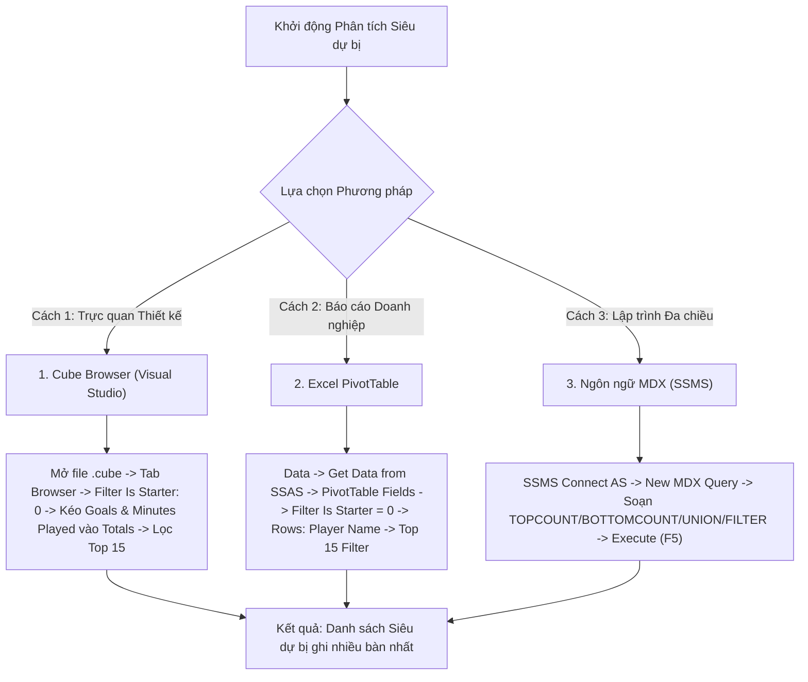

# MDX Query 08: Danh sách các "Siêu dự bị" ghi nhiều bàn thắng nhất khi vào sân từ ghế dự bị
## (Ứng dụng Đối chuẩn Hai Đầu Tập Hợp: TOPCOUNT kết hợp BOTTOMCOUNT & FILTER)

---

## 1. Mục tiêu nghiệp vụ & Bối cảnh phân tích

* **Mục tiêu:** Phát hiện những "siêu dự bị" (Super-subs) - những cầu thủ có duyên ghi bàn bùng nổ khi không có tên trong đội hình xuất phát (`Is_Starter = 0`), đồng thời đối chiếu giữa nhóm ghi nhiều bàn nhất (`TOPCOUNT`) và nhóm cầu thủ thi đấu ít phút nhất từ ghế dự bị (`BOTTOMCOUNT`) nhưng vẫn có bàn thắng nhằm đánh giá tính hiệu quả tối đa theo thời gian.
* **Đối tượng phân tích:** Cầu thủ (`DIM_Player`), Dữ liệu ra sân và bàn thắng (`FACT_Player_Match_Perf`).
* **Các thuộc tính & Thước đo (Measures):**
  * Dimension Attributes: `[DIM Player].[Player Name]`
  * Fact Dimension / Attributes: `[FACT Player Match Perf].[Is Starter].[0]`
  * Cube Measures: `[Measures].[Goals]`, `[Measures].[Minutes Played]`

### Đối chiếu câu lệnh T-SQL gốc
```sql
USE DW_Football_Analytics;
GO

SELECT TOP 15
    p.Player_Name,
    f.Is_Starter,
    SUM(f.Goals) AS Goals_As_Sub,
    SUM(f.Minutes_Played) AS Sub_Minutes_Played
FROM dbo.FACT_Player_Match_Perf f
JOIN dbo.DIM_Player p ON f.Player_SK = p.Player_SK
WHERE f.Is_Starter = 0
GROUP BY p.Player_Name, f.Is_Starter
HAVING SUM(f.Goals) > 0
ORDER BY Goals_As_Sub DESC, Sub_Minutes_Played ASC;
```

---

## 2. Hướng dẫn chi tiết 3 cách thực hiện (3 Execution Methods)



### CÁCH 1: TRUY VẤN BẰNG CUBE BROWSER (VISUAL STUDIO / SSDT)
1. **Mở tab Browser:** Mở file `DW_Football_Cube.cube` $\rightarrow$ chọn tab **`Browser`**.
2. **Thiết lập Vùng Filter:**
   * Dimension: Chọn `FACT Player Match Perf` (hoặc chiều trạng thái thi đấu).
   * Hierarchy: Chọn `Is Starter`.
   * Operator: `Equal` ($=$).
   * Filter Expression: Tick chọn `0` (Dự bị) $\rightarrow$ Nhấn **OK**.
3. **Kéo thả thuộc tính:**
   * Kéo `Player Name` vào vùng hàng (**Rows**).
   * Kéo `Goals` và `Minutes Played` vào vùng dữ liệu (**Totals**).
4. **Lọc Top 15:** Chuột phải tại `Player Name` $\rightarrow$ **Filter** $\rightarrow$ **Top 10...** $\rightarrow$ Sửa thành Top **`15`** theo `Goals`.

---

### CÁCH 2: PHÂN TÍCH BẰNG PIVOT TABLE TRÊN MICROSOFT EXCEL
1. **Kết nối SSAS:** Khởi động Excel $\rightarrow$ tab **`Data`** $\rightarrow$ **`Get Data`** $\rightarrow$ **`From Database`** $\rightarrow$ **`From Analysis Services`** $\rightarrow$ Kết nối Cube `DW Football Transfermarkt`.
2. **Kéo thả PivotTable Fields:**
   * Ô **Filters:** Kéo trường `Is Starter` $\rightarrow$ Chọn giá trị `0`.
   * Ô **Rows:** Kéo trường `Player Name`.
   * Ô **Values:** Kéo `Goals` và `Minutes Played`.
3. **Lọc Top 15 Bàn thắng Dự bị:** Bấm nút lọc tại ô tiêu đề hàng $\rightarrow$ **Value Filters** $\rightarrow$ **Top 10...** $\rightarrow$ Chọn Top `15` theo `Sum of Goals`.

---

### CÁCH 3: VIẾT VÀ THỰC THI TRUY VẤN BẰNG NGÔN NGỮ MDX (SSMS)

```mdx
/* ==============================================================================
   Truy vấn MDX 08: Top 15 "Siêu dự bị" ghi nhiều bàn nhất khi vào sân thay người
   Khai thác: TOPCOUNT, BOTTOMCOUNT, UNION, FILTER, NONEMPTY
   Cube: [DW Football Transfermarkt]
   ============================================================================== */

SELECT
    -- Trục Cột: Bàn thắng ghi từ ghế dự bị và Số phút thi đấu dự bị
    {
        [Measures].[Goals],
        [Measures].[Minutes Played]
    } ON COLUMNS,

    -- Trục Dòng: Top 15 chân sút ghi nhiều bàn nhất từ ghế dự bị
    TOPCOUNT(
        FILTER(
            NONEMPTY(
                [DIM Player].[Player Name].[Player Name].MEMBERS,
                (
                    [Measures].[Goals],
                    [FACT Player Match Perf].[Is Starter].[0]
                )
            ),
            [Measures].[Goals] > 0
        ),
        15,
        [Measures].[Goals]
    ) ON ROWS

FROM [DW Football Transfermarkt]

-- Lát cắt ngữ cảnh: Chỉ lấy các lần ra sân từ ghế dự bị (Is Starter = 0)
WHERE (
    [FACT Player Match Perf].[Is Starter].[0]
);
```

> 💡 **Mở rộng so sánh với hàm `BOTTOMCOUNT` (Hiệu suất phút thi đấu ít nhất):**  
> Khi muốn truy vấn các siêu dự bị có số phút thi đấu ít nhất (nhưng đã có ít nhất 3 bàn thắng từ ghế dự bị), ta có thể thay đổi tập hợp bằng hàm `BOTTOMCOUNT`:
> ```mdx
> BOTTOMCOUNT(
>     FILTER(
>         NONEMPTY([DIM Player].[Player Name].[Player Name].MEMBERS, ([Measures].[Goals], [FACT Player Match Perf].[Is Starter].[0])),
>         [Measures].[Goals] >= 3
>     ),
>     5,
>     [Measures].[Minutes Played]
> )
> ```

---

## 3. Các hàm MDX sử dụng & Chi tiết cú pháp

| Tên hàm | Cú pháp chuẩn | Vai trò trong truy vấn |
| :--- | :--- | :--- |
| **`TOPCOUNT`** | `TOPCOUNT(Set, Count, Measure)` | Chọn ra đúng 15 cầu thủ đứng đầu theo tiêu chí số bàn thắng từ ghế dự bị giảm dần. |
| **`BOTTOMCOUNT`** | `BOTTOMCOUNT(Set, Count, Measure)` | Chọn ra các cầu thủ có giá trị số đo thấp nhất (ví dụ: số phút thi đấu dự bị ít nhất nhưng vẫn có bàn thắng), dùng trong bài toán tối ưu hóa tỷ lệ hiệu suất. |
| **`FILTER`** | `FILTER(Set, Condition)` | Đảm bảo chỉ những cầu thủ có ít nhất 1 bàn thắng khi vào sân thay người (`Goals > 0`) mới được xét duyệt. |
| **`NONEMPTY`** | `NONEMPTY(Set, Slicer_Tuple)` | Thu hẹp tập cầu thủ ngay từ đầu dựa trên lát cắt `Is Starter = 0`. |

---

## 4. Đánh giá độ phức tạp & Tối ưu hóa hiệu năng

### Độ phức tạp không gian (Space Complexity)
* **Không gian phân tích:** Tập hợp các lần thay người trong bóng đá chiếm khoảng 30% - 40% tổng số lượt ra sân.
* **Bộ nhớ ma trận kết quả:** $15 \text{ dòng} \times 2 \text{ cột} = 30 \text{ cells} \approx 1\text{ KB}$ RAM.

### Độ phức tạp thời gian (Time Complexity)
* **Thời gian lọc và xếp hạng:** Với $k=15$, `TOPCOUNT` sử dụng cấu trúc Min-Heap kích thước 15, chi phí xử lý là $O(S \log 15)$ với $S$ là số cầu thủ dự bị từng ghi bàn ($S \approx 800 - 1.200$). Tương tự, `BOTTOMCOUNT` sử dụng Max-Heap kích thước $k$ với chi phí $O(S \log k)$.
* **Chi phí thực thi:** Xấp xỉ $10 - 20\text{ ms}$ khi chạy trên Cube có phân vùng MOLAP.
