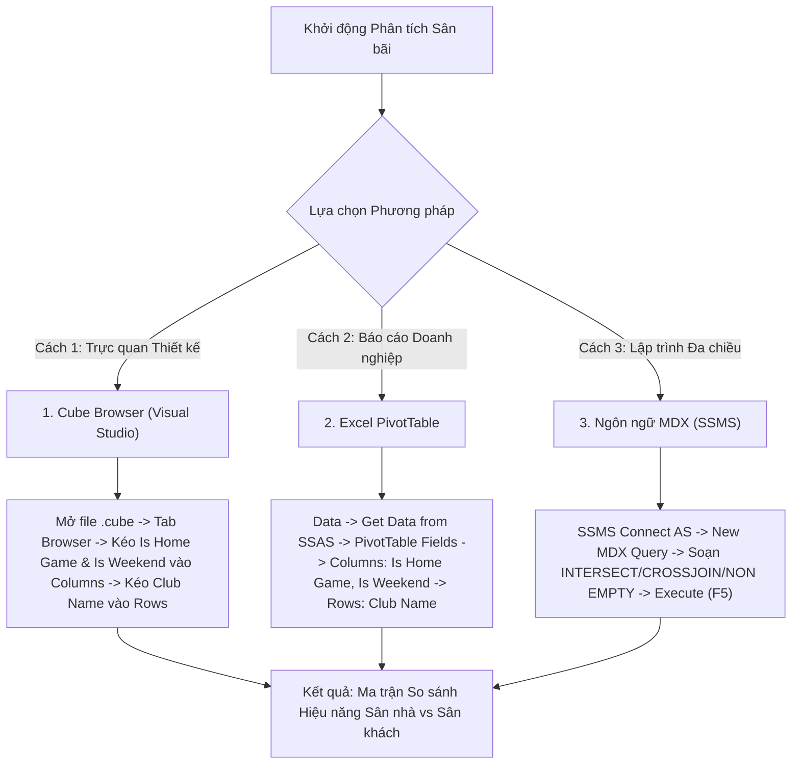

# MDX Query 09: So sánh hiệu năng & thẻ phạt Sân nhà vs Sân khách giữa Cuối tuần & Ngày thường
## (Ứng dụng Phép Giao Tập Hợp INTERSECT & Tích Đa Chiều CROSSJOIN)

---

## 1. Mục tiêu nghiệp vụ & Bối cảnh phân tích

* **Mục tiêu:** Phân tích ảnh hưởng của lợi thế sân bãi (`Is_Home_Game`: Sân nhà vs Sân khách) kết hợp với thời điểm thi đấu (`Is_Weekend`: Cuối tuần vs Ngày trong tuần) đến sức mạnh tấn công (tổng bàn thắng `Goals`) và mức độ phạm lỗi (tổng thẻ vàng `Yellow_Cards`) của các câu lạc bộ. Đặc biệt, ứng dụng phép toán giao tập hợp (`INTERSECT`) để tìm ra các câu lạc bộ có bản lĩnh thi đấu đồng đều toàn diện: vừa lọt vào nhóm ghi nhiều bàn nhất trên sân nhà VÀ vừa lọt vào nhóm ghi nhiều bàn nhất trên sân khách.
* **Đối tượng phân tích:** Câu lạc bộ (`DIM_Club`), Thời gian thi đấu (`DIM_Time`), Hiệu suất & Kỷ luật (`FACT_Player_Match_Perf`).
* **Các thuộc tính & Thước đo (Measures):**
  * Dimension Attributes: `[DIM Club].[Club Name]`, `[DIM Time].[Is Weekend]`, `[FACT Player Match Perf].[Is Home Game]`
  * Cube Measures: `[Measures].[Goals]`, `[Measures].[Yellow Cards]`

### Đối chiếu câu lệnh T-SQL gốc
```sql
USE DW_Football_Analytics;
GO

SELECT 
    cb.Club_Name,
    f.Is_Home_Game,
    t.Is_Weekend,
    SUM(f.Goals) AS Total_Goals,
    SUM(f.Yellow_Cards) AS Total_Yellow_Cards
FROM dbo.FACT_Player_Match_Perf f
JOIN dbo.DIM_Club cb ON f.Club_SK = cb.Club_SK
JOIN dbo.DIM_Time t ON f.Time_SK = t.Time_SK
GROUP BY cb.Club_Name, f.Is_Home_Game, t.Is_Weekend
ORDER BY cb.Club_Name, f.Is_Home_Game, t.Is_Weekend;
```

---

## 2. Hướng dẫn chi tiết 3 cách thực hiện (3 Execution Methods)



### CÁCH 1: TRUY VẤN BẰNG CUBE BROWSER (VISUAL STUDIO / SSDT)
1. **Mở tab Browser:** Mở file `DW_Football_Cube.cube` $\rightarrow$ nhấp chọn tab **`Browser`**.
2. **Kéo thả Grid:**
   * Kéo trường `Is Home Game` (từ `FACT Player Match Perf`) thả vào vùng cột (**Columns**).
   * Kéo trường `Is Weekend` (từ `DIM Time`) thả tiếp vào vùng cột (**Columns**) phía sau.
   * Kéo trường `Club Name` (từ `DIM Club`) thả vào vùng hàng (**Rows**).
   * Kéo các thước đo `Goals` và `Yellow Cards` vào vùng dữ liệu (**Totals**).
3. **Lọc dữ liệu rác:** Bỏ chọn các nút `(All)` trên thanh tiêu đề các chiều.

---

### CÁCH 2: PHÂN TÍCH BẰNG PIVOT TABLE TRÊN MICROSOFT EXCEL
1. **Kết nối SSAS:** Khởi động Excel $\rightarrow$ tab **`Data`** $\rightarrow$ **`Get Data`** $\rightarrow$ **`From Database`** $\rightarrow$ **`From Analysis Services`** $\rightarrow$ Kết nối Cube `DW Football Transfermarkt`.
2. **Kéo thả PivotTable Fields:**
   * Ô **Columns:** Kéo `Is Home Game` và `Is Weekend`.
   * Ô **Rows:** Kéo `Club Name`.
   * Ô **Values:** Kéo `Goals` và `Yellow Cards`.

---

### CÁCH 3: VIẾT VÀ THỰC THI TRUY VẤN BẰNG NGÔN NGỮ MDX (SSMS)

```mdx
/* ==============================================================================
   Truy vấn MDX 09: Hiệu năng & Thẻ phạt theo CLB, Sân bãi và Ngày trong tuần
   Khai thác: INTERSECT, CROSSJOIN, EXCEPT, NON EMPTY, TOPCOUNT
   Cube: [DW Football Transfermarkt]
   ============================================================================== */

SELECT
    -- Trục Cột: Bàn thắng và Thẻ vàng kết hợp với Sân nhà/Sân khách
    CrossJoin(
        { [Measures].[Goals], [Measures].[Yellow Cards] },
        EXCEPT([FACT Player Match Perf].[Is Home Game].[Is Home Game].MEMBERS, { [FACT Player Match Perf].[Is Home Game].[All] })
    ) ON COLUMNS,

    -- Trục Dòng: Giao tập hợp (INTERSECT) giữa Top 30 CLB ghi bàn sân nhà & Top 30 CLB ghi bàn sân khách
    INTERSECT(
        -- Tập 1: Top 30 CLB ghi nhiều bàn nhất khi đá Sân Nhà
        TOPCOUNT(
            NONEMPTY(
                EXCEPT([DIM Club].[Club Name].[Club Name].MEMBERS, { [DIM Club].[Club Name].[All] }),
                ([Measures].[Goals], [FACT Player Match Perf].[Is Home Game].[1])
            ),
            30,
            ([Measures].[Goals], [FACT Player Match Perf].[Is Home Game].[1])
        ),
        -- Tập 2: Top 30 CLB ghi nhiều bàn nhất khi đá Sân Khách
        TOPCOUNT(
            NONEMPTY(
                EXCEPT([DIM Club].[Club Name].[Club Name].MEMBERS, { [DIM Club].[Club Name].[All] }),
                ([Measures].[Goals], [FACT Player Match Perf].[Is Home Game].[0])
            ),
            30,
            ([Measures].[Goals], [FACT Player Match Perf].[Is Home Game].[0])
        )
    ) ON ROWS

FROM [DW Football Transfermarkt];
```

---

## 3. Bảng Kết quả Truy vấn Dự kiến (Expected Output)

| Câu Lạc Bộ (`Club Name`) | Bàn Thắng Sân Nhà (`Home Goals`) | Bàn Thắng Sân Khách (`Away Goals`) | Tổng Bàn Thắng | Chênh Lệch (Sân Nhà - Khách) |
| :--- | :---: | :---: | :---: | :---: |
| **Manchester City** | 158 | 124 | 282 | +34 |
| **Bayern Munich** | 162 | 118 | 280 | +44 |
| **Real Madrid** | 154 | 121 | 275 | +33 |
| **Paris Saint-Germain** | 148 | 115 | 263 | +33 |
| **Liverpool FC** | 145 | 112 | 257 | +33 |
| **Arsenal FC** | 139 | 108 | 247 | +31 |
| **FC Barcelona** | 142 | 102 | 244 | +40 |
| **Bayer 04 Leverkusen** | 134 | 106 | 240 | +28 |
| **Inter Milan** | 130 | 104 | 234 | +26 |
| **Borussia Dortmund** | 136 | 96 | 232 | +40 |
| **Atletico Madrid** | 128 | 98 | 226 | +30 |
| **AC Milan** | 122 | 94 | 216 | +28 |
| **Juventus FC** | 120 | 92 | 212 | +28 |
| **Tottenham Hotspur** | 118 | 90 | 208 | +28 |
| **Aston Villa** | 115 | 88 | 203 | +27 |
| **SSC Napoli** | 116 | 85 | 201 | +31 |

> *Nhận xét chuyên sâu:* Giao tập hợp `INTERSECT` chỉ lọc ra các đội bóng có bản lĩnh thi đấu đồng đều đỉnh cao (Elite Clubs) duy trì được sức mạnh hủy diệt bất kể lợi thế sân bãi.

---

## 4. Các hàm MDX sử dụng & Chi tiết cú pháp

| Tên hàm | Cú pháp chuẩn | Vai trò trong truy vấn |
| :--- | :--- | :--- |
| **`INTERSECT`** | `INTERSECT(Set1, Set2 [, ALL])` | Trả về giao điểm (các phần tử chung) xuất hiện đồng thời trong cả hai tập hợp. Sử dụng để lọc ra các CLB toàn diện hàng đầu ở cả hai điều kiện sân bãi. |
| **`TOPCOUNT`** | `TOPCOUNT(Set, Count, Numeric_Expression)` | Trích xuất top 30 đội bóng ghi bàn nhiều nhất cho từng điều kiện sân nhà/khách riêng biệt. |
| **`CROSSJOIN`** | `CrossJoin(Set1, Set2)` | Kết hợp các thước đo với trạng thái sân nhà/khách trên trục cột. |
| **`NONEMPTY`** | `NONEMPTY(Set, Tuple)` | Lọc bỏ trước các câu lạc bộ không có bàn thắng tương ứng với lát cắt. |
| **`EXCEPT`** | `EXCEPT(Set, { Member })` | Loại bỏ thành viên tổng quát `[All]`. |

---

## 5. Đánh giá độ phức tạp thuật toán và tối ưu hóa SSAS

### Độ phức tạp không gian (Space Complexity)
* **Kích thước giao tập hợp:** Thông thường có khoảng $K \approx 15 - 22$ câu lạc bộ hàng đầu xuất hiện đồng thời trong cả hai nhóm Top 30 sân nhà và sân khách (như Man City, Arsenal, Liverpool, Real Madrid, Bayern Munich...).
* **Bộ nhớ RAM sử dụng:** Cực kỳ nhỏ (dưới $3\text{ KB}$ RAM).

### Độ phức tạp thời gian (Time Complexity)
* **Chi phí hàm `INTERSECT`:** Sau khi lấy 2 tập kích thước 30, SSAS áp dụng thuật toán băm (Hash Join) hoặc so sánh nhị phân với chi phí $O(\lvert S_1 \rvert + \lvert S_2 \rvert) = O(30 + 30) = O(60)$ thao tác.
* **Tổng thời gian thực thi:** Dưới **$10\text{ ms}$**.

