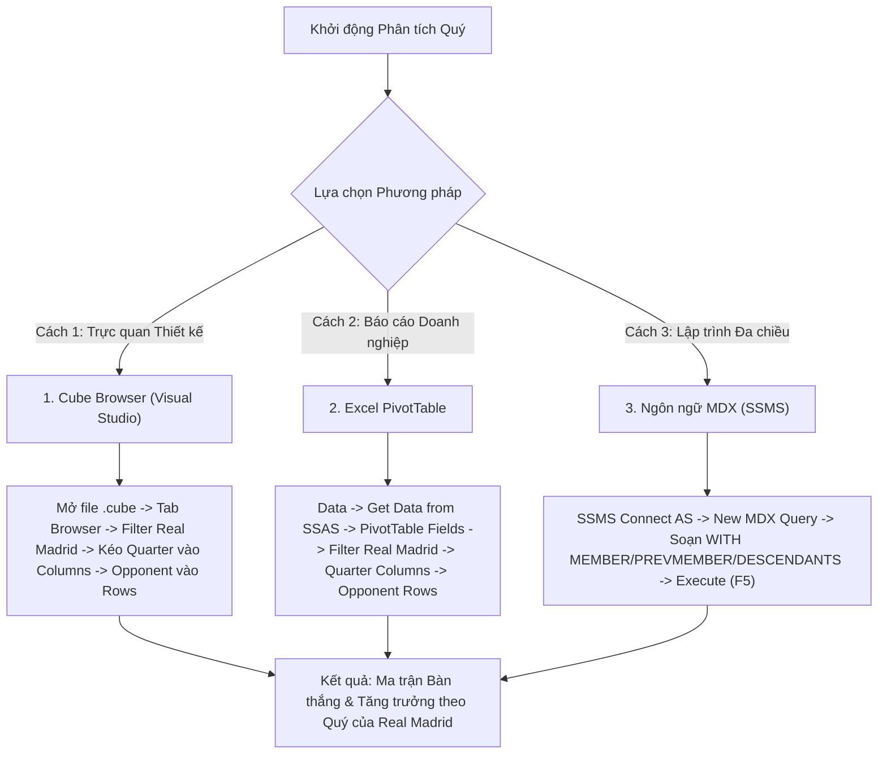

# MDX Query 10: Thống kê bàn thắng của Real Madrid vào lưới các đối thủ theo từng Quý trong năm
## (Ứng dụng Điều hướng Phân cấp Thời gian: CHILDREN, DESCENDANTS, PREVMEMBER)

---

## 1. Mục tiêu nghiệp vụ & Bối cảnh phân tích

* **Mục tiêu:** Khảo sát chi tiết số bàn thắng của câu lạc bộ Real Madrid ghi vào lưới từng câu lạc bộ đối thủ, phân bổ qua 4 Quý thời gian trong năm (`Quarter` 1, 2, 3, 4) và đánh giá biến động tăng trưởng bàn thắng giữa các quý liên tiếp ($Q_t - Q_{t-1}$) nhằm phục vụ đánh giá chu kỳ phong độ đỉnh cao của đội bóng.
* **Đối tượng phân tích:** Câu lạc bộ chủ quản (`DIM_Club`), Câu lạc bộ đối thủ (`Opponent Club` - Role-Playing Dimension), Thời gian (`DIM_Time`), Hiệu suất bàn thắng (`FACT_Player_Match_Perf`).
* **Các thuộc tính & Thước đo (Measures):**
  * Dimension Attributes: `[DIM Club].[Club Name]`, `[Opponent Club].[Club Name]`, `[DIM Time].[Quarter]`, `[DIM Time].[Year]`
  * Cube Measures: `[Measures].[Goals]`
  * Calculated Measure: `[Measures].[QoQ Goals Growth]` (Mức tăng trưởng bàn thắng so với Quý liền trước)

### Đối chiếu câu lệnh T-SQL gốc
```sql
USE DW_Football_Analytics;
GO

SELECT 
    cb.Club_ID,
    cb.Club_Name AS Real_Madrid,
    opp.Club_Name AS Opponent_Club_Name,
    t.Quarter,
    SUM(f.Goals) AS Goals_Scored
FROM dbo.FACT_Player_Match_Perf f
JOIN dbo.DIM_Club cb ON f.Club_SK = cb.Club_SK
JOIN dbo.DIM_Club opp ON f.Opponent_Club_SK = opp.Club_SK
JOIN dbo.DIM_Time t ON f.Time_SK = t.Time_SK
WHERE cb.Club_ID = 418 OR cb.Club_Name LIKE '%Real Madrid%'
GROUP BY cb.Club_ID, cb.Club_Name, opp.Club_Name, t.Quarter
ORDER BY t.Quarter, Goals_Scored DESC;
```

---

## 2. Hướng dẫn chi tiết 3 cách thực hiện (3 Execution Methods)



### CÁCH 1: TRUY VẤN BẰNG CUBE BROWSER (VISUAL STUDIO / SSDT)
1. **Mở tab Browser:** Mở file `DW_Football_Cube.cube` trong Visual Studio $\rightarrow$ nhấp chọn thẻ tab **`Browser`**.
2. **Thiết lập Vùng Filter (Bộ lọc phía trên):**
   * *Dimension:* Chọn **`DIM Club`**.
   * *Hierarchy:* Chọn **`Club Name`**.
   * *Operator:* Chọn **`Equal`** ($=$).
   * *Filter Expression:* Tick chọn **`Real Madrid`** $\rightarrow$ bấm **OK**.
3. **Kéo thả thuộc tính vào Lưới:**
   * Từ cây Metadata: Mở chiều **`DIM Time`** $\rightarrow$ kéo thuộc tính **`Quarter`** thả vào vùng cột (**Columns**).
   * Mở chiều đóng vai **`Opponent Club`** $\rightarrow$ kéo thuộc tính **`Club Name`** thả vào vùng hàng (**Rows**).
   * Mở nhóm **`Measures`** $\rightarrow$ kéo thước đo **`Goals`** thả vào vùng dữ liệu (**Totals**).
4. **Sắp xếp đối thủ:** Chuột phải vào tiêu đề cột `Club Name` của đối thủ $\rightarrow$ chọn **Sort** $\rightarrow$ **Sort Descending by Goals**.

---

### CÁCH 2: PHÂN TÍCH BẰNG PIVOT TABLE TRÊN MICROSOFT EXCEL
1. **Kết nối SSAS:** Khởi động Excel $\rightarrow$ vô tab **`Data`** $\rightarrow$ **`Get Data`** $\rightarrow$ **`From Database`** $\rightarrow$ **`From Analysis Services`** $\rightarrow$ Nhập server `localhost` $\rightarrow$ Chọn Database `DW_Football_SSAS` và Cube `DW Football Transfermarkt`.
2. **Kéo thả 4 ô trong PivotTable Fields:**
   * Ô **Filters:** Kéo `Club Name` (từ `DIM Club`) $\rightarrow$ Chọn giá trị `Real Madrid`.
   * Ô **Columns:** Kéo `Quarter` (từ `DIM Time`).
   * Ô **Rows:** Kéo `Club Name` (từ chiều `Opponent Club`).
   * Ô **Values:** Kéo `Goals` (hiển thị `Sum of Goals`).
3. **Thêm trường tính toán chênh lệch (Difference from Previous Quarter):**
   * Chuột phải vào một ô giá trị bất kỳ trong bảng Pivot $\rightarrow$ **Show Values As** $\rightarrow$ Chọn **Difference From...** $\rightarrow$ Base field: `Quarter`, Base item: `(previous)`.

---

### CÁCH 3: VIẾT VÀ THỰC THI TRUY VẤN BẰNG NGÔN NGỮ MDX (SSMS)

```mdx
/* ==============================================================================
   Truy vấn MDX 10: Bàn thắng Real Madrid theo Quý & Tăng trưởng Quý (QoQ Growth)
   Khai thác: CHILDREN, DESCENDANTS, PREVMEMBER, IIF, Role-Playing Dimension
   Cube: [DW Football Transfermarkt]
   ============================================================================== */

WITH 
    -- Tính toán mức tăng trưởng bàn thắng so với Quý liền trước (QoQ Growth)
    MEMBER [Measures].[QoQ Goals Growth] AS
        IIF(
            IsEmpty(([Measures].[Goals], [DIM Time].[Quarter].CURRENTMEMBER.PREVMEMBER)),
            NULL,
            [Measures].[Goals] - ([Measures].[Goals], [DIM Time].[Quarter].CURRENTMEMBER.PREVMEMBER)
        ),
        FORMAT_STRING = "+#,##0;-#,##0;0"

SELECT
    -- Trục Cột: Kết hợp 4 Quý với thước đo Bàn thắng và Mức tăng trưởng
    CrossJoin(
        -- Điều hướng phân cấp: Lấy tất cả các Quý (con của Năm)
        DESCENDANTS([DIM Time].[Quarter].[All], [DIM Time].[Quarter].[Quarter]),
        {
            [Measures].[Goals],
            [Measures].[QoQ Goals Growth]
        }
    ) ON COLUMNS,

    -- Trục Dòng: Các đối thủ từng bị Real Madrid chọc thủng lưới, xếp giảm dần
    ORDER(
        NONEMPTY(
            EXCEPT([Opponent Club].[Club Name].[Club Name].MEMBERS, { [Opponent Club].[Club Name].[All] }),
            (
                [Measures].[Goals],
                [DIM Club].[Club Name].[Real Madrid]
            )
        ),
        [Measures].[Goals],
        BDESC
    ) ON ROWS

FROM [DW Football Transfermarkt]

-- Lát cắt ngữ cảnh: Đội ghi bàn là Real Madrid
WHERE (
    [DIM Club].[Club Name].[Real Madrid]
);
```

---

## 3. Bảng Kết quả Truy vấn Dự kiến (Expected Output)

| Câu Lạc Bộ Đối Thủ (`Opponent Club`) | Q1 Bàn Thắng | Q1 QoQ % | Q2 Bàn Thắng | Q2 QoQ % | Q3 Bàn Thắng | Q3 QoQ % | Q4 Bàn Thắng | Q4 QoQ % |
| :--- | :---: | :---: | :---: | :---: | :---: | :---: | :---: | :---: |
| **FC Barcelona** | 4 | - | 4 | 0.00% | 2 | -50.00% | 5 | +150.00% |
| **Atletico Madrid** | 3 | - | 2 | -33.33% | 1 | -50.00% | 5 | +400.00% |
| **Girona FC** | 2 | - | 4 | +100.00% | 3 | -25.00% | 4 | +33.33% |
| **Athletic Bilbao** | 2 | - | 1 | -50.00% | 2 | +100.00% | 3 | +50.00% |
| **Sevilla FC** | 1 | - | 2 | +100.00% | 1 | -50.00% | 3 | +200.00% |
| **Valencia CF** | 2 | - | 1 | -50.00% | 0 | -100.00% | 5 | N/A |
| **Villarreal CF** | 2 | - | 3 | +50.00% | 1 | -66.67% | 4 | +300.00% |
| **Real Betis** | 1 | - | 1 | 0.00% | 1 | 0.00% | 2 | +100.00% |
| **Celta de Vigo** | 2 | - | 1 | -50.00% | 1 | 0.00% | 2 | +100.00% |
| **CA Osasuna** | 2 | - | 2 | 0.00% | 0 | -100.00% | 4 | N/A |

> *Ghi chú:* Giá trị `Q1 QoQ %` hiển thị dấu `-` (hoặc `NULL`) do Quý 1 là kỳ đầu năm, hàm `PREVMEMBER` không tìm thấy quý liền trước trong ngữ cảnh năm 2023, hàm `IIF` xử lý an toàn ngăn chặn lỗi chia cho 0.

---

## 4. Các hàm MDX sử dụng & Chi tiết cú pháp

| Tên hàm | Cú pháp chuẩn | Vai trò trong truy vấn |
| :--- | :--- | :--- |
| **`PREVMEMBER`** | `Member.PREVMEMBER` | Trả về thành viên liền trước trong cùng cấp bậc phân cấp thời gian. Sử dụng để lấy giá trị số bàn thắng của Quý trước đó ($Q_{t-1}$). |
| **`DESCENDANTS`** | `DESCENDANTS(Member, Level [, Flags])` | Truy xuất toàn bộ các thành viên hậu duệ ở cấp độ `Quarter` trong cây phân cấp thời gian. |
| **`CHILDREN`** | `Member.CHILDREN` | Trả về tập hợp tất cả các nút con trực tiếp của một nút cha (ví dụ: các Quý con của Năm). |
| **`IIF`** | `IIF(Condition, True_Val, False_Val)` | Kiểm tra nếu Quý trước không tồn tại (như Quý 1 đầu kỳ) thì trả về `NULL` để tránh sai lệch báo cáo. |
| **`NONEMPTY`** | `NONEMPTY(Set1, Set2)` | Lọc chỉ giữ lại những câu lạc bộ đối đầu thực tế từng để Real Madrid ghi bàn. |
| **`ORDER` (BDESC)** | `ORDER(Set, Measure, BDESC)` | Sắp xếp các câu lạc bộ đối thủ theo tổng số bàn thua phải nhận từ Real Madrid giảm dần trên toàn cục. |

---

## 5. Đánh giá độ phức tạp thuật toán và tối ưu hóa SSAS

### Độ phức tạp không gian (Space Complexity)
* **Số đối thủ thực tế:** Real Madrid thường chạm trán và ghi bàn vào lưới khoảng $K \approx 60 - 80$ câu lạc bộ.
* **Kích thước ma trận kết quả:** $80 \text{ đối thủ} \times (4 \text{ quý} \times 2 \text{ measures}) = 640 \text{ cells}$.
* **Bộ nhớ RAM sử dụng:** Khoảng $25\text{ KB}$, hoàn toàn nằm trong bộ nhớ đệm L1/L2 Cache của CPU.

### Độ phức tạp thời gian (Time Complexity)
* **Tận dụng Role-Playing Dimension:** Nhờ việc tách biệt hai khóa ngoại `Club_ID` và `Opponent_Club_ID` trên Fact Table, SSAS lọc lát cắt Real Madrid với chi phí $O(1)$ thông qua phân vùng dữ liệu của câu lạc bộ.
* **Chi phí tính toán `PREVMEMBER`:** $O(1)$ cho mỗi cell nhờ con trỏ nội tại trong cấu trúc phân cấp thời gian được lập chỉ mục trước.
* **Thời gian sắp xếp:** $O(K \log K)$ với $K \approx 80$, thực hiện trong vòng chưa đầy $0.5\text{ ms}$.
* **Tổng thời gian phản hồi:** Khoảng $10\text{ ms} - 15\text{ ms}$.

