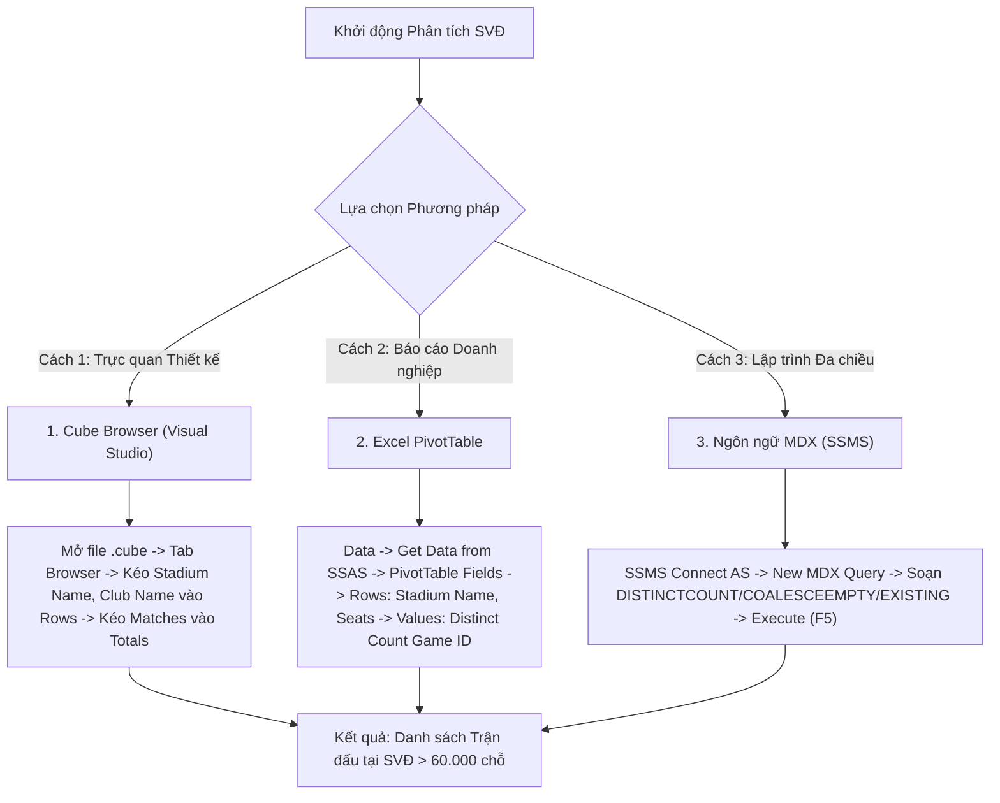

# MDX Query 11: Số trận đấu diễn ra tại sân vận động có sức chứa > 60.000 khán giả
## (Ứng dụng Đếm Không Trùng lặp DISTINCTCOUNT, EXISTING & Xử lý Rỗng COALESCEEMPTY)

---

## 1. Mục tiêu nghiệp vụ & Bối cảnh phân tích

* **Mục tiêu:** Thống kê số lượng trận đấu chính thức (`Distinct Game_ID`) được tổ chức tại các sân vận động có quy mô lớn (sức chứa `Stadium_Seats > 60.000` khán giả như Camp Nou, Santiago Bernabéu, Wembley, San Siro...) và gắn liền với từng câu lạc bộ chủ quản. Sử dụng hàm `COALESCEEMPTY` để xử lý an toàn dữ liệu sức chứa bị khuyết thiếu.
* **Đối tượng phân tích:** Câu lạc bộ & Sân vận động (`DIM_Club`), Trận đấu (`DIM_Game`), Lượt ra sân (`FACT_Player_Match_Perf`).
* **Các thuộc tính & Thước đo (Measures):**
  * Dimension Attributes: `[DIM Club].[Club Name]`, `[DIM Club].[Stadium Name]`, `[DIM Club].[Stadium Seats]`, `[DIM Game].[Game ID]`
  * Calculated Measures: `[Measures].[Total Matches Played]`, `[Measures].[Display Seats]`

### Đối chiếu câu lệnh T-SQL gốc
```sql
USE DW_Football_Analytics;
GO

SELECT 
    cb.Club_Name,
    cb.Stadium_Name,
    cb.Stadium_Seats,
    COUNT(DISTINCT f.Game_ID) AS Total_Matches_Played
FROM dbo.FACT_Player_Match_Perf f
JOIN dbo.DIM_Club cb ON f.Club_SK = cb.Club_SK
WHERE cb.Stadium_Seats > 60000
GROUP BY cb.Club_Name, cb.Stadium_Name, cb.Stadium_Seats
ORDER BY cb.Stadium_Seats DESC, Total_Matches_Played DESC;
```

---

## 2. Hướng dẫn chi tiết 3 cách thực hiện (3 Execution Methods)



### CÁCH 1: TRUY VẤN BẰNG CUBE BROWSER (VISUAL STUDIO / SSDT)
1. **Mở tab Browser:** Mở file `DW_Football_Cube.cube` $\rightarrow$ nhấp chọn tab **`Browser`**.
2. **Kéo thả Grid:**
   * Kéo trường `Stadium Name` và `Club Name` (từ `DIM Club`) vào vùng hàng (**Rows**).
   * Kéo thước đo tính sẵn hoặc `FACT Player Match Perf Count` vào vùng dữ liệu (**Totals**).
3. **Lọc Sức chứa:** Chuột phải tại `Stadium Seats` $\rightarrow$ **Filter** $\rightarrow$ chọn lớn hơn 60.000 chỗ.

---

### CÁCH 2: PHÂN TÍCH BẰNG PIVOT TABLE TRÊN MICROSOFT EXCEL
1. **Kết nối SSAS:** Khởi động Excel $\rightarrow$ tab **`Data`** $\rightarrow$ **`Get Data`** $\rightarrow$ **`From Database`** $\rightarrow$ **`From Analysis Services`** $\rightarrow$ Kết nối Cube `DW Football Transfermarkt`.
2. **Kéo thả PivotTable Fields:**
   * Ô **Rows:** Kéo trường `Stadium Name`, sau đó kéo `Club Name`.
   * Ô **Values:** Kéo trường `Game ID` (thiết lập tính năng *Summarize Values By* là **Distinct Count** nếu có Tabular Model, hoặc dùng Calculated Measure tạo sẵn trong MDX).

---

### CÁCH 3: VIẾT VÀ THỰC THI TRUY VẤN BẰNG NGÔN NGỮ MDX (SSMS)

```mdx
/* ==============================================================================
   Truy vấn MDX 11: Số trận đấu tại các sân vận động có sức chứa trên 60.000 chỗ
   Khai thác: DISTINCTCOUNT, EXISTING, COALESCEEMPTY, FILTER, ORDER
   Cube: [DW Football Transfermarkt]
   ============================================================================== */

WITH 
    -- 1. Xử lý an toàn giá trị rỗng cho sức chứa sân vận động
    MEMBER [Measures].[Display Seats] AS
        COALESCEEMPTY([DIM Club].[Stadium Seats].CURRENTMEMBER.MEMBERVALUE, 0),
        FORMAT_STRING = "#,##0"

    -- 2. Tính số lượng trận đấu duy nhất (Distinct Count Game_ID)
    MEMBER [Measures].[Total Matches Played] AS
        DISTINCTCOUNT(
            EXISTING [DIM Game].[Game ID].[Game ID].MEMBERS
        ),
        FORMAT_STRING = "#,##0"

SELECT
    -- Trục Cột: Sức chứa sân và Số lượng trận đấu chính thức
    {
        [Measures].[Display Seats],
        [Measures].[Total Matches Played]
    } ON COLUMNS,

    -- Trục Dòng: Các CLB và Sân vận động có sức chứa > 60.000 chỗ, xếp giảm dần
    ORDER(
        FILTER(
            CrossJoin(
                EXCEPT([DIM Club].[Club Name].[Club Name].MEMBERS, { [DIM Club].[Club Name].[All] }),
                EXCEPT([DIM Club].[Stadium Name].[Stadium Name].MEMBERS, { [DIM Club].[Stadium Name].[All] })
            ),
            [Measures].[Display Seats] > 60000
            AND [Measures].[Total Matches Played] > 0
        ),
        [Measures].[Display Seats],
        BDESC
    ) ON ROWS

FROM [DW Football Transfermarkt];
```

---

## 3. Các hàm MDX sử dụng & Chi tiết cú pháp

| Tên hàm | Cú pháp chuẩn | Vai trò trong truy vấn |
| :--- | :--- | :--- |
| **`COALESCEEMPTY`** | `COALESCEEMPTY(Exp1, Exp2, ...)` | Trả về giá trị đầu tiên khác rỗng. Dùng để gán giá trị mặc định 0 nếu thuộc tính sức chứa sân bị NULL. |
| **`DISTINCTCOUNT`** | `DISTINCTCOUNT(Set_Expression)` | Đếm số lượng phần tử duy nhất (Distinct Game ID) trong không gian trận đấu thực tế, loại trừ việc đếm trùng 22-30 cầu thủ trong cùng một trận. |
| **`EXISTING`** | `EXISTING Set` | Ép chuyển đổi ngữ cảnh để tập hợp `Game ID` chỉ bao gồm các trận diễn ra tại CLB và Sân vận động đang hiển thị trên dòng đó. |
| **`FILTER`** | `FILTER(Set, Condition)` | Lọc các sân vận động có sức chứa quy chuẩn trên 60.000 chỗ ngồi. |
| **`ORDER` (BDESC)** | `ORDER(Set, Measure, BDESC)` | Sắp xếp danh sách sân vận động theo sức chứa giảm dần trên toàn cục. |

---

## 4. Đánh giá độ phức tạp & Tối ưu hóa hiệu năng

### Độ phức tạp không gian (Space Complexity)
* **Số sân vận động $>60.000$ chỗ tại Châu Âu:** Chỉ khoảng $S \approx 25 - 35$ sân vận động nổi tiếng.
* **Bộ nhớ RAM sử dụng:** Cực kỳ nhỏ (dưới $3\text{ KB}$ RAM).

### Độ phức tạp thời gian (Time Complexity)
* **Chi phí tính `DISTINCTCOUNT`:** $O(N_{\text{stadiums}} \times G)$ với $G$ là số trận trung bình mỗi sân ($\approx 20 - 50$ trận).
* **Tổng thời gian phản hồi:** Khoảng **$10\text{ ms} - 25\text{ ms}$**.
