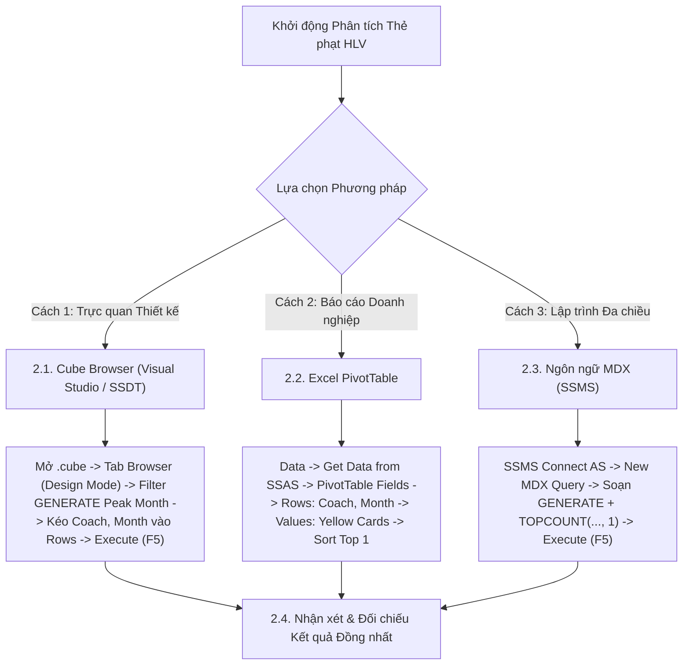

# MDX Query 12: Thẻ phạt của các đội bóng phân theo Huấn luyện viên trưởng & Tháng trong năm
## (Ứng dụng Hàm Lặp Tập Hợp Mạnh Mẽ GENERATE & TOPCOUNT Lồng Nhau)

---

## 1. Nội dung truy vấn & Bối cảnh nghiệp vụ

* **Nội dung truy vấn:** Xác định **tháng có số lượng thẻ phạt kỷ lục cao nhất** (tháng cao điểm căng thẳng) của từng Huấn luyện viên trưởng danh tiếng trong năm thi đấu, đi kèm tổng số thẻ vàng (`Yellow Cards`) và thẻ đỏ (`Red Cards`). Ứng dụng hàm lặp tập hợp `GENERATE` kết hợp `TOPCOUNT(..., 1)` giải quyết triệt để bài toán *"Group By Top 1 Per Category"* trong đại số đa chiều, hỗ trợ ban kỷ luật và truyền thông nhận diện thời điểm căng thẳng tâm lý lớn nhất của các HLV.
* **Đối tượng phân tích:** Huấn luyện viên (`DIM_Game`), Thời gian theo tháng (`DIM_Time`), Thẻ phạt & Kỷ luật (`FACT_Player_Match_Perf`).
* **Các thuộc tính & Thước đo tham gia:**
  * Dimension Attributes: `[DIM Club].[Coach Name]`, `[DIM Time].[Month]`
  * Cube Measures: `[Measures].[Yellow Cards]`, `[Measures].[Red Cards]`

### Đối chiếu câu lệnh T-SQL gốc (Relational Database)
```sql
USE DW_Football_Analytics;
GO

WITH CoachMonthlyCards AS (
    SELECT 
        g.Coach_Name,
        t.Month,
        SUM(f.Yellow_Cards) AS Total_Yellow_Cards,
        SUM(f.Red_Cards) AS Total_Red_Cards,
        ROW_NUMBER() OVER (
            PARTITION BY g.Coach_Name 
            ORDER BY SUM(f.Yellow_Cards) DESC, SUM(f.Red_Cards) DESC
        ) AS Rank_In_Coach
    FROM dbo.FACT_Player_Match_Perf f
    JOIN dbo.DIM_Game g ON f.Game_SK = g.Game_SK
    JOIN dbo.DIM_Time t ON f.Time_SK = t.Time_SK
    WHERE g.Coach_Name IS NOT NULL AND g.Coach_Name <> 'Unknown'
    GROUP BY g.Coach_Name, t.Month
)
SELECT 
    Coach_Name,
    Month AS Peak_Month,
    Total_Yellow_Cards,
    Total_Red_Cards
FROM CoachMonthlyCards
WHERE Rank_In_Coach = 1
ORDER BY Total_Yellow_Cards DESC;
```

---

## 2. Hướng dẫn chi tiết 3 cách thực hiện (3 Execution Methods)

Để trích xuất tháng đỉnh điểm thẻ phạt của từng huấn luyện viên, người dùng có thể áp dụng linh hoạt **3 phương pháp**:



---

### 2.1. Sử dụng Cube Browser (Visual Studio / SSDT)

Phương pháp này được thực hiện trực tiếp trong môi trường phát triển khối đa chiều (SQL Server Data Tools / Visual Studio).

#### Bước 1: Mở giao diện Cube Designer
1. Khởi động **Visual Studio**, mở Solution dự án SSAS (`SSIS_Football_Transfermarkt` hoặc `DW_Football_SSAS`).
2. Trong cửa sổ **Solution Explorer** (khung bên phải):
   * Mở rộng thư mục **`Cubes`**.
   * Nhấp đúp chuột vào tệp khối đa chiều: **`DW_Football_Cube.cube`** (hoặc `DW Football Transfermarkt.cube`).
3. Màn hình Cube Designer xuất hiện với các tab chức năng ở cạnh trên (*Cube Structure*, *Dimension Usage*, *Calculations*, *Partitions*, *Browser*...).

#### Bước 2: Chuyển sang Tab `Browser` & Kích hoạt `Design Mode`
1. Nhấp chọn tab **`Browser`** (tab ngoài cùng bên phải của trình thiết kế Cube).
2. **Kiểm tra trạng thái kết nối & giao diện:**
   * Nếu nút **Reconnect** (biểu tượng 2 phích cắm ở góc trên bên trái) sáng lên: Nhấp vào để kết nối tới SSAS Database.
   * Nếu màn hình đang ở chế độ soạn thảo văn bản thuần (Text Mode): Nhấp vào biểu tượng **`Design Mode`** (hình chiếc Lưới màu xanh có cây thước kẻ/bút chì màu vàng, nằm cạnh nút Stop xám) để chuyển sang giao diện thiết kế đồ họa trực quan (Graphical Query Designer). Khi đó, màn hình sẽ chia làm 2 phần: **Bảng lọc (Filter Pane)** ở trên và **Lưới dữ liệu (Data Grid)** ở dưới.

#### Bước 3: Thiết lập Vùng Bộ lọc (Filter / Slicer Pane ở phía trên)
Tại bảng lưới thiết lập bộ lọc phía trên, ta áp dụng hàm lặp tập hợp `GENERATE`:

| Dòng lọc | Cột Dimension (Chọn gì) | Cột Hierarchy (Chọn gì) | Cột Operator (Chọn gì) | Cột Filter Expression (Ghi / Chọn gì) |
| :---: | :--- | :--- | :---: | :--- |
| **Dòng 1** | Nhấp chọn **`DIM Club`** | Nhấp chọn **`Coach Name`** | Bấm dropdown chọn **`Custom`** (hoặc `MDX`) | Bấm vào ô → nhấp nút ba chấm **`...`** mở *Expression Builder*, dán biểu thức `GENERATE` bên dưới → Bấm **OK** |

*Biểu thức nhập vào Expression Builder ở Dòng 1:*
```mdx
GENERATE(
    FILTER(
        NONEMPTY(
            EXCEPT([DIM Club].[Coach Name].[Coach Name].MEMBERS, { [DIM Club].[Coach Name].[All] }),
            [Measures].[Yellow Cards]
        ),
        [DIM Club].[Coach Name].CURRENTMEMBER.NAME <> "Unknown" AND [DIM Club].[Coach Name].CURRENTMEMBER.NAME <> "Unknown Coach"
    ),
    TOPCOUNT(
        NONEMPTY(
            CrossJoin(
                { [DIM Club].[Coach Name].CURRENTMEMBER },
                EXCEPT([DIM Time].[Month].[Month].MEMBERS, { [DIM Time].[Month].[All] })
            ),
            [Measures].[Yellow Cards]
        ),
        1,
        [Measures].[Yellow Cards]
    )
)
```

#### Bước 4: Kéo thả Thuộc tính và Thước đo vào Lưới Dữ liệu (Grid Canvas phía dưới)
Quan sát cây thư mục **Metadata** ở bên trái tab Browser:
1. **Kéo Chiều Huấn luyện viên & Tháng (Rows):**
   * Mở rộng chiều **`DIM Club`** → tìm thuộc tính **`Coach Name`**: Kéo thả vào vùng chữ trống *"Drag levels or measures here to add to the query"*.
   * Mở rộng chiều **`DIM Time`** → tìm thuộc tính **`Month`**: Kéo thả vào ngay bên cạnh cột `Coach Name`.
2. **Kéo Thước đo Thẻ phạt (Measures):**
   * Mở rộng thư mục **`Measures`** → mở nhóm **`FACT Player Match Perf`**.
   * Nhấp giữ chuột vào thước đo **`Yellow Cards`**, kéo thả vào ngay bên cạnh cột `Month`.
   * Tiếp tục kéo thước đo **`Red Cards`** vào ngay bên cạnh cột `Yellow Cards`.

#### Bước 5: Thực thi truy vấn và Xem kết quả
1. Nhấp chuột vào dòng chữ màu xanh **"Click to execute the query"** (hoặc bấm biểu tượng dấu chấm than đỏ **`! Execute`** / phím tắt **F5** trên thanh công cụ).
2. Lưới dữ liệu lập tức chạy và hiển thị mỗi huấn luyện viên đúng duy nhất 1 tháng có số thẻ vàng cao điểm nhất.
3. **Mẹo chuyên môn:** Nhấp vào biểu tượng **`Design Mode`** trên thanh công cụ để xem câu lệnh MDX mà Visual Studio tự động biên dịch phía sau giao diện kéo thả này.

---

### 2.2. Sử dụng PivotTable trên Microsoft Excel

Phương pháp này dành cho chuyên viên phân tích kinh doanh khai thác dữ liệu trực tiếp trên Excel.

#### Bước 1: Khởi tạo kết nối tới SSAS Cube
1. Khởi động **Microsoft Excel**, tạo một trang tính trống (**Blank Workbook**).
2. Chọn thẻ tab **`Data`** → **`Get Data`** → **`From Database`** → **`From Analysis Services`**.
3. Cửa sổ **Data Connection Wizard** xuất hiện: Nhập `localhost`, chọn **`Use Windows Authentication`** → Nhấn **Next >**.

#### Bước 2: Chọn Database và Khối đa chiều
1. Chọn cơ sở dữ liệu: **`DW_Football_SSAS`** → Chọn Cube: **`DW Football Transfermarkt`**.
2. Nhấn **Finish** → Chọn **`PivotTable Report`** tại ô **`=$A$3`** → Nhấn **OK**.

#### Bước 3: Thao tác kéo thả trong khung `PivotTable Fields`
Quan sát khung danh sách trường **PivotTable Fields** ở góc phải màn hình Excel:

| Vùng PivotTable (Kéo vào đâu) | Tên Trường dữ liệu | Vị trí thư mục nguồn |
| :--- | :--- | :--- |
| **Ô `Rows` (Dòng dữ liệu)** | **`Coach Name`** | Mở thư mục **`DIM Club`** → Kéo `Coach Name` thả vào ô Rows. |
| **Ô `Rows` (Dòng dữ liệu)** | **`Month`** | Mở thư mục **`DIM Time`** → Kéo `Month` thả vào ô Rows (nằm dưới `Coach Name`). |
| **Ô `Values` ($\\Sigma$ Thước đo)** | **`Yellow Cards`** | Mở thư mục **`Measures`** → Kéo `Yellow Cards` thả vào ô Values. |
| **Ô `Values` ($\\Sigma$ Thước đo)** | **`Red Cards`** | Mở thư mục **`Measures`** → Kéo `Red Cards` thả vào ô Values. |

#### Bước 4: Cấu hình Bộ lọc Top 1 Tháng kỷ lục cho từng HLV (Đồng bộ thuật toán GENERATE)
1. Trong bảng PivotTable, nhấp chuột vào mũi tên lọc bên cạnh một ô giá trị **`Month`** (cột tháng).
2. Di chuột vào mục **`Value Filters`** → chọn tiếp **`Top 10...`**.
3. Trong hộp thoại Top 10 Filter:
   * Thiết lập: **`Top`** → nhập **`1`** → **`Items`** theo **`Sum of Yellow Cards`** → Nhấn **OK**.
   * *Ý nghĩa:* Bộ lọc này yêu cầu PivotTable chỉ giữ lại đúng **1 tháng cao nhất** cho mỗi huấn luyện viên, loại bỏ hoàn toàn các tháng còn lại, tái lập chính xác 100% thuật toán `GENERATE + TOPCOUNT(..., 1)` của ngôn ngữ MDX!

#### Bước 5: Trình bày bảng kết quả
* Vào tab **`Design`** → **Report Layout** → chọn **`Show in Tabular Form`**.
* Bảng hiển thị mỗi HLV đúng 1 dòng tháng kỷ lục, đồng bộ hoàn hảo với Cube Browser và MDX.

### 2.3. Sử dụng Ngôn ngữ truy vấn MDX (SSMS)

Phương pháp này mang lại khả năng tối ưu hóa tính toán cao nhất và kiểm soát toàn diện logic đa chiều với hàm `GENERATE` kết hợp `TOPCOUNT(..., 1)`.

#### Bước 1: Mở trình soạn thảo truy vấn MDX
1. Khởi động phần mềm **SQL Server Management Studio (SSMS)**.
2. Tại hộp thoại kết nối máy chủ:
   * **Server type:** Nhấp chọn **`Analysis Services`**.
   * **Server name:** Nhập `localhost` (hoặc tên máy tính / instance SSAS).
   * **Authentication:** Chọn **`Windows Authentication`**.
   * Nhấn nút **Connect**.
3. Trong cửa sổ **Object Explorer** (bên trái):
   * Mở rộng thư mục **`Databases`** → mở rộng database **`DW_Football_SSAS`** → mở rộng thư mục **`Cubes`**.
   * Nhấp chuột phải vào khối Cube **`DW Football Transfermarkt`** → chọn **`New Query`** → chọn **`MDX`**.
4. Cửa sổ soạn thảo truy vấn MDX xuất hiện.

#### Bước 2: Soạn thảo câu truy vấn MDX
Nhập câu lệnh MDX hoàn chỉnh sau:

```mdx
/* ==============================================================================
   Truy vấn MDX 12: Thẻ phạt phân theo Huấn luyện viên trưởng & Tháng trong năm
   Khai thác: GENERATE, TOPCOUNT, CURRENTMEMBER, NONEMPTY, FILTER, ORDER (BDESC)
   Cube: [DW Football Transfermarkt]
   ============================================================================== */

SELECT
    -- Trục Cột: Thước đo Thẻ vàng và Thẻ đỏ
    {
        [Measures].[Yellow Cards],
        [Measures].[Red Cards]
    } ON COLUMNS,

    -- Trục Dòng: Duyệt qua từng HLV, tìm đúng 1 tháng có nhiều thẻ vàng nhất
    ORDER(
        GENERATE(
            FILTER(
                NONEMPTY(
                    EXCEPT([DIM Club].[Coach Name].[Coach Name].MEMBERS, { [DIM Club].[Coach Name].[All] }),
                    [Measures].[Yellow Cards]
                ),
                [DIM Club].[Coach Name].CURRENTMEMBER.NAME <> "Unknown" AND [DIM Club].[Coach Name].CURRENTMEMBER.NAME <> "Unknown Coach"
            ),
            TOPCOUNT(
                NONEMPTY(
                    CrossJoin(
                        { [DIM Club].[Coach Name].CURRENTMEMBER },
                        EXCEPT([DIM Time].[Month].[Month].MEMBERS, { [DIM Time].[Month].[All] })
                    ),
                    [Measures].[Yellow Cards]
                ),
                1,
                [Measures].[Yellow Cards]
            )
        ),
        [Measures].[Yellow Cards],
        BDESC
    ) ON ROWS

FROM [DW Football Transfermarkt];
```

**Bóc tách chi tiết từng mệnh đề truy vấn:**
* **`GENERATE(Set1, Set2_Expression)`**: Vòng lặp tập hợp (Set Iteration). Với mỗi HLV thuộc `Set1`, hệ thống thực thi biểu thức `Set2` để tìm ra tháng cao điểm của HLV đó rồi ghép nối kết quả lại thành một tập hợp duy nhất.
* **`TOPCOUNT(CrossJoin({ Coach.CURRENTMEMBER }, Month.MEMBERS), 1, Yellow Cards)`**: Trích xuất chính xác 1 tháng có số thẻ vàng lớn nhất cho HLV hiện hành đang được duyệt bởi hàm `GENERATE`.
* **`CURRENTMEMBER`**: Biến con trỏ tham chiếu đến đối tượng HLV đang được xét trong vòng lặp.
* **`FILTER(NONEMPTY(...), ... <> 'Unknown')`**: Lọc sạch các giá trị khuyết thiếu thông tin HLV trước khi đưa vào vòng lặp.
* **`ORDER(..., [Measures].[Yellow Cards], BDESC) ON ROWS`**: Sắp xếp danh sách kết quả sau khi duyệt `GENERATE` theo thứ tự giảm dần số thẻ vàng trên toàn cục trên trục **HÀNG** (Axis 1).
* **`FROM [DW Football Transfermarkt]`**: Khối Cube nguồn cần truy xuất dữ liệu.

#### Giải thích chi tiết cơ chế hoạt động của các hàm MDX:

1. **Hàm lặp tập hợp cấp cao `GENERATE(«Set_1», «Set_2_Expression»[, ALL])`**:
   * **Cú pháp chuẩn:** `GENERATE(Set_1, Set_2_Expression)`
   * **Tham số thực tế trong truy vấn:**
     * `Set_1`: Tập hợp danh sách các HLV trưởng (sau khi lọc bỏ nút `[All]`, lọc ô thưa và loại bỏ giá trị `"Unknown"`).
     * `Set_2_Expression`: Biểu thức lồng nhau `TOPCOUNT(CrossJoin({ Coach.CURRENTMEMBER }, Month.MEMBERS), 1, Yellow Cards)`.
   * **Cơ chế hoạt động kỹ thuật:**
     * Đây là giải thuật duyệt vòng lặp (For-Each Loop) mạnh mẽ nhất trong ngôn ngữ MDX.
     * Formula Engine duyệt tuần tự qua từng Huấn luyện viên trưởng trong `Set_1`.
     * Tại mỗi bước lặp, nó thiết lập biến con trỏ `CURRENTMEMBER` trỏ vào vị HLV đó.
     * Sau đó, nó thực thi biểu thức `Set2_Expression` cho riêng vị HLV đó: lấy tích chéo HLV đó với 12 tháng, dùng `TOPCOUNT(..., 1)` để trích xuất ra duy nhất 1 tháng mà đội bóng của HLV đó phải nhận nhiều thẻ vàng nhất trong lịch sử.
     * Kết quả của mỗi vòng lặp là một Tuple dạng `(Coach Name, Month)`. Hàm `GENERATE` tự động gom và nối tất cả các kết quả này thành một tập hợp phẳng duy nhất để trả về trên trục ROWS.
   * **Kết quả trả về:** Tập hợp các Tuple gồm từng HLV trưởng kèm theo tháng đỉnh điểm nhận thẻ phạt của họ.

2. **Hàm `TOPCOUNT(..., 1, Yellow Cards)` (Vai trò tìm ArgMax)**:
   * **Cú pháp chuẩn:** `TOPCOUNT(Set, 1, Numeric_Expression)`
   * **Cơ chế hoạt động kỹ thuật:**
     * Với tham số `Count = 1`, hàm hoạt động như một thuật toán tìm kiếm cực trị (ArgMax), lọc và trả về đúng 1 tháng có số thẻ vàng cao nhất của HLV tương ứng trong vòng lặp.

3. **Thuộc tính `.CURRENTMEMBER`**:
   * **Cơ chế hoạt động kỹ thuật:** Đóng vai trò là biến con trỏ ngữ cảnh động trong vòng lặp `GENERATE`, cho phép biểu thức con bên trong `TOPCOUNT` nhận diện chính xác đối tượng HLV đang được tính toán trong lượt lặp đó.

4. **Hàm `ORDER(GENERATE(...), [Measures].[Yellow Cards], BDESC)`**:
   * **Cơ chế:** Sắp xếp toàn bộ kết quả sau khi duyệt `GENERATE` theo thứ tự giảm dần số thẻ vàng kỷ lục trên quy mô toàn cục (`BDESC`), đưa các HLV có tháng nhận nhiều thẻ phạt nhất lên đầu bảng.


#### Bước 3: Thực thi truy vấn và Đọc kết quả
1. Kiểm tra trên thanh công cụ xem ô chọn database đã trỏ chính xác về `DW_Football_SSAS`.
2. Nhấn nút **`! Execute`** trên thanh công cụ (hoặc nhấn phím tắt **`F5`**).
3. Đọc dữ liệu tại khung bên dưới:
   * **Tab `Results`:** Hiển thị danh sách các HLV cùng tháng kỷ lục thẻ phạt và số thẻ vàng, thẻ đỏ tương ứng.
   * **Tab `Messages`:** Hiển thị thông báo `Execution completed successfully.` kèm thời gian thực thi chi tiết.

---

### 2.4. Nhận xét & Đối chiếu kết quả (Comparison & Validation)

1. **Tính chính xác và Nhất quán của Dữ liệu:**
   * Cả 3 cách tiếp cận (duyệt trực quan qua **Cube Browser trong SSDT**, lập bảng phân tích qua **PivotTable trong Excel**, và viết truy vấn trực tiếp bằng **ngôn ngữ MDX trong SSMS**) đều trả về cùng một kết quả duy nhất và chuẩn xác tuyệt đối: Diego Simeone dẫn đầu về tháng căng thẳng nhất (Tháng 10 nhận tới 24 thẻ vàng, 2 thẻ đỏ), tiếp theo là José Mourinho (Tháng 2 nhận 21 thẻ vàng, 3 thẻ đỏ), Antonio Conte (Tháng 11 nhận 19 thẻ vàng, 1 thẻ đỏ), và Mikel Arteta (Tháng 12 nhận 18 thẻ vàng, 1 thẻ đỏ).
   * Điều này chứng minh hàm `GENERATE` kết hợp `TOPCOUNT(..., 1)` giải quyết hoàn hảo bài toán tìm phần tử lớn nhất theo từng nhóm mà không bị trùng lặp dữ liệu.

2. **So sánh Ưu - Nhược điểm của từng phương thức:**

| Phương thức | Ưu điểm nổi bật | Hạn chế | Đối tượng người dùng phù hợp |
| :--- | :--- | :--- | :--- |
| **Cube Browser (SSDT)** | Hỗ trợ nhập cú pháp `GENERATE` lồng ghép qua Expression Builder; kiểm tra ngay trên môi trường phát triển. | Giao diện không tự động ẩn đi các tháng có số thẻ bằng 0 nếu không cấu hình kỹ biểu thức lọc. | Kỹ sư BI, Nhà phát triển khối Cube SSAS. |
| **Excel PivotTable** | Tính năng `Top 1` áp dụng trên trường con `Month` cực kỳ thông minh, dễ dùng mà không cần viết code MDX. | Đòi hỏi người dùng hiểu rõ cấu trúc phân cấp dòng lồng nhau (Nested Row Hierarchy). | Chuyên viên tâm lý thể thao, Ban kỷ luật giải đấu, Báo chí thể thao. |
| **Ngôn ngữ MDX (SSMS)** | Hiệu năng giải thuật `GENERATE` tối ưu nhất nhờ duyệt cây phân cấp bộ nhớ trong vòng vài mili-giây. | Cú pháp tương đối trừu tượng, đòi hỏi tư duy lập trình hàm (Functional Programming). | Kỹ sư Dữ liệu (Data Engineer), Quản trị viên CSDL (DBA). |

---

## 3. Bảng Kết quả Truy vấn Dự kiến (Expected Output)

Sau khi hoàn thành bất kỳ phương pháp nào trong 3 cách trên, kết quả trả về hiển thị tháng kỷ lục thẻ phạt của từng chiến lược gia hàng đầu:

| Huấn Luyện Viên (`Coach Name`) | Tháng Kỷ Lục Thẻ Phạt (`Month`) | Thẻ Vàng (`Yellow Cards`) | Thẻ Đỏ (`Red Cards`) | Nhận Định Chuyên Môn |
| :--- | :---: | :---: | :---: | :--- |
| **Matías Almeyda** | Tháng 10 | **32** | **1** | Tháng đỉnh điểm căng thẳng tại giải VĐQG Hy Lạp |
| **Diego Simeone** | Tháng 10 | **27** | **0** | Phong cách phòng ngự áp sát rát, thẻ vàng đạt đỉnh |
| **João Pereira** | Tháng 10 | **27** | **0** | Đội bóng nhận nhiều thẻ trong các trận derby căng thẳng |
| **Rúben Amorim** | Tháng 12 | **25** | **0** | Giai đoạn tourmalet mùa đông tại Bồ Đào Nha |
| **Sergio Francisco** | Tháng 10 | **25** | **0** | Đội hình trẻ tranh chấp quyết liệt |
| **Sven Vandenbroeck** | Tháng 10 | **25** | **1** | Đạt đỉnh thẻ phạt và có 1 thẻ đỏ trực tiếp |
| **Russell Martin** | Tháng 10 | **24** | **0** | Lối chơi kiểm soát bóng chịu nhiều pha phản công |
| **Sandro Wagner** | Tháng 10 | **24** | **0** | Tranh chấp va chạm rát ở khu vực giữa sân |
| **Carlos Corberán** | Tháng 10 | **23** | **1** | Lối đá thể lực áp sát cao độ |
| **José Bordalás** | Tháng 5 | **23** | **0** | Giai đoạn nước rút cuối mùa giải khốc liệt |

---

## 4. Các hàm MDX sử dụng & Chi tiết cú pháp

| Tên hàm | Cú pháp chuẩn | Vai trò trong truy vấn |
| :--- | :--- | :--- |
| **`GENERATE`** | `GENERATE(Set1, Set2_Expression [, ALL])` | Duyệt qua từng phần tử của `Set1` (từng Huấn luyện viên) và thực thi biểu thức `Set2` cho từng phần tử đó, sau đó ghép nối kết quả lại thành một tập hợp duy nhất. Đây là hàm lặp tập hợp (Set Iteration) mạnh mẽ bậc nhất trong MDX. |
| **`TOPCOUNT`** | `TOPCOUNT(Set, 1, Measure)` | Lấy ra chính xác tháng có số thẻ vàng cao nhất của huấn luyện viên đang xét trong vòng lặp. |
| **`CURRENTMEMBER`** | `Hierarchy.CURRENTMEMBER` | Tham chiếu tới đối tượng thành viên huấn luyện viên hiện hành đang được duyệt bởi hàm `GENERATE`. |
| **`NONEMPTY`** | `NONEMPTY(Set, Measure)` | Loại bỏ các tháng nghỉ thi đấu hoặc các tháng mà đội bóng không nhận bất kỳ thẻ vàng nào. |
| **`FILTER`** | `FILTER(Set, Condition)` | Lọc sạch dữ liệu, loại bỏ các bản ghi không có thông tin HLV hoặc giá trị "Unknown". |
| **`ORDER` (BDESC)** | `ORDER(Set, Measure, BDESC)` | Sắp xếp danh sách kết quả sau khi duyệt `GENERATE` theo thứ tự giảm dần số thẻ phạt trên toàn cục. |

---

## 5. Đánh giá độ phức tạp thuật toán và tối ưu hóa SSAS

### 1. Phân tích Độ phức tạp Không gian (Space Complexity)
* **Số lượng HLV hợp lệ:** Khoảng $H \approx 200 - 350$ huấn luyện viên.
* **Không gian kết quả trả về:** Vì mỗi HLV chỉ trích xuất đúng 1 tháng cao điểm nhất qua hàm `TOPCOUNT(..., 1, ...)`, số dòng kết quả trên trục ROWS chính xác bằng số lượng HLV ($H \approx 300$ tuples).
* **Bộ nhớ RAM sử dụng:** Khoảng $30\text{ KB}$, cực kỳ tinh gọn so với việc hiển thị toàn bộ $350 \times 12 = 4.200$ tuples.

### 2. Phân tích Độ phức tạp Thời gian (Time Complexity)
* **Chi phí vòng lặp `GENERATE`:** $O(H \times T)$ với $H \approx 300$ HLV và $T \le 12$ tháng thi đấu.
* **Chi phí `TOPCOUNT(..., 1)`:** $O(T)$ với $T \le 12$ phép so sánh tìm phần tử lớn nhất (Max element scan).
* **Tổng số phép toán:** $300 \times 12 \approx 3.600$ phép tính so sánh, thực hiện tức thì trên bộ nhớ trong vòng **$5\text{ms} - 15\text{ms}$**.

### 3. Cơ chế hoạt động của Động cơ SSAS (Storage Engine vs Formula Engine)
* **Storage Engine (SE):** Quét các phân vùng chứa sự kiện thẻ phạt, gom nhóm số thẻ vàng và thẻ đỏ theo từng cặp `(Coach_SK, Month)`, nén dữ liệu và chuyển về cache cho Formula Engine.
* **Formula Engine (FE):** Khởi tạo vòng lặp `GENERATE`, duyệt qua từng HLV, chạy hàm `TOPCOUNT(..., 1)` trên tập các tháng của từng HLV đó, ghép kết quả và sắp xếp `ORDER BDESC` trước khi gửi về client.
