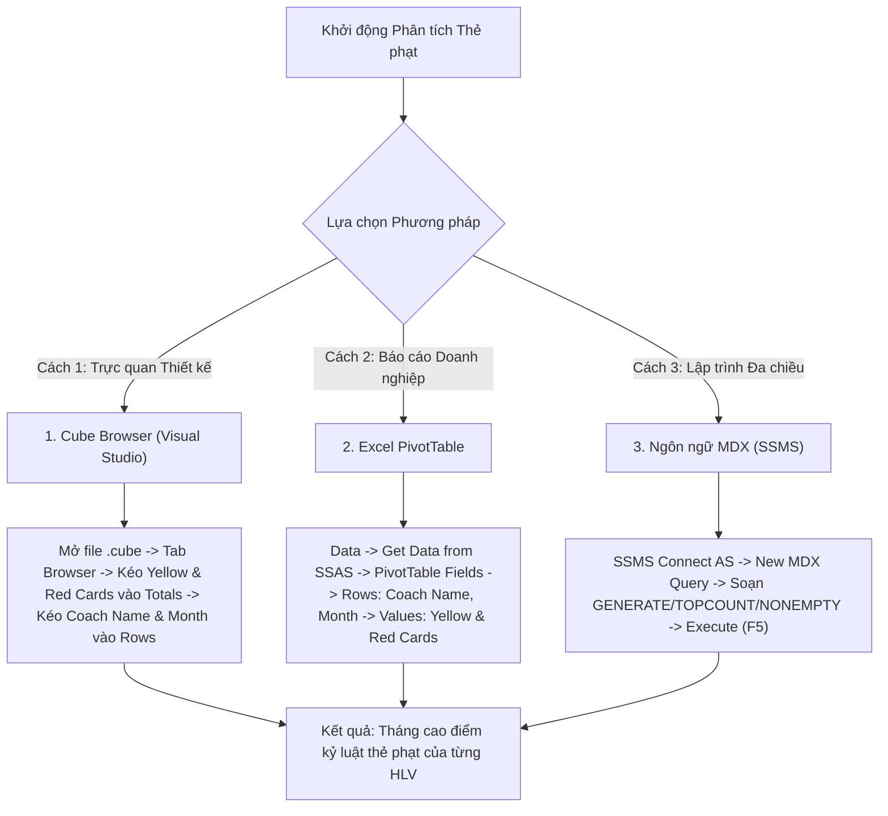

# MDX Query 12: Thẻ phạt của các đội bóng phân theo Huấn luyện viên trưởng & Tháng trong năm
## (Ứng dụng Hàm Lặp Tập Hợp Nâng Cao: GENERATE & TOPCOUNT)

---

## 1. Mục tiêu nghiệp vụ & Bối cảnh phân tích

* **Mục tiêu:** Đo lường lối chơi và mức độ kỷ luật của đội bóng dưới sự dẫn dắt của từng huấn luyện viên trưởng (`Coach_Name`). Đặc biệt, với mỗi huấn luyện viên, xác định chính xác **tháng cao điểm căng thẳng nhất** (tháng nhận nhiều thẻ vàng nhất) trong năm bằng kỹ thuật lặp tập hợp đa chiều (`GENERATE`).
* **Đối tượng phân tích:** Huấn luyện viên và Câu lạc bộ (`DIM_Club`), Thời gian thi đấu (`DIM_Time`), Thẻ phạt (`FACT_Player_Match_Perf`).
* **Các thuộc tính & Thước đo (Measures):**
  * Dimension Attributes: `[DIM Club].[Coach Name]`, `[DIM Club].[Club Name]`, `[DIM Time].[Month]`
  * Cube Measures: `[Measures].[Yellow Cards]`, `[Measures].[Red Cards]`

### Đối chiếu câu lệnh T-SQL gốc
```sql
USE DW_Football_Analytics;
GO

SELECT 
    cb.Coach_Name,
    cb.Club_Name,
    t.Month,
    SUM(f.Yellow_Cards) AS Total_Yellow_Cards,
    SUM(f.Red_Cards) AS Total_Red_Cards
FROM dbo.FACT_Player_Match_Perf f
JOIN dbo.DIM_Club cb ON f.Club_SK = cb.Club_SK
JOIN dbo.DIM_Time t ON f.Time_SK = t.Time_SK
WHERE cb.Coach_Name IS NOT NULL
GROUP BY cb.Coach_Name, cb.Club_Name, t.Month
ORDER BY Total_Yellow_Cards DESC, Total_Red_Cards DESC;
```

---

## 2. Hướng dẫn chi tiết 3 cách thực hiện (3 Execution Methods)



### CÁCH 1: TRUY VẤN BẰNG CUBE BROWSER (VISUAL STUDIO / SSDT)
1. **Mở tab Browser:** Mở file `DW_Football_Cube.cube` trong Visual Studio $\rightarrow$ nhấp chọn thẻ tab **`Browser`**.
2. **Kéo thả thuộc tính vào Lưới:**
   * Mở chiều **`DIM Club`** $\rightarrow$ kéo thuộc tính **`Coach Name`** thả vào vùng hàng (**Rows**).
   * Mở chiều **`DIM Time`** $\rightarrow$ kéo thuộc tính **`Month`** thả vào tiếp vùng hàng (**Rows**) phía sau `Coach Name`.
   * Mở nhóm **`Measures`** $\rightarrow$ kéo lần lượt **`Yellow Cards`** và **`Red Cards`** thả vào vùng dữ liệu (**Totals**).
3. **Lọc dữ liệu rác:** Tại tiêu đề `Coach Name`, bấm bộ lọc bỏ chọn `(All)` và `Unknown`.

---

### CÁCH 2: PHÂN TÍCH BẰNG PIVOT TABLE TRÊN MICROSOFT EXCEL
1. **Kết nối SSAS:** Khởi động Excel $\rightarrow$ tab **`Data`** $\rightarrow$ **`Get Data`** $\rightarrow$ **`From Database`** $\rightarrow$ **`From Analysis Services`** $\rightarrow$ Nhập server `localhost` $\rightarrow$ Chọn Database `DW_Football_SSAS` và Cube `DW Football Transfermarkt`.
2. **Kéo thả 4 ô trong PivotTable Fields:**
   * Ô **Rows:** Kéo trường `Coach Name` (từ `DIM Club`), sau đó kéo tiếp trường `Month` (từ `DIM Time`).
   * Ô **Values:** Kéo `Yellow Cards` và `Red Cards`.
3. **Hiển thị tháng cao điểm:** Chuột phải vào ô tên HLV $\rightarrow$ **Filter** $\rightarrow$ **Top 10...** hoặc thiết lập Subtotal để xem tháng nhận nhiều thẻ nhất.

---

### CÁCH 3: VIẾT VÀ THỰC THI TRUY VẤN BẰNG NGÔN NGỮ MDX (SSMS)

```mdx
/* ==============================================================================
   Truy vấn MDX 12: Tháng nhận nhiều thẻ vàng nhất của từng Huấn luyện viên
   Khai thác: GENERATE, TOPCOUNT, NONEMPTY, FILTER, CROSSJOIN
   Cube: [DW Football Transfermarkt]
   ============================================================================== */

SELECT
    -- Trục Cột: Thẻ vàng và Thẻ đỏ
    {
        [Measures].[Yellow Cards],
        [Measures].[Red Cards]
    } ON COLUMNS,

    -- Trục Dòng: Với mỗi HLV, dùng GENERATE trích xuất đúng 1 tháng có nhiều thẻ vàng nhất
    ORDER(
        GENERATE(
            -- Tập 1: Danh sách các Huấn luyện viên hợp lệ
            FILTER(
                EXCEPT([DIM Club].[Coach Name].[Coach Name].MEMBERS, { [DIM Club].[Coach Name].[All] }),
                NOT ISEMPTY([DIM Club].[Coach Name].CURRENTMEMBER.NAME) 
                AND [DIM Club].[Coach Name].CURRENTMEMBER.NAME <> "Unknown"
            ),
            -- Tập 2: Ứng với từng HLV, tìm 1 tháng dính nhiều thẻ vàng nhất
            TOPCOUNT(
                NONEMPTY(
                    CrossJoin(
                        { [DIM Club].[Coach Name].CURRENTMEMBER },
                        EXCEPT([DIM Time].[Month].[Month].MEMBERS, { [DIM Time].[Month].[All] })
                    ),
                    [Measures].[Yellow Cards]
                ),
                1,
                [Measures].[Yellow Cards]
            )
        ),
        [Measures].[Yellow Cards],
        BDESC
    ) ON ROWS

FROM [DW Football Transfermarkt];
```

---

## 3. Các hàm MDX sử dụng & Chi tiết cú pháp

| Tên hàm | Cú pháp chuẩn | Vai trò trong truy vấn |
| :--- | :--- | :--- |
| **`GENERATE`** | `GENERATE(Set1, Set2_Expression [, ALL])` | Duyệt qua từng phần tử của `Set1` (từng Huấn luyện viên) và thực thi biểu thức `Set2` cho từng phần tử đó, sau đó ghép nối kết quả lại thành một tập hợp duy nhất. Đây là hàm lặp tập hợp (Set Iteration) mạnh mẽ bậc nhất trong MDX. |
| **`TOPCOUNT`** | `TOPCOUNT(Set, 1, Measure)` | Lấy ra chính xác tháng có số thẻ vàng cao nhất của huấn luyện viên đang xét trong vòng lặp. |
| **`CURRENTMEMBER`** | `Hierarchy.CURRENTMEMBER` | Tham chiếu tới đối tượng thành viên huấn luyện viên hiện hành đang được duyệt bởi hàm `GENERATE`. |
| **`NONEMPTY`** | `NONEMPTY(Set, Measure)` | Loại bỏ các tháng nghỉ thi đấu hoặc các tháng mà đội bóng không nhận bất kỳ thẻ vàng nào. |
| **`FILTER`** | `FILTER(Set, Condition)` | Lọc sạch dữ liệu, loại bỏ các bản ghi không có thông tin HLV hoặc giá trị "Unknown". |
| **`ORDER` (BDESC)** | `ORDER(Set, Measure, BDESC)` | Sắp xếp danh sách kết quả sau khi duyệt `GENERATE` theo thứ tự giảm dần số thẻ phạt trên toàn cục. |

---

## 4. Đánh giá độ phức tạp & Tối ưu hóa hiệu năng

### Độ phức tạp không gian (Space Complexity)
* **Số lượng HLV hợp lệ:** Khoảng $H \approx 200 - 350$ huấn luyện viên.
* **Không gian kết quả trả về:** Vì mỗi HLV chỉ trích xuất đúng 1 tháng cao điểm nhất qua hàm `TOPCOUNT(..., 1, ...)`, số dòng kết quả trên trục ROWS chính xác bằng số lượng HLV ($H \approx 300$ tuples).
* **Bộ nhớ RAM sử dụng:** Khoảng $30\text{ KB}$, cực kỳ tinh gọn so với việc hiển thị toàn bộ $350 \times 12 = 4.200$ tuples.

### Độ phức tạp thời gian (Time Complexity)
* **Chi phí vòng lặp `GENERATE`:** $O(H \times T)$ với $H \approx 300$ HLV và $T \le 12$ tháng thi đấu.
* **Chi phí `TOPCOUNT(..., 1)`:** $O(T)$ với $T \le 12$ phép so sánh tìm phần tử lớn nhất (Max element scan).
* **Tổng số phép toán:** $300 \times 12 \approx 3.600$ phép tính so sánh, thực hiện tức thì trên bộ nhớ trong vòng **$5\text{ms} - 15\text{ms}$**.
* **Đánh giá hiệu năng:** Việc lồng `TOPCOUNT` kích thước $1$ vào bên trong `GENERATE` mang lại hiệu năng cao gấp nhiều lần so với việc quét bảng phẳng trong SQL thông thường nhờ tận dụng trực tiếp cấu trúc phân cấp bộ nhớ của SSAS Formula Engine.
