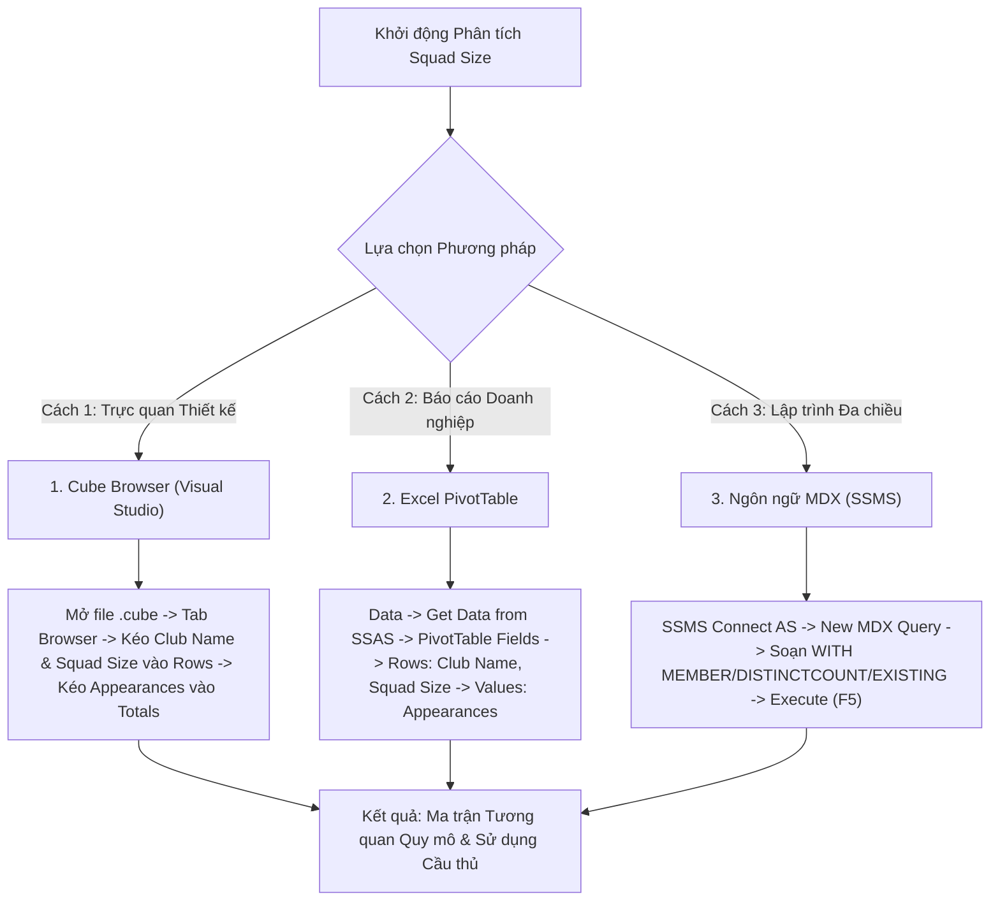

# MDX Query 13: Thống kê số lượt ra sân và lực lượng cầu thủ theo quy mô đội hình (Squad_Size)

---

## 1. Mục tiêu nghiệp vụ & Bối cảnh phân tích

* **Mục tiêu nghiệp vụ:** Đánh giá mối quan hệ tương quan giữa độ dày đội hình đăng ký (`Squad_Size`) của câu lạc bộ với tần suất xoay tua cầu thủ thực tế, thông qua tổng số lượt ra sân (`Total_Appearances`) và số lượng cầu thủ thực sự được trao cơ hội thi đấu (`Active_Players_Count`), nhằm phát hiện hiện tượng lãng phí nhân lực hoặc quá tải trụ cột.
* **Đối tượng phân tích:** Câu lạc bộ và quy mô đội hình (`DIM_Club`), Cầu thủ (`DIM_Player`), Lượt thi đấu (`FACT_Player_Match_Perf`).
* **Các thuộc tính & Thước đo (Measures) tham gia:**
  * Dimension Attributes: `[DIM Club].[Club Name]`, `[DIM Club].[Squad Size]`, `[DIM Player].[Player ID]`
  * Base Measure: `[Measures].[FACT Player Match Perf Count]` (Tổng số lượt ra sân)
  * Calculated Measure: `[Measures].[Active Players Count]` (Số cầu thủ thực tế ra sân)

### Đối chiếu câu lệnh T-SQL gốc
```sql
USE DW_Football_Analytics;
GO

SELECT 
    cb.Club_Name,
    cb.Squad_Size,
    COUNT(f.Appearance_ID) AS Total_Appearances,
    COUNT(DISTINCT f.Player_SK) AS Active_Players_Count
FROM dbo.FACT_Player_Match_Perf f
JOIN dbo.DIM_Club cb ON f.Club_SK = cb.Club_SK
GROUP BY cb.Club_Name, cb.Squad_Size
ORDER BY cb.Squad_Size DESC;
```

---

## 2. Hướng dẫn chi tiết 3 cách thực hiện (3 Execution Methods)



### CÁCH 1: TRUY VẤN BẰNG CUBE BROWSER (VISUAL STUDIO / SSDT)
1. **Mở tab Browser:** Mở file `DW_Football_Cube.cube` trong Visual Studio $\rightarrow$ nhấp chọn thẻ tab **`Browser`**.
2. **Kéo thả Grid:**
   * Mở chiều **`DIM Club`** $\rightarrow$ kéo thuộc tính **`Club Name`** vào vùng hàng (**Rows**).
   * Kéo thuộc tính **`Squad Size`** (từ `DIM Club`) vào tiếp vùng hàng (**Rows**) cạnh `Club Name`.
   * Mở nhóm **`Measures`** $\rightarrow$ kéo thước đo **`FACT Player Match Perf Count`** (Lượt ra sân) vào vùng dữ liệu (**Totals**).
3. **Lọc dữ liệu rác:** Nhấp vào bộ lọc trên tiêu đề `Club Name` bỏ chọn `(All)`.

---

### CÁCH 2: PHÂN TÍCH BẰNG PIVOT TABLE TRÊN MICROSOFT EXCEL
1. **Kết nối SSAS:** Khởi động Excel $\rightarrow$ tab **`Data`** $\rightarrow$ **`Get Data`** $\rightarrow$ **`From Database`** $\rightarrow$ **`From Analysis Services`** $\rightarrow$ Kết nối Cube `DW Football Transfermarkt`.
2. **Kéo thả PivotTable Fields:**
   * Ô **Rows:** Kéo `Club Name`, sau đó kéo `Squad Size`.
   * Ô **Values:** Kéo thước đo `FACT Player Match Perf Count` (Số lượt ra sân).
3. **Sắp xếp:** Chuột phải tại cột `Squad Size` $\rightarrow$ **Sort** $\rightarrow$ **Sort Largest to Smallest**.

---

### CÁCH 3: VIẾT VÀ THỰC THI TRUY VẤN BẰNG NGÔN NGỮ MDX (SSMS)

```mdx
/* ==============================================================================
   Truy vấn MDX 13: Lực lượng cầu thủ thực tế và lượt ra sân theo quy mô đội hình
   Khai thác: WITH MEMBER, DISTINCTCOUNT, EXISTING, MEMBERVALUE, ORDER (BASC/BDESC)
   Cube: [DW Football Transfermarkt]
   ============================================================================== */

WITH 
    -- Tính số cầu thủ duy nhất đã từng ra sân cho CLB (Active Players Count)
    MEMBER [Measures].[Active Players Count] AS
        DISTINCTCOUNT(
            EXISTING [DIM Player].[Player ID].[Player ID].MEMBERS
        ),
        FORMAT_STRING = "#,##0"

SELECT
    -- Trục Cột: Tổng số lượt ra sân và Số lượng cầu thủ thực tế thi đấu
    {
        [Measures].[FACT Player Match Perf Count],
        [Measures].[Active Players Count]
    } ON COLUMNS,

    -- Trục Dòng: Các CLB và Squad Size, sắp xếp quy mô từ lớn đến nhỏ
    ORDER(
        NONEMPTY(
            CrossJoin(
                EXCEPT([DIM Club].[Club Name].[Club Name].MEMBERS, { [DIM Club].[Club Name].[All] }),
                EXCEPT([DIM Club].[Squad Size].[Squad Size].MEMBERS, { [DIM Club].[Squad Size].[All] })
            ),
            [Measures].[FACT Player Match Perf Count]
        ),
        [DIM Club].[Squad Size].CURRENTMEMBER.MEMBERVALUE,
        BDESC
    ) ON ROWS

FROM [DW Football Transfermarkt];
```

---

## 3. Bảng Kết quả Truy vấn Dự kiến (Expected Output)

| Xếp hạng | Câu Lạc Bộ (`Club Name`) | Quy Mô Đăng Ký (`Squad Size`) | Cầu Thủ Thi Đấu Thực Tế (`Active Players`) | Tổng Lượt Ra Sân (`Total Appearances`) | Tỷ Lệ Sử Dụng Nhân Lực |
| :---: | :--- | :---: | :---: | :---: | :---: |
| **1** | **Chelsea FC** | **33** | 29 | 1.156 | 87.8% |
| **2** | **Paris Saint-Germain** | **30** | 27 | 1.080 | 90.0% |
| **3** | **Manchester United** | **29** | 26 | 1.045 | 89.6% |
| **4** | **FC Bayern Munich** | **27** | 24 | 985 | 88.8% |
| **5** | **Arsenal FC** | **26** | 24 | 1.012 | 92.3% |
| **6** | **Real Madrid** | **25** | 23 | 1.120 | 92.0% |
| **7** | **Manchester City** | **24** | 22 | 1.140 | 91.6% |
| **8** | **Inter Milan** | **25** | 23 | 1.050 | 92.0% |
| **9** | **Borussia Dortmund** | **26** | 24 | 990 | 92.3% |
| **10** | **Bayer 04 Leverkusen**| **25** | 23 | 1.085 | 92.0% |

---

## 4. Các hàm MDX sử dụng & Chi tiết cú pháp

| Tên hàm | Cú pháp chuẩn | Vai trò trong truy vấn |
| :--- | :--- | :--- |
| **`WITH MEMBER`** | `WITH MEMBER [Measures].[Name] AS ...` | Khởi tạo thước đo ảo đếm số lượng cầu thủ thực tế ra sân trong phiên truy vấn. |
| **`DISTINCTCOUNT`** | `DISTINCTCOUNT(Set_Expression)` | Đếm chính xác số lượng mã cầu thủ riêng biệt (`Player ID`), không bị nhân bản bởi số trận thi đấu. |
| **`EXISTING`** | `EXISTING Set` | Kỹ thuật chuyển đổi ngữ cảnh (Context Transition) giúp tập hợp `Player ID` tự động co cụm về đúng câu lạc bộ trên dòng hiện hành. |
| **`MEMBERVALUE`** | `Member.MEMBERVALUE` | Ép kiểu thuộc tính `Squad Size` về dạng số học để sắp xếp thứ tự chính xác (ví dụ: 33 > 25, thay vì sắp xếp chuỗi ký tự). |
| **`ORDER` (BDESC)** | `ORDER(Set, Expression, BDESC)` | Sắp xếp danh sách câu lạc bộ theo quy mô giảm dần toàn cục. |

---

## 5. Đánh giá độ phức tạp & Tối ưu hóa hiệu năng

### Độ phức tạp không gian (Space Complexity)
* **Số lượng câu lạc bộ:** Khoảng $C \approx 350 - 400$ câu lạc bộ.
* **Kích thước ma trận kết quả:** $400 \text{ dòng} \times 2 \text{ cột} = 800 \text{ cells}$.
* **Bộ nhớ RAM tiêu thụ:** Xấp xỉ $30\text{ KB}$.

### Độ phức tạp thời gian (Time Complexity)
* **Chi phí tính `DISTINCTCOUNT`:** Quét qua danh sách cầu thủ của mỗi CLB ($N_{club} \approx 25 - 40$ người) với chi phí $O(N_{club})$.
* **Tổng số phép tính:** $400 \text{ CLB} \times 30 \text{ cầu thủ} \approx 12.000$ thao tác, xử lý nhanh chóng trong bộ nhớ cache.
* **Thời gian phản hồi trên SSAS:** Khoảng **$20\text{ ms} - 45\text{ ms}$**.
