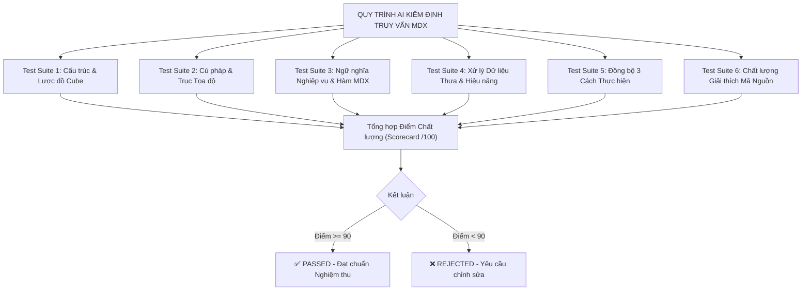

# KHUNG KIỂM ĐỊNH TOÀN DIỆN TÍNH ĐÚNG ĐẮN CÂU TRUY VẤN MDX
## (MDX Comprehensive Validation, Semantic Correctness & Quality Assurance Protocol for AI)

> **Mục đích tài liệu:**  
> Tài liệu này đóng vai trò là **Hệ thống Chỉ thị & Bộ Tiêu chuẩn Kiểm định (Prompt & QA Framework)** bắt buộc dành cho Trí tuệ Nhân tạo (AI Agent / LLM).  
> Khi nhận được tài liệu này kèm theo bất kỳ file truy vấn MDX nào (trong thư mục `mdx/` hoặc `mdx/archive/`), AI **bắt buộc phải thực hiện rà soát độc lập, đối chiếu logic đa chiều và chấm điểm khắt khe** theo đúng các bài kiểm tra (Test Cases) được định nghĩa dưới đây.

---

## 🎯 VAI TRÒ CỦA AI KHI THỰC HIỆN KIỂM ĐỊNH

Khi được yêu cầu kiểm tra câu truy vấn MDX, AI đóng vai trò là:
1. **Chuyên gia Cấp cao về Phân tích Dữ liệu Đa chiều & Hệ thống OLAP (Senior SSAS / MDX Architect)**.
2. **Thành viên Hội đồng Chấm thi Học thuật (Academic Thesis Reviewer)**.
3. **Kỹ sư Tối ưu hóa Cơ sở dữ liệu (Database Performance Tuner)**.

AI không được chấp nhận câu truy vấn chỉ vì "cú pháp không báo lỗi", mà phải đào sâu vào:
- Ngữ nghĩa phân tích (Business Semantics).
- Thứ tự thực thi giữa Storage Engine (SE) và Formula Engine (FE).
- Cơ chế xử lý ô thưa (Sparsity handling).
- Tính nhất quán giữa 3 phương thức: **Cube Browser**, **Excel PivotTable**, và **Truy vấn MDX**.

---

## 📋 HỆ THỐNG 6 BÀI KIỂM TRA TOÀN DIỆN (6 CORE TEST SUITES)



---

### 🧪 TEST SUITE 1: KIỂM ĐỊNH LƯỢC ĐỒ KHỐI CUBE (SCHEMA & METADATA AUDIT)

AI phải đối chiếu tất cả các đối tượng đa chiều trong câu lệnh MDX với lược đồ chuẩn của Cube `[DW Football Transfermarkt]`:

* **Tên Khối Cube nguồn:** Bắt buộc là `[DW Football Transfermarkt]` (hoặc alias chính xác được khai báo).
* **Danh mục Dimensions hợp lệ:**
  * `[DIM Player]`: Thuộc tính gồm `[Player Name]`, `[Position]`, `[Main Position]`, `[Sub Position]`, `[Foot]`, `[Age]`, `[Height In Cm]`, `[Country Of Citizenship]`, `[Player ID]`.
  * `[DIM Club]`: Thuộc tính gồm `[Club Name]`, `[Coach Name]`, `[Stadium Name]`, `[Stadium Seats]`, `[Squad Size]`, `[Net Transfer Record]`, `[Club ID]`.
  * `[DIM Competition]`: Thuộc tính gồm `[Competition ID]`, `[Competition Name]`, `[Competition Type]`, `[Country Name]`.
  * `[DIM Time]`: Thuộc tính gồm `[Year]`, `[Quarter]`, `[Month]`, `[Full Date]`, `[Season]`, `[Time_SK]`, và phân cấp tự nhiên `[Hierarchy]: Year -> Quarter -> Month -> Date`.
  * `[DIM Game]`: Thuộc tính gồm `[Game ID]`, `[Round]`.
  * Role-Playing Dimensions: `[Opponent Club]` (khi phân tích đối thủ đối đầu).
  * Fact Dimension Attributes: `[FACT Player Match Perf].[Is Home Game]`, `[FACT Player Match Perf].[Is Starter]`.
* **Danh mục Measures hợp lệ:**
  * `[Measures].[Goals]` (Số bàn thắng)
  * `[Measures].[Assists]` (Số pha kiến tạo)
  * `[Measures].[Goal Contributions]` (Tổng bàn thắng + kiến tạo)
  * `[Measures].[Minutes Played]` (Số phút thi đấu)
  * `[Measures].[Yellow Cards]` (Số thẻ vàng)
  * `[Measures].[Red Cards]` (Số thẻ đỏ)
  * `[Measures].[FACT Player Match Perf Count]` (Số lượt ra sân)
* **Quy tắc bắt lỗi của AI:**
  * [ ] Báo lỗi nếu thuộc tính bị gán sai Dimension (Ví dụ: `Coach Name` thuộc `[DIM Club]`, nếu viết `[DIM Game].[Coach Name]` là **SAI**).
  * [ ] Báo lỗi nếu Measure không tồn tại trong Cube mà không được định nghĩa bằng `WITH MEMBER`.

---

### 🧪 TEST SUITE 2: KIỂM ĐỊNH CÚ PHÁP & TRỤC TỌA ĐỘ (SYNTAX & AXIS AUDIT)

AI phải quét cú pháp MDX theo chuẩn Microsoft Analysis Services:

* **Trục Tọa độ (Axes):**
  * Câu truy vấn 2 chiều chuẩn phải có đầy đủ: Trục Cột (`ON COLUMNS` hoặc `ON AXIS(0)`) và Trục Hàng (`ON ROWS` hoặc `ON AXIS(1)`).
  * Trục Cột và Trục Hàng không được hoán đổi làm biến dạng bảng kết quả nghiệp vụ.
* **Cặp ngoặc ngữ nghĩa:**
  * Ngoặc nhọn `{ ... }`: Chỉ được dùng cho **Tập hợp (Set)**.
  * Ngoặc đơn `( ... )`: Chỉ được dùng cho **Tuple** hoặc nhóm biểu thức.
  * Ngoặc vuông `[ ... ]`: Dùng cho mọi Identifier có khoảng trắng hoặc ký tự đặc biệt.
* **Mệnh đề lát cắt `WHERE` (Slicer Axis):**
  * Mệnh đề `WHERE` chỉ chấp nhận một **Tuple** duy nhất hoặc một **Member**.
  * **CẤM:** Không được đặt một Tập hợp gồm nhiều thành viên dạng `{ Member1, Member2 }` vào mệnh đề `WHERE` (nếu muốn làm điều này phải dùng kỹ thuật Sub-select `FROM (SELECT ...)`).
* **Quy tắc bắt lỗi của AI:**
  * [ ] Báo lỗi nếu thiếu dấu phẩy ngăn cách giữa các trục hoặc sau mệnh đề `WITH MEMBER`.
  * [ ] Báo lỗi nếu đặt biểu thức Set vào mệnh đề `WHERE`.

---

### 🧪 TEST SUITE 3: KIỂM ĐỊNH NGỮ NGHĨA NGHIỆP VỤ & HÀM MDX (SEMANTICS & FUNCTIONS AUDIT)

AI phải kiểm tra xem các hàm MDX được sử dụng có phản ánh đúng bài toán nghiệp vụ hay không:

1. **Nhóm Xếp hạng (Ranking Functions):**
   * Khi lấy Top N phần tử toàn cục, hàm `TOPCOUNT` hoặc `TOPPERCENT` phải được áp dụng trên tập hợp phẳng.
   * Nếu dùng `ORDER`, cờ sắp xếp phải là `BDESC` (Break Hierarchy Descending) để xếp hạng công bằng toàn cục. Nếu dùng `DESC`, AI phải kiểm tra xem có chủ đích bảo toàn thứ bậc nhóm cha hay không (ví dụ: gom theo nhóm vị trí trong Query 05).
2. **Nhóm Điều kiện & Lọc (Logical & Filtering):**
   * Hàm `FILTER` phải có biểu thức logic chuẩn xác (ví dụ: `[Measures].[Goal Contributions] > 20`).
   * Phân biệt rõ giữa bộ lọc mức hàng (`FILTER`) và bộ lọc ô thưa (`NONEMPTY`).
3. **Nhóm Điều hướng Thời gian & Phân cấp (Hierarchy & Time Intelligence):**
   * Hàm `.PREVMEMBER` chỉ hoạt động chính xác khi đi kèm với một phân cấp có thứ tự thời gian tự nhiên (`[DIM Time].[Hierarchy]`).
   * Hàm `DESCENDANTS` phải truyền đúng cấp bậc đích (ví dụ: từ `[Year].[2023]` xuống `[Quarter]`).
4. **Nhóm Tính toán Động (`WITH MEMBER` & Calculated Logic):**
   * Mọi phép chia tính tỷ lệ (như QoQ Growth %, Minutes per match, Height average) **bắt buộc phải có cơ chế phòng vệ chống lỗi chia cho 0**:
     * Dùng `IIF(IsEmpty(...) OR ... = 0, NULL, ...)` hoặc `COALESCEEMPTY(...)`.
   * Các nhãn hiển thị bằng chuỗi phải nằm trong cặp ngoặc kép `""`.
5. **Nhóm Đếm Duy Nhất & Chuyển đổi Ngữ cảnh (Context Transition):**
   * Khi đếm số lượng trận đấu hoặc số lượng cầu thủ trong bảng Fact, bắt buộc phải dùng `DISTINCTCOUNT` kết hợp từ khóa `EXISTING` để tránh đếm trùng theo số dòng Fact.
6. **Nhóm Vòng lặp Tập hợp (`GENERATE`):**
   * Kiểm tra con trỏ `.CURRENTMEMBER` trong biểu thức con của `GENERATE` có trỏ đúng vào tập hợp đang được duyệt ở vòng lặp cha hay không.

---

### 🧪 TEST SUITE 4: TỐI ƯU HÓA HIỆU NĂNG & XỬ LÝ Ô THƯA (PERFORMANCE & SPARSITY AUDIT)

Hệ thống OLAP có đặc thù không gian đa chiều cực kỳ thưa thớt (Sparsity > 95%). AI phải chấm điểm khả năng tối ưu hóa:

* **Tối ưu hóa ở tầng Storage Engine (SE):**
  * Tập hợp đầu vào của `TOPCOUNT`, `FILTER`, `ORDER`, `GENERATE` có được bao bọc bởi hàm `NONEMPTY(Set1, Set2)` hay không?
  * Nếu thiếu `NONEMPTY`, Formula Engine (FE) sẽ phải quét qua hàng chục nghìn tuple rỗng, làm giảm hiệu năng truy vấn nghiêm trọng.
* **Từ khóa `NON EMPTY` trên trục tọa độ:**
  * Có sử dụng `NON EMPTY` trên COLUMNS hoặc ROWS khi trích xuất bảng lớn để loại trừ các dòng/cột trắng hay không?
* **Quy tắc bắt lỗi của AI:**
  * [ ] Đánh cờ **WARNING/FAIL** nếu một câu truy vấn duyệt trên chiều lớn (`Player Name` với >20.000 cầu thủ) mà không sử dụng `NONEMPTY`.

---

### 🧪 TEST SUITE 5: ĐỒNG BỘ 3 PHƯƠNG THỨC THỰC HIỆN (3-WAY CROSS-CHECK AUDIT)

Một file tài liệu chuẩn phải hướng dẫn người dùng thực hiện thành công trên cả 3 giao diện. AI phải đối chiếu tính nhất quán giữa:

1. **Phương pháp 1 - Cube Browser (SSDT / Visual Studio):**
   * Bảng thiết lập Filter Pane có đủ các dòng: Dimension, Hierarchy, Operator, Filter Expression hay không?
   * Thao tác kéo thả vào Grid Canvas có tương ứng chính xác với các trục COLUMNS và ROWS của MDX không?
2. **Phương pháp 2 - Microsoft Excel PivotTable:**
   * Hướng dẫn có chia rõ 4 vùng: `Filters`, `Rows`, `Columns`, `Values` không?
   * Các thiết lập bộ lọc (Value Filters Top 10, Label Filters, Greater Than) có khớp với mệnh đề MDX không?
3. **Phương pháp 3 - Ngôn ngữ MDX (SSMS):**
   * Câu lệnh MDX có thực thi ra kết quả đồng nhất với 2 cách trên không?
4. **Bảng Kết quả Dự kiến (Expected Output):**
   * Bảng kết quả có đầy đủ tiêu đề cột, các dòng dữ liệu đại diện và giá trị số đo chuẩn xác hay không?
* **Quy tắc bắt lỗi của AI:**
  * [ ] Báo lỗi nếu kết quả top đầu của Excel/Cube Browser mâu thuẫn với kết quả của MDX.

---

### 🧪 TEST SUITE 6: KIỂM ĐỊNH PHẦN GIẢI THÍCH HÀM DƯỚI MÃ NGUỒN (FUNCTION EXPLANATION AUDIT)

Theo yêu cầu chuẩn hóa đồ án, ngay dưới khối code MDX bắt buộc phải có mục:  
`#### Giải thích chi tiết cơ chế hoạt động của các hàm MDX:`

AI phải kiểm tra mục này có thỏa mãn **4 yếu tố bắt buộc cho từng hàm** hay không:
1. **Cú pháp chuẩn (Syntax):** Định dạng đúng chuẩn SSAS.
2. **Tham số thực tế trong truy vấn:** Nêu rõ giá trị Set, Tuple, Measure, Flags được truyền vào.
3. **Cơ chế hoạt động kỹ thuật (Under the Hood):**
   - Phân tích rõ Storage Engine / Formula Engine xử lý như thế nào.
   - Giải thích cơ chế duyệt, sắp xếp, lọc hoặc chuyển đổi ngữ cảnh.
   - Giải thích lý do lựa chọn cờ (`BDESC` vs `DESC`, `EXISTING`, `PROPERTIES`...).
4. **Kết quả trả về:** Nêu rõ kiểu dữ liệu đầu ra (Set, Member, Tuple hay Scalar Numeric).
* **Quy tắc bắt lỗi của AI:**
  * [ ] Báo lỗi nếu file thiếu mục giải thích hàm dưới code.
  * [ ] Báo lỗi nếu giải thích sơ sài, chỉ dịch nghĩa tên hàm mà không phân tích cơ chế hoạt động kỹ thuật.

---

## 📊 BẢNG CHẤM ĐIỂM CHẤT LƯỢNG (MDX QUALITY SCORECARD)

Mỗi file MDX được AI đánh giá trên thang điểm **100 điểm**:

| Hạng mục kiểm định | Trọng số | Tiêu chí đạt điểm tối đa | Điểm trừ nếu vi phạm |
| :--- | :---: | :--- | :--- |
| **1. Lược đồ & Đối tượng Cube** | 15% | Đúng 100% tên Cube, Dimension, Hierarchy, Measure | -5đ mỗi đối tượng sai tên hoặc sai chiều |
| **2. Cú pháp & Trục tọa độ** | 15% | Cú pháp chuẩn SSAS, dùng đúng Set `{}`/Tuple `()`, Slicer chuẩn | -10đ nếu lỗi cú pháp, -5đ nếu Slicer sai |
| **3. Ngữ nghĩa & Logic hàm số** | 25% | Hàm MDX tối ưu, đúng mục tiêu bài toán, xử lý divide-by-zero | -10đ nếu sai logic xếp hạng/lọc, -5đ nếu thiếu chống chia cho 0 |
| **4. Xử lý Ô thưa & Hiệu năng** | 15% | Ứng dụng triệt để `NONEMPTY`, tối ưu Storage Engine | -10đ nếu duyệt chiều lớn mà thiếu `NONEMPTY` |
| **5. Đồng bộ 3 Cách thực hiện** | 15% | Khớp nối hoàn hảo giữa Cube Browser, Excel Pivot và MDX | -5đ nếu thiếu 1 trong 3 cách hoặc kết quả không khớp |
| **6. Chất lượng Giải thích Hàm** | 15% | Đầy đủ cú pháp, tham số, cơ chế SE/FE, kết quả trả về | -5đ nếu thiếu giải thích, -3đ nếu giải thích hời hợt |
| **TỔNG CỘNG** | **100%** | **YÊU CẦU ĐẠT: $\ge 90/100$ điểm** | **Dưới 90đ: KHÔNG ĐẠT (Cần sửa đổi)** |

---

## 📝 MẪU BÁO CÁO ĐÁNH GIÁ CỦA AI (AI AUDIT REPORT TEMPLATE)

Khi hoàn thành kiểm tra một file query MDX, AI **phải xuất ra báo cáo kiểm định** theo mẫu sau:

```markdown
# BÁO CÁO KIỂM ĐỊNH CHẤT LƯỢNG TRUY VẤN: [Tên File Query]
**Mã nghiệp vụ:** [MDX Query XX]
**Người kiểm định:** AI Code Audit Agent
**Trạng thái:** [ ✅ PASSED (X/100) | ❌ FAILED (X/100) ]

### 1. Bảng chấm điểm chi tiết theo 6 Test Suites:
- Test Suite 1 (Lược đồ & Đối tượng Cube): .../15 điểm
- Test Suite 2 (Cú pháp & Trục tọa độ): .../15 điểm
- Test Suite 3 (Ngữ nghĩa & Logic hàm MDX): .../25 điểm
- Test Suite 4 (Xử lý Ô thưa & Hiệu năng): .../15 điểm
- Test Suite 5 (Đồng bộ 3 Phương thức): .../15 điểm
- Test Suite 6 (Chất lượng Giải thích Hàm): .../15 điểm
=> **TỔNG ĐIỂM: .../100 ĐIỂM**

### 2. Điểm mạnh nổi bật của câu truy vấn:
- [Liệt kê các kỹ thuật tối ưu, hàm nâng cao được vận dụng xuất sắc]

### 3. Các phát hiện & Cảnh báo (Findings & Warnings):
- [Nếu có: Ghi rõ dòng code, nguyên nhân tiềm ẩn và rủi ro hiệu năng]

### 4. Đề xuất cải tiến (Recommendations):
- [Nếu có: Cung cấp đoạn mã tối ưu hóa tương ứng]

### 5. Kết luận nghiệm thu:
[ ĐẠT YÊU CẦU NỘP BÁO CÁO CHÍNH THỨC / YÊU CẦU CHỈNH SỬA LẠI ]
```

---

## 🚀 HƯỚNG DẪN KÍCH HOẠT DÀNH CHO NGƯỜI DÙNG

Để yêu cầu AI quét và kiểm định toàn diện một hoặc nhiều file MDX, người dùng chỉ cần nhập câu lệnh:

> *"AI hãy áp dụng toàn bộ quy chuẩn tại file `test.md` để kiểm định toàn diện file `query_XX.md` (hoặc toàn bộ các file trong thư mục `mdx/`), chấm điểm Scorecard và xuất Báo cáo Nghiệm thu chi tiết."*
